# Matemática Elementar · Trilha completa

Versão integral reescrita em 12/11/2026. Três unidades, 20 passos por unidade e 17 telas por passo: **1.020 telas**, **600 questões corrigíveis** e **60 exemplos guiados**, cada um com três momentos de resolução. As questões são autorais e têm respostas comentadas.

Esta apostila acompanha a sequência do aplicativo e também pode ser lida sem login no leitor em HTML. ‘Tela’ designa uma entrada didática da trilha, e não uma página impressa ou uma altura fixa de dispositivo. Não há cronômetro obrigatório; avance, volte e reveja as soluções no seu ritmo.

Referência curricular: IMD1001_acervo_unificado_P1_P2_P3.md, fornecido pelo estudante; recorte P1/P2/P3 de 2025.2. Texto, exemplos e questões desta versão são autorais. Os PDFs de P2/P3 não foram conferidos diretamente nesta produção. As exclusões de 2025.2 não devem ser presumidas para outras ofertas.

A linguagem leve não altera as condições matemáticas. Contextos quantitativos são fictícios e servem ao estudo. Não pressupomos repertório de um curso, equipamento pessoal ou disponibilidade financeira. Figuras têm descrições textuais; símbolos são explicados no próprio texto.

## Como estudar

1. Leia o problema inicial e formule uma hipótese antes da definição.
2. Leia a justificativa e percorra o exemplo em três momentos.
3. Responda às questões antes de consultar a solução.
4. Ao errar, identifique se a dificuldade foi de interpretação, condição, sinal ou método e volte à explicação correspondente.
5. Na revisão final, escreva a solução discursiva indicada no texto.

## Unidades

- Unidade 1, passos 1–20: conjuntos, números, potências, logaritmos, equações e inequações.
- Unidade 2, passos 21–40: polinômios, relações e funções, retas e parábolas.
- Unidade 3, passos 41–60: simetria, funções por partes, exponenciais, trigonometria, matrizes e determinantes.

## Passo 1 · Coleções, pistas e linguagem matemática

### Tela 1 · Coleções, pistas e linguagem matemática

Uma comissão recolhe sugestões para uma semana cultural: música, cinema, música, debate. Para listar os temas diferentes, repetir música não ajuda — nem se o pedido vier em caixa alta. Como registrar a coleção sem confundir variedade com quantidade de votos?

Ao concluir: Representar conjuntos e distinguir elementos, vazio e conjunto unitário.

Para começar: Leitura de números e comparação de listas; nenhum conteúdo de curso específico.

### Tela 2 · Dar nome às ideias

Conjunto é uma coleção de elementos bem determinados. Escrevemos A={música,cinema,debate}. Ordem e repetição não mudam A. O símbolo ∈ significa ‘pertence a’; ∉ significa ‘não pertence a’. ∅ é o conjunto vazio. {∅} tem um elemento, que é um conjunto. Na descrição por propriedade, {x∈ℤ : x²=4} reúne os inteiros que satisfazem a condição.

**a∈A**

Leitura: O objeto a pertence ao conjunto A.

### Tela 3 · Pratique

Qual conjunto registra os temas música, cinema, música e debate?

A) {música,cinema}

B) {música,música}

C) {música,cinema,debate}

Resposta comentada — consulte depois de tentar

**C.** Os três temas distintos aparecem uma única vez.

### Tela 4 · Por que isso funciona?

Dois conjuntos são iguais quando possuem exatamente os mesmos elementos: cada elemento de um precisa aparecer no outro e vice-versa. Por isso {1,2,2}={2,1}. Mas ∅≠{∅}: o primeiro não contém elementos; o segundo contém o objeto ∅. Chaves não são apenas decoração tipográfica.

- **Objetivo:** Representar conjuntos e distinguir elementos, vazio e conjunto unitário. Considere A={x∈ℤ : −1≤x<3}. O universo declarado é o dos inteiros; não inclua frações.
- **Conferência:** Volte às condições da expressão original. Logo A={−1,0,1,2}. Temos 0∈A e 3∉A. A escrita {2,1,0,−1} representa o mesmo conjunto.

### Tela 5 · Pratique

Se A={1,3,5}, qual frase é verdadeira?

A) 5∉A

B) 3∈A

C) 2∈A

Resposta comentada — consulte depois de tentar

**B.** O número 3 está listado entre os elementos de A.

### Tela 6 · Exemplo guiado

**1. Organizar as informações**

Considere A={x∈ℤ : −1≤x<3}. O universo declarado é o dos inteiros; não inclua frações.

**2. Desenvolver o raciocínio**

Teste os extremos: −1 satisfaz ≤ e entra; 3 falha em < e fica fora. Os elementos são −1,0,1,2.

**3. Concluir e conferir**

Logo A={−1,0,1,2}. Temos 0∈A e 3∉A. A escrita {2,1,0,−1} representa o mesmo conjunto.

### Tela 7 · Pratique

Qual conjunto é igual a {1,2,3}?

A) {3,2,1,1}

B) {1,2}

C) {1,2,4}

Resposta comentada — consulte depois de tentar

**A.** Ordem e repetição não alteram o conjunto de elementos.

### Tela 8 · Pratique

Quantos elementos tem ∅?

A) 1

B) 2

C) 0

Resposta comentada — consulte depois de tentar

**C.** O vazio não contém elemento algum.

### Tela 9 · O erro que vale investigar

Uma lista pode contar repetições; um conjunto não. Se a pergunta for ‘quantos votos chegaram?’, a lista original pode ter quatro entradas. Se for ‘quais temas apareceram?’, o conjunto tem três elementos. Escolha a estrutura conforme a pergunta.

Antes de seguir: explique o erro em suas palavras e construa um exemplo que o torne visível.

### Tela 10 · Pratique

Quantos elementos tem {∅}?

A) Infinitos

B) 1

C) 0

Resposta comentada — consulte depois de tentar

**B.** As chaves envolvem um único objeto, o conjunto vazio.

### Tela 11 · Pratique

Qual é {x∈ℤ : x²=4}?

A) {−2,2}

B) {2}

C) {4}

Resposta comentada — consulte depois de tentar

**A.** Tanto −2 quanto 2 têm quadrado igual a 4.

### Tela 12 · Levar a ideia para outra situação

Conjuntos descrevem participantes de pesquisa, ingredientes, referências bibliográficas ou soluções de equações. Faça uma pausa: invente uma coleção com regra clara de pertencimento e uma descrição vaga. ‘Números pares’ é precisa; ‘números interessantes’ precisa de um critério antes de virar uma definição.

### Tela 13 · Pratique

Qual é {x∈ℤ : 0<x<3}?

A) {0,1,2,3}

B) {0,1,2}

C) {1,2}

Resposta comentada — consulte depois de tentar

**C.** A desigualdade é estrita nos dois extremos e o universo é inteiro.

### Tela 14 · Pratique

Se A={0,2}, qual afirmação é falsa?

A) 2∈A

B) 1∈A

C) 0∈A

Resposta comentada — consulte depois de tentar

**B.** O elemento 1 não consta em A.

### Tela 15 · Mapa de bolso

Conjunto é uma coleção de elementos bem determinados. Escrevemos A={música,cinema,debate}. Ordem e repetição não mudam A. O símbolo ∈ significa ‘pertence a’; ∉ significa ‘não pertence a’. ∅ é o conjunto vazio. {∅} tem um elemento, que é um conjunto. Na descrição por propriedade, {x∈ℤ : x²=4} reúne os inteiros que satisfazem a condição.

Verificação: Logo A={−1,0,1,2}. Temos 0∈A e 3∉A. A escrita {2,1,0,−1} representa o mesmo conjunto.

Recuperação ativa: explique como representar conjuntos e distinguir elementos, vazio e conjunto unitário. Depois reconstrua o exemplo sem consultar a solução.

Referência curricular: IMD1001_acervo_unificado_P1_P2_P3.md, fornecido pelo estudante; recorte P1/P2/P3 de 2025.2. Texto, exemplos e questões desta versão são autorais. Os PDFs de P2/P3 não foram conferidos diretamente nesta produção. As exclusões de 2025.2 não devem ser presumidas para outras ofertas.

### Tela 16 · Pratique

Qual informação se perde ao converter uma lista de votos em conjunto?

A) Quantas vezes cada opção foi marcada

B) Quais opções apareceram

C) Se uma opção apareceu

Resposta comentada — consulte depois de tentar

**A.** O conjunto guarda presença, mas não frequência.

### Tela 17 · Pratique

Quando dois conjuntos são iguais?

A) Quando têm o mesmo número de elementos

B) Quando foram escritos na mesma ordem

C) Quando possuem exatamente os mesmos elementos

Resposta comentada — consulte depois de tentar

**C.** Mesma cardinalidade não garante mesmos elementos; {1} e {2} são diferentes.

---

## Passo 2 · O mapa dos números

### Tela 1 · O mapa dos números

Uma sala tem 32 cadeiras, a temperatura de um modelo pode ser −2 e uma divisão de tarefas pede 3/2 hora. Os números trocam de roupa conforme o problema. O mapa dos conjuntos ajuda a saber quem cabe em cada descrição.

Ao concluir: Classificar números em ℕ, ℤ, ℚ, irracionais e ℝ.

Para começar: Conjuntos e pertencimento (passo 1).

### Tela 2 · Dar nome às ideias

Nesta trilha, ℕ={0,1,2,…}; ℤ inclui os naturais e seus opostos; ℚ={p/q : p,q∈ℤ e q≠0}. Irracionais são os reais que não são racionais. ℝ reúne racionais e irracionais e corresponde aos pontos da reta real. As inclusões são ℕ⊂ℤ⊂ℚ⊂ℝ. Um mesmo número pode pertencer a vários conjuntos.

**ℕ⊂ℤ⊂ℚ⊂ℝ**

Leitura: Naturais estão contidos nos inteiros, nos racionais e nos reais.

### Tela 3 · Pratique

Nesta trilha, 0 pertence a qual conjunto?

A) A nenhum conjunto numérico

B) ℕ

C) Apenas aos irracionais

Resposta comentada — consulte depois de tentar

**B.** Adotamos explicitamente ℕ={0,1,2,…}.

### Tela 4 · Por que isso funciona?

Todo inteiro n pode ser escrito n/1, portanto é racional. Decimais finitos são frações com denominador potência de 10: 0,125=125/1000=1/8. Nem toda raiz é irracional: √9=3. Para √2, suponha √2=p/q em forma reduzida; p²=2q² força p par e depois q par, contrariando a forma reduzida. Logo √2 é irracional.

- **Objetivo:** Classificar números em ℕ, ℤ, ℚ, irracionais e ℝ. Classifique −3, 0,125 e √9. O número −3 é inteiro, logo também racional e real, mas não natural.
- **Conferência:** Volte às condições da expressão original. ‘Menor conjunto da cadeia’ é uma resposta diferente de ‘todos os conjuntos a que pertence’. Leia a pergunta antes de escolher apenas um nome.

### Tela 5 · Pratique

Qual é o menor conjunto da cadeia ℕ⊂ℤ⊂ℚ⊂ℝ que contém −7?

A) ℤ

B) ℕ

C) ℚ

Resposta comentada — consulte depois de tentar

**A.** −7 é inteiro e não natural.

### Tela 6 · Exemplo guiado

**1. Organizar as informações**

Classifique −3, 0,125 e √9. O número −3 é inteiro, logo também racional e real, mas não natural.

**2. Desenvolver o raciocínio**

0,125=1/8 é racional e real; não é inteiro. Já √9=3 é natural, inteiro, racional e real.

**3. Concluir e conferir**

‘Menor conjunto da cadeia’ é uma resposta diferente de ‘todos os conjuntos a que pertence’. Leia a pergunta antes de escolher apenas um nome.

### Tela 7 · Pratique

Qual número é racional e não inteiro?

A) −3

B) √2

C) 3/2

Resposta comentada — consulte depois de tentar

**C.** 3/2 é uma fração de inteiros e vale 1,5.

### Tela 8 · Pratique

Quanto vale √9?

A) 9

B) 3

C) ±3

Resposta comentada — consulte depois de tentar

**B.** O símbolo de raiz quadrada representa a raiz principal não negativa; resolver x²=9 daria ±3.

### Tela 9 · O erro que vale investigar

Decimal com muitas casas não é automaticamente irracional; a escrita pode ser uma aproximação de uma fração. Também não classifique √4 como irracional só por haver radical. A convenção de incluir 0 em ℕ deve ser declarada, pois livros podem adotar outra.

Antes de seguir: explique o erro em suas palavras e construa um exemplo que o torne visível.

### Tela 10 · Pratique

Qual número é irracional?

A) √2

B) 0,25

C) −8/2

Resposta comentada — consulte depois de tentar

**A.** √2 não admite fração de inteiros; os outros dois admitem.

### Tela 11 · Pratique

Qual fração representa 0,125?

A) 1/4

B) 1/125

C) 1/8

Resposta comentada — consulte depois de tentar

**C.** 125/1000 simplifica para 1/8.

### Tela 12 · Levar a ideia para outra situação

Na reta, racionais e irracionais convivem sem buracos no conjunto dos reais. A medida √2 pode surgir na diagonal de um quadrado de lado 1, independentemente da área do seu curso. Explique por que ‘todo inteiro é racional’ não implica ‘todo racional é inteiro’.

### Tela 13 · Pratique

Todo inteiro é racional?

A) Apenas os positivos

B) Sim

C) Não

Resposta comentada — consulte depois de tentar

**B.** Cada inteiro n é n/1.

### Tela 14 · Pratique

Todo racional é inteiro?

A) Não

B) Sim

C) Apenas se for positivo

Resposta comentada — consulte depois de tentar

**A.** 1/2 é racional e não inteiro, fornecendo contraexemplo.

### Tela 15 · Mapa de bolso

Nesta trilha, ℕ={0,1,2,…}; ℤ inclui os naturais e seus opostos; ℚ={p/q : p,q∈ℤ e q≠0}. Irracionais são os reais que não são racionais. ℝ reúne racionais e irracionais e corresponde aos pontos da reta real. As inclusões são ℕ⊂ℤ⊂ℚ⊂ℝ. Um mesmo número pode pertencer a vários conjuntos.

Verificação: ‘Menor conjunto da cadeia’ é uma resposta diferente de ‘todos os conjuntos a que pertence’. Leia a pergunta antes de escolher apenas um nome.

Recuperação ativa: explique como classificar números em ℕ, ℤ, ℚ, irracionais e ℝ. Depois reconstrua o exemplo sem consultar a solução.

Referência curricular: IMD1001_acervo_unificado_P1_P2_P3.md, fornecido pelo estudante; recorte P1/P2/P3 de 2025.2. Texto, exemplos e questões desta versão são autorais. Os PDFs de P2/P3 não foram conferidos diretamente nesta produção. As exclusões de 2025.2 não devem ser presumidas para outras ofertas.

### Tela 16 · Pratique

Quais pontos correspondem aos números reais?

A) Apenas marcas inteiras

B) Apenas pontos racionais

C) Todos os pontos da reta real

Resposta comentada — consulte depois de tentar

**C.** A reta real também contém pontos irracionais.

### Tela 17 · Pratique

Qual é a condição em p/q para definir um racional?

A) p irracional e q inteiro

B) p e q inteiros, q≠0

C) p e q naturais, q=0

Resposta comentada — consulte depois de tentar

**B.** A definição exige inteiros e proíbe divisão por zero.

---

## Passo 3 · Pertencer é diferente de estar contido

### Tela 1 · Pertencer é diferente de estar contido

Uma estudante pertence à turma. Um grupo de estudantes está contido na turma. Trocar as duas frases pode parecer um detalhe de português, mas muda os objetos que você compara. É o tipo de erro em que a notação pede documento de identidade.

Ao concluir: Distinguir pertinência, inclusão e subconjunto próprio.

Para começar: Elementos, vazio e igualdade de conjuntos.

### Tela 2 · Dar nome às ideias

A⊆B significa: para todo x, se x∈A, então x∈B. A é subconjunto de B. A⊊B acrescenta A≠B e indica subconjunto próprio. O símbolo ∈ compara um objeto com um conjunto; ⊆ compara conjuntos. Conjuntos também podem ser elementos de outros conjuntos, quando isso é explicitado.

**A⊆B ⇔ ∀x∈A, x∈B**

Leitura: A está contido em B se todo elemento de A também pertence a B.

### Tela 3 · Pratique

Se A={1,2,3}, qual afirmação é verdadeira?

A) {2}⊆A

B) {2}∈A

C) 4∈A

Resposta comentada — consulte depois de tentar

**A.** O único elemento de {2} está em A; A não lista conjuntos como elementos.

### Tela 4 · Por que isso funciona?

Todo conjunto é subconjunto de si mesmo, pois nenhum elemento seu fica de fora dele. O vazio é subconjunto de qualquer conjunto: não existe elemento do vazio que possa violar a condição. Para provar A=B, podemos mostrar A⊆B e B⊆A. Para refutar inclusão, basta exibir um elemento de A que não esteja em B.

- **Objetivo:** Distinguir pertinência, inclusão e subconjunto próprio. Se A={1,2} e B={1,2,3}, então todo elemento de A está em B: A⊆B.
- **Conferência:** Volte às condições da expressão original. Se C=&#123;{1,2},3}, então A∈C, mas 1∉C. O objeto {1,2} aparece inteiro como elemento de C.

### Tela 5 · Pratique

Qual afirmação vale para todo conjunto A?

A) ∅∈A

B) A=∅

C) ∅⊆A

Resposta comentada — consulte depois de tentar

**C.** Não há elemento do vazio que esteja fora de A; pertinência do vazio não é automática.

### Tela 6 · Exemplo guiado

**1. Organizar as informações**

Se A={1,2} e B={1,2,3}, então todo elemento de A está em B: A⊆B.

**2. Desenvolver o raciocínio**

Como 3∈B e 3∉A, os conjuntos são diferentes; portanto A⊊B. Além disso, 2∈A e {2}⊆A.

**3. Concluir e conferir**

Se C=&#123;{1,2},3}, então A∈C, mas 1∉C. O objeto {1,2} aparece inteiro como elemento de C.

### Tela 7 · Pratique

Se A=B, então A⊊B?

A) Apenas se A for vazio

B) Não

C) Sim

Resposta comentada — consulte depois de tentar

**B.** Subconjunto próprio exige desigualdade entre os conjuntos.

### Tela 8 · Pratique

Qual condição demonstra A=B?

A) A⊆B e B⊆A

B) Apenas A⊆B

C) Apenas |A|=|B|

Resposta comentada — consulte depois de tentar

**A.** As duas inclusões garantem exatamente os mesmos elementos.

### Tela 9 · O erro que vale investigar

{2}∈{1,2,3} é falso: os elementos do conjunto da direita são números, e não o conjunto {2}. Já {2}⊆{1,2,3} é verdadeiro. Leia as chaves como parte do objeto; não as remova mentalmente.

Antes de seguir: explique o erro em suas palavras e construa um exemplo que o torne visível.

### Tela 10 · Pratique

Se A={1,2} e B={2,3}, por que A⊆B é falso?

A) 2 pertence aos dois

B) B tem dois elementos

C) 1∈A e 1∉B

Resposta comentada — consulte depois de tentar

**C.** O elemento 1 é um contraexemplo à inclusão.

### Tela 11 · Pratique

Em C=&#123;{1,2},3}, qual é um elemento de C?

A) 2

B) {1,2}

C) 1

Resposta comentada — consulte depois de tentar

**B.** O conjunto {1,2} foi listado inteiro como um elemento.

### Tela 12 · Levar a ideia para outra situação

Arquivos dentro de pastas e grupos dentro de turmas podem ajudar a começar, mas a definição é o teste de todos os elementos. Tente refutar uma inclusão com um único contraexemplo; depois explique por que provar inclusão exige controlar todos os elementos, mesmo sem listá-los um a um.

### Tela 13 · Pratique

Se A={a,b}, qual é um subconjunto próprio?

A) {a}

B) {a,b}

C) {a,b,c}

Resposta comentada — consulte depois de tentar

**A.** {a} está contido em A e é diferente dele.

### Tela 14 · Pratique

Quantos elementos tem &#123;{1,2},3}?

A) 3

B) 1

C) 2

Resposta comentada — consulte depois de tentar

**C.** Seus dois elementos são {1,2} e 3.

### Tela 15 · Mapa de bolso

A⊆B significa: para todo x, se x∈A, então x∈B. A é subconjunto de B. A⊊B acrescenta A≠B e indica subconjunto próprio. O símbolo ∈ compara um objeto com um conjunto; ⊆ compara conjuntos. Conjuntos também podem ser elementos de outros conjuntos, quando isso é explicitado.

Verificação: Se C=&#123;{1,2},3}, então A∈C, mas 1∉C. O objeto {1,2} aparece inteiro como elemento de C.

Recuperação ativa: explique como distinguir pertinência, inclusão e subconjunto próprio. Depois reconstrua o exemplo sem consultar a solução.

Referência curricular: IMD1001_acervo_unificado_P1_P2_P3.md, fornecido pelo estudante; recorte P1/P2/P3 de 2025.2. Texto, exemplos e questões desta versão são autorais. Os PDFs de P2/P3 não foram conferidos diretamente nesta produção. As exclusões de 2025.2 não devem ser presumidas para outras ofertas.

### Tela 16 · Pratique

Qual símbolo expressa ‘o número 3 pertence a A’?

A) ∪

B) ∈

C) ⊆

Resposta comentada — consulte depois de tentar

**B.** Pertinência compara um objeto com o conjunto que o contém.

### Tela 17 · Pratique

Se A⊆B e B⊆C, o que podemos concluir?

A) A⊆C

B) C⊆A

C) A=C

Resposta comentada — consulte depois de tentar

**A.** Cada elemento de A está em B e, por isso, em C.

---

## Passo 4 · Operações: cruzando listas sem tropeçar

### Tela 1 · Operações: cruzando listas sem tropeçar

A biblioteca tem uma lista de quem pediu livros de História e outra de quem pediu livros de Biologia. ‘Pelo menos uma lista’, ‘as duas’ e ‘só a primeira’ são perguntas diferentes. Hoje o desafio é responder sem inventar uma terceira lista de confusão.

Ao concluir: Calcular união, interseção, diferença e complemento com universo declarado.

Para começar: Pertinência e inclusão.

### Tela 2 · Dar nome às ideias

A∪B reúne elementos de A ou de B, incluindo quem está nos dois. A∩B reúne quem pertence aos dois. A∖B contém elementos de A que não estão em B. Se o universo U foi declarado, Aᶜ=U∖A. ‘Ou’ é inclusivo nesta notação; ‘apenas um dos dois’ precisa excluir a interseção.

**Aᶜ=U∖A**

Leitura: O complemento de A no universo U contém os elementos de U que não estão em A.

### Tela 3 · Pratique

Para A={1,2,3} e B={3,4}, qual é A∪B?

A) {3}

B) {1,2,4}

C) {1,2,3,4}

Resposta comentada — consulte depois de tentar

**C.** União inclui qualquer elemento de pelo menos um dos conjuntos.

### Tela 4 · Por que isso funciona?

Para decidir a região de um elemento, faça duas perguntas: ele está em A? Está em B? As respostas possíveis são sim/sim, sim/não, não/sim e não/não. Elas particionam U em quatro regiões sem sobreposição. Esse procedimento justifica o diagrama de Venn e funciona mesmo sem desenho.

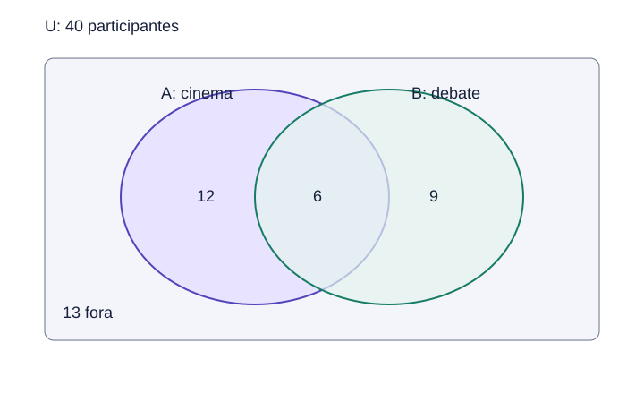

### Tela 5 · Pratique

Para os mesmos A e B, qual é A∩B?

A) ∅

B) {3}

C) {1,2,3,4}

Resposta comentada — consulte depois de tentar

**B.** O único elemento comum é 3.

### Tela 6 · Exemplo guiado

**1. Organizar as informações**

Tome U={1,2,3,4,5,6}, A={1,2,3} e B={3,4}. A união é {1,2,3,4}; a interseção é {3}.

**2. Desenvolver o raciocínio**

A∖B={1,2}, enquanto B∖A={4}. A diferença depende da ordem.

**3. Concluir e conferir**

O complemento de A em U é {4,5,6}. Quem está em apenas uma lista forma {1,2,4}, pois retiramos o elemento 3 que estava em ambas.

### Tela 7 · Pratique

Qual é A∖B no exemplo?

A) {1,2}

B) {4}

C) {1,2,4}

Resposta comentada — consulte depois de tentar

**A.** Mantemos os elementos de A que não estão em B.

### Tela 8 · Pratique

Qual é B∖A no exemplo?

A) {1,2}

B) {3,4}

C) {4}

Resposta comentada — consulte depois de tentar

**C.** A diferença troca de resultado ao trocar a ordem.

### Tela 9 · O erro que vale investigar

A∖B não significa remover todos os elementos de B do universo, e sim remover de A aqueles que também estão em B. Sem declarar U, ‘o complemento de A’ fica incompleto: o conjunto de quem ficou de fora depende de quem poderia participar.

Antes de seguir: explique o erro em suas palavras e construa um exemplo que o torne visível.

### Tela 10 · Pratique

Em U={1,2,3,4,5,6} e A={1,2,3}, qual é Aᶜ?

A) {4}

B) {4,5,6}

C) {1,2,3}

Resposta comentada — consulte depois de tentar

**B.** O complemento é calculado em relação a todo o universo U.

### Tela 11 · Pratique

Se x∈A∩B, qual frase é verdadeira?

A) x está em A e em B

B) x está apenas em A

C) x está fora de ambos

Resposta comentada — consulte depois de tentar

**A.** Interseção exige as duas pertinências simultaneamente.

### Tela 12 · Levar a ideia para outra situação

Use as operações para combinar critérios de uma pesquisa ou de uma agenda. Em linguagem cotidiana, ‘ou’ pode ser exclusivo; em matemática, escreva a condição sem deixar isso implícito. Explique uma operação escolhendo um elemento de cada uma das quatro regiões.

### Tela 13 · Pratique

Se x∈A∪B, x pode estar nos dois conjuntos?

A) Não

B) Só se A=B

C) Sim

Resposta comentada — consulte depois de tentar

**C.** O ‘ou’ da união inclui a possibilidade de pertencer a ambos.

### Tela 14 · Pratique

Qual é A∩∅?

A) {∅}

B) ∅

C) A

Resposta comentada — consulte depois de tentar

**B.** Nenhum elemento pode pertencer ao conjunto vazio.

### Tela 15 · Mapa de bolso

A∪B reúne elementos de A ou de B, incluindo quem está nos dois. A∩B reúne quem pertence aos dois. A∖B contém elementos de A que não estão em B. Se o universo U foi declarado, Aᶜ=U∖A. ‘Ou’ é inclusivo nesta notação; ‘apenas um dos dois’ precisa excluir a interseção.

Verificação: O complemento de A em U é {4,5,6}. Quem está em apenas uma lista forma {1,2,4}, pois retiramos o elemento 3 que estava em ambas.

Recuperação ativa: explique como calcular união, interseção, diferença e complemento com universo declarado. Depois reconstrua o exemplo sem consultar a solução.

Referência curricular: IMD1001_acervo_unificado_P1_P2_P3.md, fornecido pelo estudante; recorte P1/P2/P3 de 2025.2. Texto, exemplos e questões desta versão são autorais. Os PDFs de P2/P3 não foram conferidos diretamente nesta produção. As exclusões de 2025.2 não devem ser presumidas para outras ofertas.

### Tela 16 · Pratique

Qual é A∪∅?

A) A

B) ∅

C) {A}

Resposta comentada — consulte depois de tentar

**A.** O vazio não acrescenta nenhum elemento à união.

### Tela 17 · Pratique

No exemplo, quem está em apenas um dos conjuntos?

A) {1,2,3,4}

B) {3}

C) {1,2,4}

Resposta comentada — consulte depois de tentar

**C.** Reunimos a união e retiramos a interseção, excluindo 3.

---

## Passo 5 · O mistério das inscrições repetidas

### Tela 1 · O mistério das inscrições repetidas

Uma mostra universitária recebeu 18 inscrições para cinema e 15 para debate. A organização anunciou 33 pessoas. Alguém levantou a mão: ‘Eu me inscrevi nos dois’. A soma acaba de ganhar uma testemunha contra ela. Como corrigir a contagem sem conhecer todos os nomes?

Ao concluir: Justificar contagens com união, interseção e conjunto das partes.

Para começar: Linguagem, inclusão e operações entre conjuntos (passos 1 a 4).

### Tela 2 · Dar nome às ideias

Para conjuntos finitos A e B, |A∪B|=|A|+|B|−|A∩B|. As barras aqui significam número de elementos. A interseção é subtraída porque foi contada duas vezes. O complemento Aᶜ depende de um universo U declarado. Um conjunto com n elementos possui 2ⁿ subconjuntos e 2ⁿ−1 subconjuntos próprios, incluindo o vazio quando n>0.

**|A∪B|=|A|+|B|−|A∩B|**

Leitura: A quantidade de elementos da união é a soma das quantidades menos a interseção.

### Tela 3 · Pratique

18 pessoas escolhem cinema, 15 debate e 6 ambos. Quantas escolhem ao menos um?

A) 21

B) 27

C) 33

Resposta comentada — consulte depois de tentar

**B.** A soma 33 contou as seis pessoas duas vezes; subtraímos uma cópia de cada: 33−6=27.

### Tela 4 · Por que isso funciona?

Divida a união em três regiões disjuntas: só A, ambos, só B. Suas contagens são |A|−|A∩B|, |A∩B| e |B|−|A∩B|. Somá-las demonstra a fórmula. Para contar subconjuntos, cada elemento tem duas escolhas independentes: entrar ou ficar de fora. As n escolhas produzem 2ⁿ possibilidades, sem que a ordem crie conjuntos novos.

### Tela 5 · Pratique

No universo de 40 pessoas, 27 escolhem alguma atividade. Quantas não escolhem nenhuma?

A) 13

B) 27

C) 67

Resposta comentada — consulte depois de tentar

**A.** O complemento da união tem 40−27=13 elementos.

### Tela 6 · Exemplo guiado

**1. Organizar as informações**

Se 6 pessoas se inscreveram nas duas atividades, as regiões exclusivas têm 18−6=12 e 15−6=9 pessoas.

**2. Desenvolver o raciocínio**

Logo |A∪B|=12+6+9=27. Com universo de 40 participantes, 40−27=13 não escolheram nenhuma.

**3. Concluir e conferir**

Uma comissão escolhida de {Ana, Bia, Caio} é um subconjunto: há 2³=8 possibilidades, ou 7 se a comissão não puder ser o grupo completo. Se também não puder ser vazia, restam 6.

### Tela 7 · Pratique

Se |A|=12 e |A∩B|=5, quantas pessoas estão só em A?

A) 12

B) 17

C) 7

Resposta comentada — consulte depois de tentar

**C.** Remova de A as cinco pessoas que também estão em B: 12−5=7.

### Tela 8 · Pratique

Um conjunto com 4 elementos tem quantos subconjuntos?

A) 4

B) 16

C) 8

Resposta comentada — consulte depois de tentar

**B.** Cada elemento pode entrar ou sair: 2⁴=16.

### Tela 9 · O erro que vale investigar

‘Próprio’ significa diferente do conjunto original; não significa ‘não vazio’. Para A=∅, o único subconjunto é ∅, portanto há zero subconjuntos próprios. E 18+15 só seria uma contagem de pessoas distintas se a interseção fosse vazia.

Antes de seguir: explique o erro em suas palavras e construa um exemplo que o torne visível.

### Tela 10 · Pratique

Quantos subconjuntos próprios tem um conjunto de 4 elementos?

A) 15

B) 16

C) 14

Resposta comentada — consulte depois de tentar

**A.** Dos 16 subconjuntos, excluímos somente o conjunto completo.

### Tela 11 · Pratique

Quantos subconjuntos não vazios e próprios tem {a,b,c}?

A) 7

B) 8

C) 6

Resposta comentada — consulte depois de tentar

**C.** São 8 subconjuntos; removemos o vazio e o completo, que são distintos.

### Tela 12 · Levar a ideia para outra situação

Em pesquisas de Saúde, Humanas ou Tecnologia, uma pessoa pode marcar várias opções. Antes de somar frequências, pergunte se as categorias se sobrepõem. Reconstrua a fórmula desenhando três regiões e explique por que a interseção aparece uma vez no resultado.

### Tela 13 · Pratique

Qual é a quantidade de subconjuntos próprios de ∅?

A) 2

B) 0

C) 1

Resposta comentada — consulte depois de tentar

**B.** O único subconjunto de ∅ é ele mesmo, portanto não é próprio.

### Tela 14 · Pratique

Se A∩B=∅, qual contagem vale para conjuntos finitos?

A) |A∪B|=|A|+|B|

B) |A∪B|=|A|−|B|

C) |A∪B|=0

Resposta comentada — consulte depois de tentar

**A.** Sem interseção não há repetição na soma das cardinalidades.

### Tela 15 · Mapa de bolso

Para conjuntos finitos A e B, |A∪B|=|A|+|B|−|A∩B|. As barras aqui significam número de elementos. A interseção é subtraída porque foi contada duas vezes. O complemento Aᶜ depende de um universo U declarado. Um conjunto com n elementos possui 2ⁿ subconjuntos e 2ⁿ−1 subconjuntos próprios, incluindo o vazio quando n>0.

Verificação: Uma comissão escolhida de {Ana, Bia, Caio} é um subconjunto: há 2³=8 possibilidades, ou 7 se a comissão não puder ser o grupo completo. Se também não puder ser vazia, restam 6.

Recuperação ativa: explique como justificar contagens com união, interseção e conjunto das partes. Depois reconstrua o exemplo sem consultar a solução.

Referência curricular: IMD1001_acervo_unificado_P1_P2_P3.md, fornecido pelo estudante; recorte P1/P2/P3 de 2025.2. Texto, exemplos e questões desta versão são autorais. Os PDFs de P2/P3 não foram conferidos diretamente nesta produção. As exclusões de 2025.2 não devem ser presumidas para outras ofertas.

### Tela 16 · Pratique

Em U={1,2,3,4,5}, A={2,4}. Qual é Aᶜ?

A) {2,4}

B) {1,2,3,4,5}

C) {1,3,5}

Resposta comentada — consulte depois de tentar

**C.** O complemento reúne exatamente os elementos de U que não pertencem a A.

### Tela 17 · Pratique

Numa pesquisa, |A|=10, |B|=8 e |A∪B|=14. Qual é |A∩B|?

A) 6

B) 4

C) 18

Resposta comentada — consulte depois de tentar

**B.** De 14=10+8−|A∩B| obtemos interseção igual a 4.

---

## Passo 6 · Intervalos: quem pode entrar?

### Tela 1 · Intervalos: quem pode entrar?

A sala de estudos funciona das 8h às 20h; uma atividade aceita chegadas depois das 10h e até as 12h. O relógio não lê intenções: chegar exatamente às 10h conta? Esse pequeno detalhe é a diferença entre um extremo aberto e um fechado.

Ao concluir: Traduzir condições simultâneas e alternativas para intervalos.

Para começar: Conjuntos numéricos e operações entre conjuntos (passos 2 a 4).

### Tela 2 · Dar nome às ideias

Um intervalo é um conjunto de reais entre limites. Em (a,b], a<x≤b: parêntese exclui e colchete inclui. ±∞ não são números reais e sempre levam parênteses. ‘E’ pede interseção; ‘ou’ inclusivo pede união. Uma solução pode ser vazia, um ponto ou vários intervalos.

**(a,b]={x∈ℝ:a<x≤b}**

Leitura: O intervalo aberto em a e fechado em b contém os reais maiores que a e menores ou iguais a b.

### Tela 3 · Pratique

Qual intervalo representa 1<x≤4?

A) (1,4]

B) [1,4)

C) [1,4]

Resposta comentada — consulte depois de tentar

**A.** O limite 1 é excluído e 4 é incluído.

### Tela 4 · Por que isso funciona?

Na interseção, cada número precisa passar por todos os filtros. Para x>1 e x≤4, os testes deixam (1,4]. Na união basta passar por um filtro. Para x<0 ou x≥2, há dois pedaços separados: (−∞,0)∪[2,∞). Testar os extremos evita decidir o colchete por aparência.

![Reta com intervalo (1,4]: 1 está excluído por círculo aberto, 4 incluído por círculo fechado; o trecho entre eles está destacado.](../../public/materiais/elementar/intervalo.svg)

### Tela 5 · Pratique

Qual é [0,5]∩(2,8)?

A) [0,8)

B) [2,5]

C) (2,5]

Resposta comentada — consulte depois de tentar

**C.** Os números precisam ser maiores que 2 e no máximo 5.

### Tela 6 · Exemplo guiado

**1. Organizar as informações**

Uma biblioteca aceita acesso para 8≤t≤20 e uma atividade exige 10<t≤12. Escreva [8,20]∩(10,12].

**2. Desenvolver o raciocínio**

O segundo intervalo já está contido no primeiro. A interseção é (10,12].

**3. Concluir e conferir**

Verifique: 10 não entra, 11 entra, 12 entra. Aqui t é um horário idealizado como número real; uma regra administrativa diferente mudaria o modelo.

### Tela 7 · Pratique

Qual é (−∞,1)∪[1,∞)?

A) ∅

B) ℝ

C) ℝ sem 1

Resposta comentada — consulte depois de tentar

**B.** O segundo intervalo inclui 1 e os dois cobrem todos os reais.

### Tela 8 · Pratique

Qual é [0,1]∩[2,3]?

A) ∅

B) [0,3]

C) {1,2}

Resposta comentada — consulte depois de tentar

**A.** Nenhum número pertence aos dois intervalos.

### Tela 9 · O erro que vale investigar

Não arredonde um intervalo real para uma lista de inteiros sem que o domínio peça isso. (1,2) contém infinitos reais, embora não contenha nenhum inteiro. Também não use [−∞,3], pois infinito não é ponto final alcançável.

Antes de seguir: explique o erro em suas palavras e construa um exemplo que o torne visível.

### Tela 10 · Pratique

Qual é [0,2]∩[2,4]?

A) ∅

B) (0,4)

C) {2}

Resposta comentada — consulte depois de tentar

**C.** O único ponto comum é o extremo 2, incluído nos dois.

### Tela 11 · Pratique

Qual é a escrita correta de x≤3?

A) (−∞,3)

B) (−∞,3]

C) [−∞,3]

Resposta comentada — consulte depois de tentar

**B.** O infinito fica aberto; 3 pertence ao conjunto.

### Tela 12 · Levar a ideia para outra situação

Em alimentação, transporte ou planejamento de pesquisa, condições de viabilidade podem ser combinadas do mesmo jeito. Escreva primeiro a frase, depois os testes sobre x e só então o intervalo. Desenhe a reta com legenda verbal para que a resposta não dependa da cor.

### Tela 13 · Pratique

Quantos inteiros há em (1,2)?

A) 0

B) 1

C) Infinitos

Resposta comentada — consulte depois de tentar

**A.** Nenhum inteiro é estritamente maior que 1 e menor que 2.

### Tela 14 · Pratique

Qual condição representa [2,6)?

A) 2<x≤6

B) x≤2 ou x>6

C) 2≤x<6

Resposta comentada — consulte depois de tentar

**C.** Leia cada extremo conforme seu colchete ou parêntese.

### Tela 15 · Mapa de bolso

Um intervalo é um conjunto de reais entre limites. Em (a,b], a<x≤b: parêntese exclui e colchete inclui. ±∞ não são números reais e sempre levam parênteses. ‘E’ pede interseção; ‘ou’ inclusivo pede união. Uma solução pode ser vazia, um ponto ou vários intervalos.

Verificação: Verifique: 10 não entra, 11 entra, 12 entra. Aqui t é um horário idealizado como número real; uma regra administrativa diferente mudaria o modelo.

Recuperação ativa: explique como traduzir condições simultâneas e alternativas para intervalos. Depois reconstrua o exemplo sem consultar a solução.

Referência curricular: IMD1001_acervo_unificado_P1_P2_P3.md, fornecido pelo estudante; recorte P1/P2/P3 de 2025.2. Texto, exemplos e questões desta versão são autorais. Os PDFs de P2/P3 não foram conferidos diretamente nesta produção. As exclusões de 2025.2 não devem ser presumidas para outras ofertas.

### Tela 16 · Pratique

Qual é o conjunto de x>3 e x<1?

A) ℝ

B) ∅

C) (1,3)

Resposta comentada — consulte depois de tentar

**B.** Um real não pode satisfazer simultaneamente essas duas desigualdades.

### Tela 17 · Pratique

Qual é a solução de x<0 ou x≥2?

A) (−∞,0)∪[2,∞)

B) (0,2)

C) [0,2]

Resposta comentada — consulte depois de tentar

**A.** ‘Ou’ reúne os dois conjuntos; 0 fica fora e 2 entra.

---

## Passo 7 · Potências: multiplicar sem escrever tudo

### Tela 1 · Potências: multiplicar sem escrever tudo

Uma sequência começa com 1 e duplica a cada rodada: 1,2,4,8. Se o processo andar uma rodada para trás, chegamos a 1/2. O expoente negativo vai nascer desse movimento, sem precisar de uma regra caída do céu.

Ao concluir: Interpretar expoentes inteiros, zero e negativos.

Para começar: Multiplicação e frações.

### Tela 2 · Dar nome às ideias

Para n natural positivo, aⁿ é o produto de n fatores iguais a a. Base e expoente têm papéis diferentes: 3⁴ usa quatro fatores 3. Para a≠0, definimos a⁰=1 e a⁻ⁿ=1/aⁿ para manter as leis de multiplicação. 0⁻¹ não existe, pois exigiria divisão por zero; 0⁰ não será usado nesta trilha.

**a⁻ⁿ=1/aⁿ, a≠0**

Leitura: Uma potência de expoente negativo é o recíproco da potência correspondente; a base não pode ser zero.

### Tela 3 · Pratique

Quanto vale 2³?

A) 6

B) 9

C) 8

Resposta comentada — consulte depois de tentar

**C.** São três fatores 2: 2·2·2=8.

### Tela 4 · Por que isso funciona?

A sequência de potências de base 2 é …,2⁻²=1/4,2⁻¹=1/2,2⁰=1,2¹=2,2²=4,… Cada avanço multiplica por 2 e cada retorno divide por 2. Isso torna os expoentes coerentes nos dois sentidos. O sinal do expoente não é o sinal do resultado.

- **Objetivo:** Interpretar expoentes inteiros, zero e negativos. Simplifique 3²·3⁻¹. Primeiro escreva 3²=9 e 3⁻¹=1/3.
- **Conferência:** Volte às condições da expressão original. Compare com −3²=−9 e (−3)²=9. Os parênteses dizem se o sinal negativo integra a base.

### Tela 5 · Pratique

Qual é a base em 5⁴?

A) 20

B) 5

C) 4

Resposta comentada — consulte depois de tentar

**B.** A base é o número repetido como fator.

### Tela 6 · Exemplo guiado

**1. Organizar as informações**

Simplifique 3²·3⁻¹. Primeiro escreva 3²=9 e 3⁻¹=1/3.

**2. Desenvolver o raciocínio**

O produto é 9/3=3. Pela lei dos expoentes, 3²·3⁻¹=3¹=3.

**3. Concluir e conferir**

Compare com −3²=−9 e (−3)²=9. Os parênteses dizem se o sinal negativo integra a base.

### Tela 7 · Pratique

Quanto vale 7⁰?

A) 1

B) 0

C) 7

Resposta comentada — consulte depois de tentar

**A.** Uma base não nula elevada a zero vale 1.

### Tela 8 · Pratique

Quanto vale 2⁻³?

A) −8

B) −1/8

C) 1/8

Resposta comentada — consulte depois de tentar

**C.** Expoente negativo dá o recíproco de 2³.

### Tela 9 · O erro que vale investigar

2³ é 2·2·2=8, não 2·3=6. E 2⁻³ é 1/8, não −8. Em frações, (2/3)⁻¹=3/2, porque o recíproco deve produzir 1 quando multiplicado pela base.

Antes de seguir: explique o erro em suas palavras e construa um exemplo que o torne visível.

### Tela 10 · Pratique

Quanto vale (2/3)⁻¹?

A) 2/3

B) 3/2

C) −2/3

Resposta comentada — consulte depois de tentar

**B.** O recíproco de 2/3 é 3/2.

### Tela 11 · Pratique

Quanto vale 10²·10³?

A) 10⁵

B) 10⁶

C) 20⁵

Resposta comentada — consulte depois de tentar

**A.** Multiplicar potências da mesma base soma seus expoentes.

### Tela 12 · Levar a ideia para outra situação

Potências aparecem em crescimento de populações idealizadas, organização de possibilidades e medidas científicas. A notação reduz escrita, mas você deve conseguir desmontá-la em fatores para conferir exemplos pequenos. Explique por que a condição a≠0 é necessária ao usar expoente negativo.

### Tela 13 · Pratique

Quanto vale 4³/4²?

A) 16

B) 1

C) 4

Resposta comentada — consulte depois de tentar

**C.** Subtrair os expoentes dá 4¹.

### Tela 14 · Pratique

Qual expressão não está definida em ℝ?

A) (−2)³

B) 0⁻¹

C) 2⁰

Resposta comentada — consulte depois de tentar

**B.** 0⁻¹ exigiria 1/0.

### Tela 15 · Mapa de bolso

Para n natural positivo, aⁿ é o produto de n fatores iguais a a. Base e expoente têm papéis diferentes: 3⁴ usa quatro fatores 3. Para a≠0, definimos a⁰=1 e a⁻ⁿ=1/aⁿ para manter as leis de multiplicação. 0⁻¹ não existe, pois exigiria divisão por zero; 0⁰ não será usado nesta trilha.

Verificação: Compare com −3²=−9 e (−3)²=9. Os parênteses dizem se o sinal negativo integra a base.

Recuperação ativa: explique como interpretar expoentes inteiros, zero e negativos. Depois reconstrua o exemplo sem consultar a solução.

Referência curricular: IMD1001_acervo_unificado_P1_P2_P3.md, fornecido pelo estudante; recorte P1/P2/P3 de 2025.2. Texto, exemplos e questões desta versão são autorais. Os PDFs de P2/P3 não foram conferidos diretamente nesta produção. As exclusões de 2025.2 não devem ser presumidas para outras ofertas.

### Tela 16 · Pratique

Quanto vale (−2)³?

A) −8

B) 8

C) −6

Resposta comentada — consulte depois de tentar

**A.** Três fatores negativos produzem um resultado negativo.

### Tela 17 · Pratique

Por que 3⁰=1 é coerente com 3²/3²?

A) O quociente vale zero

B) Toda potência de 3 vale 1

C) O quociente vale 1 e também 3²⁻²

Resposta comentada — consulte depois de tentar

**C.** A lei de quociente liga o expoente zero ao número 1.

---

## Passo 8 · Potências sob investigação

### Tela 1 · Potências sob investigação

Um arquivo é duplicado três vezes. Você prevê 2³ cópias. Agora alguém propõe que duplicar e triplicar dá ‘2³+2²=2⁵’. Parece uma economia de escrita. A matemática pede para ver as contas antes de assinar.

Ao concluir: Aplicar leis de expoentes com suas hipóteses e diagnosticar regras falsas.

Para começar: Potências inteiras e frações (passo 7).

### Tela 2 · Dar nome às ideias

Para a>0 e expoentes reais r,s: aʳaˢ=aʳ⁺ˢ, aʳ/aˢ=aʳ⁻ˢ e (aʳ)ˢ=aʳˢ. Para a≠0, expoentes inteiros admitem a⁰=1 e a⁻ⁿ=1/aⁿ. A definição de expoente racional envolve raízes; base positiva evita ambiguidades ao estender as regras a expoentes reais.

**aʳaˢ=aʳ⁺ˢ, a>0**

Leitura: O produto de potências da mesma base positiva soma os expoentes.

### Tela 3 · Pratique

Quanto vale 2³·2⁴?

A) 64

B) 128

C) 24

Resposta comentada — consulte depois de tentar

**B.** Some os expoentes: 2⁷=128.

### Tela 4 · Por que isso funciona?

Com expoentes naturais, a³a² concatena três fatores e dois fatores: cinco ao todo. Já a³+a² soma dois números e não concatena fatores. O expoente zero é compatível com a³/a³=a⁰=1, desde que a≠0. Para racionais m/n, aᵐ⁄ⁿ é a raiz n-ésima de aᵐ quando a>0.

- **Objetivo:** Aplicar leis de expoentes com suas hipóteses e diagnosticar regras falsas. Calcule (16^(3/4)·2⁻¹)/2. Primeiro 16^(1/4)=2, porque 2⁴=16.
- **Conferência:** Volte às condições da expressão original. Dividir por 2 dá 2. Uma conferência alternativa troca 16 por 2⁴ e reúne expoentes: 2³·2⁻¹/2¹=2¹.

### Tela 5 · Pratique

Quanto vale 3⁵/3²?

A) 27

B) 9

C) 243

Resposta comentada — consulte depois de tentar

**A.** Subtraia expoentes: 3³=27.

### Tela 6 · Exemplo guiado

**1. Organizar as informações**

Calcule (16^(3/4)·2⁻¹)/2. Primeiro 16^(1/4)=2, porque 2⁴=16.

**2. Desenvolver o raciocínio**

Então 16^(3/4)=2³=8 e 2⁻¹=1/2. O numerador vale 4.

**3. Concluir e conferir**

Dividir por 2 dá 2. Uma conferência alternativa troca 16 por 2⁴ e reúne expoentes: 2³·2⁻¹/2¹=2¹.

### Tela 7 · Pratique

Quanto vale (2³)²?

A) 32

B) 256

C) 64

Resposta comentada — consulte depois de tentar

**C.** Multiplique os expoentes: 2⁶=64.

### Tela 8 · Pratique

Quanto vale 5⁻²?

A) −1/25

B) 1/25

C) −25

Resposta comentada — consulte depois de tentar

**B.** Expoente negativo indica recíproco, não sinal negativo.

### Tela 9 · O erro que vale investigar

−2²=−4, enquanto (−2)²=4. O sinal faz parte da base apenas no segundo caso. Em ℝ, √(x²)=|x|, portanto a simplificação para x exige x≥0. Não estenda automaticamente identidades de bases positivas a bases negativas com expoentes fracionários.

Antes de seguir: explique o erro em suas palavras e construa um exemplo que o torne visível.

### Tela 10 · Pratique

Quanto vale 27^(2/3)?

A) 9

B) 18

C) 6

Resposta comentada — consulte depois de tentar

**A.** A raiz cúbica de 27 é 3; ao quadrado resulta 9.

### Tela 11 · Pratique

Quanto vale (−3)²?

A) −9

B) 6

C) 9

Resposta comentada — consulte depois de tentar

**C.** A base inteira é −3, e (−3)(−3)=9.

### Tela 12 · Levar a ideia para outra situação

Escalas de laboratório e ordens de grandeza de dados usam a mesma estrutura. Explique as condições antes de simplificar. Para refutar uma regra universal falsa, basta um contraexemplo: 2³+2²=12 e 2⁵=32.

### Tela 13 · Pratique

Quanto vale −3²?

A) −6

B) −9

C) 9

Resposta comentada — consulte depois de tentar

**B.** A potência é calculada antes do sinal: −(3²)=−9.

### Tela 14 · Pratique

Se x=−4, quanto vale √(x²)?

A) 4

B) −4

C) 16

Resposta comentada — consulte depois de tentar

**A.** A raiz quadrada principal é não negativa: √16=4.

### Tela 15 · Mapa de bolso

Para a>0 e expoentes reais r,s: aʳaˢ=aʳ⁺ˢ, aʳ/aˢ=aʳ⁻ˢ e (aʳ)ˢ=aʳˢ. Para a≠0, expoentes inteiros admitem a⁰=1 e a⁻ⁿ=1/aⁿ. A definição de expoente racional envolve raízes; base positiva evita ambiguidades ao estender as regras a expoentes reais.

Verificação: Dividir por 2 dá 2. Uma conferência alternativa troca 16 por 2⁴ e reúne expoentes: 2³·2⁻¹/2¹=2¹.

Recuperação ativa: explique como aplicar leis de expoentes com suas hipóteses e diagnosticar regras falsas. Depois reconstrua o exemplo sem consultar a solução.

Referência curricular: IMD1001_acervo_unificado_P1_P2_P3.md, fornecido pelo estudante; recorte P1/P2/P3 de 2025.2. Texto, exemplos e questões desta versão são autorais. Os PDFs de P2/P3 não foram conferidos diretamente nesta produção. As exclusões de 2025.2 não devem ser presumidas para outras ofertas.

### Tela 16 · Pratique

Qual igualdade é falsa?

A) 2³·2²=2⁵

B) (2³)²=2⁶

C) 2³+2²=2⁵

Resposta comentada — consulte depois de tentar

**C.** A soma vale 12, enquanto 2⁵ vale 32.

### Tela 17 · Pratique

Para a>0, qual é aʳ/aˢ?

A) aʳ⁄ˢ

B) aʳ⁻ˢ

C) aʳ⁺ˢ

Resposta comentada — consulte depois de tentar

**B.** O quociente de potências da mesma base subtrai expoentes.

---

## Passo 9 · Logaritmo nasce de uma pergunta

### Tela 1 · Logaritmo nasce de uma pergunta

Uma oficina começa com 3 participantes e triplica o número em cada rodada idealizada. Quando alcançará 81? Se a pergunta procura a quantidade de rodadas, a incógnita está no expoente. É a deixa para o logaritmo entrar em cena.

Ao concluir: Converter entre notações exponencial e logarítmica.

Para começar: Potências e raízes (passos 7 e 8).

### Tela 2 · Dar nome às ideias

logₐb é o expoente c tal que aᶜ=b. A base deve satisfazer a>0 e a≠1, e o argumento deve satisfazer b>0. Exemplo: log₃81=4 porque 3⁴=81. A notação ln b significa logaritmo de base e, com e≈2,71828. Quando o contexto usa log decimal, a base é 10, mas nesta trilha bases serão explicitadas.

**logₐb=c ⇔ aᶜ=b**

Leitura: O logaritmo de b na base a é c exatamente quando a elevado a c é b.

### Tela 3 · Pratique

Qual potência traduz log₂8=3?

A) 2³=8

B) 3²=8

C) 8³=2

Resposta comentada — consulte depois de tentar

**A.** Base 2 elevada ao resultado 3 produz o argumento 8.

### Tela 4 · Por que isso funciona?

Para a>1, aˣ cresce estritamente; para 0<a<1, decresce estritamente. Assim um valor positivo b tem um único expoente real correspondente. Potências de base positiva são positivas: por isso não existe logₐ0 nem logaritmo real de argumento negativo nessa definição.

- **Objetivo:** Converter entre notações exponencial e logarítmica. Resolva 2ˣ=1/8. Reescreva o lado direito como 2⁻³.
- **Conferência:** Volte às condições da expressão original. A mesma conclusão escreve-se log₂(1/8)=−3. O expoente pode ser negativo mesmo quando o argumento é positivo.

### Tela 5 · Pratique

Quanto vale log₅25?

A) 5

B) 1/2

C) 2

Resposta comentada — consulte depois de tentar

**C.** 5²=25.

### Tela 6 · Exemplo guiado

**1. Organizar as informações**

Resolva 2ˣ=1/8. Reescreva o lado direito como 2⁻³.

**2. Desenvolver o raciocínio**

A igualdade entre potências da mesma base admissível permite concluir x=−3.

**3. Concluir e conferir**

A mesma conclusão escreve-se log₂(1/8)=−3. O expoente pode ser negativo mesmo quando o argumento é positivo.

### Tela 7 · Pratique

Quanto vale log₂(1/8)?

A) −4

B) −3

C) 3

Resposta comentada — consulte depois de tentar

**B.** 2⁻³=1/8.

### Tela 8 · Pratique

Quanto vale log₇1?

A) 0

B) 1

C) 7

Resposta comentada — consulte depois de tentar

**A.** A potência de expoente zero de uma base admissível é 1.

### Tela 9 · O erro que vale investigar

log₂8 não é 8/2, porque o logaritmo pergunta pelo expoente. E logₐ1=0 para qualquer base admissível, pois a⁰=1. Não aceite base 1: 1ˣ=1 para todo x, deixando de haver uma resposta única.

Antes de seguir: explique o erro em suas palavras e construa um exemplo que o torne visível.

### Tela 10 · Pratique

Quanto vale log₃3?

A) 0

B) 3

C) 1

Resposta comentada — consulte depois de tentar

**C.** O expoente procurado é 1, pois 3¹=3.

### Tela 11 · Pratique

Qual base é válida?

A) −2

B) 1/2

C) 1

Resposta comentada — consulte depois de tentar

**B.** A base precisa ser positiva e diferente de 1.

### Tela 12 · Levar a ideia para outra situação

Antes de memorizar propriedades, treine a tradução ‘base elevada ao resultado é igual ao argumento’. Escreva exemplos com resultado positivo, zero e negativo. O sinal do logaritmo depende da base e do argumento, e não apenas de o argumento ser positivo.

### Tela 13 · Pratique

Qual argumento é válido para log₂b em ℝ?

A) 1/4

B) 0

C) −4

Resposta comentada — consulte depois de tentar

**A.** O argumento deve ser estritamente positivo.

### Tela 14 · Pratique

Quanto vale log_(1/2)4?

A) 2

B) 4

C) −2

Resposta comentada — consulte depois de tentar

**C.** (1/2)⁻²=4.

### Tela 15 · Mapa de bolso

logₐb é o expoente c tal que aᶜ=b. A base deve satisfazer a>0 e a≠1, e o argumento deve satisfazer b>0. Exemplo: log₃81=4 porque 3⁴=81. A notação ln b significa logaritmo de base e, com e≈2,71828. Quando o contexto usa log decimal, a base é 10, mas nesta trilha bases serão explicitadas.

Verificação: A mesma conclusão escreve-se log₂(1/8)=−3. O expoente pode ser negativo mesmo quando o argumento é positivo.

Recuperação ativa: explique como converter entre notações exponencial e logarítmica. Depois reconstrua o exemplo sem consultar a solução.

Referência curricular: IMD1001_acervo_unificado_P1_P2_P3.md, fornecido pelo estudante; recorte P1/P2/P3 de 2025.2. Texto, exemplos e questões desta versão são autorais. Os PDFs de P2/P3 não foram conferidos diretamente nesta produção. As exclusões de 2025.2 não devem ser presumidas para outras ofertas.

### Tela 16 · Pratique

Qual é a base de ln?

A) 2

B) e

C) 10

Resposta comentada — consulte depois de tentar

**B.** ln é a notação do logaritmo natural, cuja base é e.

### Tela 17 · Pratique

Se log₄b=3, quanto vale b?

A) 64

B) 12

C) 81

Resposta comentada — consulte depois de tentar

**A.** A definição fornece b=4³=64.

---

## Passo 10 · Logaritmos: a pergunta escondida

### Tela 1 · Logaritmos: a pergunta escondida

Uma cultura fictícia dobra a cada etapa: 1, 2, 4, 8, 16. A pergunta ‘quantas etapas até 16?’ é um logaritmo disfarçado. Ele não é um inimigo novo; é a pergunta de potência olhando na direção contrária.

Ao concluir: Justificar propriedades logarítmicas a partir de potências.

Para começar: Potências e definição de logaritmo (passos 7 a 9).

### Tela 2 · Dar nome às ideias

logₐb=c significa aᶜ=b, com a>0, a≠1 e b>0. Para x,y>0: logₐ(xy)=logₐx+logₐy e logₐ(x/y)=logₐx−logₐy. Para r real, logₐ(xʳ)=r logₐx. A mudança de base é logₐb=ln b/ln a. A constante e≈2,71828 é a base de ln; não é uma incógnita.

**logₐ(xy)=logₐx+logₐy**

Leitura: O logaritmo de um produto positivo é a soma dos logaritmos, numa base admissível.

### Tela 3 · Pratique

Quanto vale log₂32?

A) 16

B) 3

C) 5

Resposta comentada — consulte depois de tentar

**C.** Como 2⁵=32, o expoente procurado é 5.

### Tela 4 · Por que isso funciona?

Se u=logₐx e v=logₐy, então x=aᵘ e y=aᵛ. Logo xy=aᵘ⁺ᵛ. A unicidade do expoente dá logₐ(xy)=u+v. Essa demonstração também mostra por que não existe uma regra semelhante para x+y: somar potências não soma expoentes. A base 1 falha porque 1ᶜ não distingue expoentes.

- **Objetivo:** Justificar propriedades logarítmicas a partir de potências. Calcule log₂(8·√2). Escreva 8=2³ e √2=2^(1/2).
- **Conferência:** Volte às condições da expressão original. Pelas propriedades, log₂8+log₂√2=3+1/2=7/2. Os dois caminhos concordam e todos os argumentos são positivos.

### Tela 5 · Pratique

Quanto vale log₃(1/9)?

A) 1/3

B) −2

C) 2

Resposta comentada — consulte depois de tentar

**B.** Temos 3⁻²=1/9.

### Tela 6 · Exemplo guiado

**1. Organizar as informações**

Calcule log₂(8·√2). Escreva 8=2³ e √2=2^(1/2).

**2. Desenvolver o raciocínio**

O produto é 2^(7/2). O expoente procurado pelo logaritmo é 7/2.

**3. Concluir e conferir**

Pelas propriedades, log₂8+log₂√2=3+1/2=7/2. Os dois caminhos concordam e todos os argumentos são positivos.

### Tela 7 · Pratique

Quanto vale log₁₀1?

A) 0

B) 1

C) 10

Resposta comentada — consulte depois de tentar

**A.** Toda base admissível elevada a zero dá 1.

### Tela 8 · Pratique

Quanto vale log₂(8·4)?

A) 6

B) 12

C) 5

Resposta comentada — consulte depois de tentar

**C.** O produto é 32=2⁵; também podemos somar 3+2.

### Tela 9 · O erro que vale investigar

ln(x+y) não é ln x+ln y. Com x=y=1, o lado esquerdo é ln2 e o direito é 0. E ln(x²)=2ln x só pode ser escrito dessa forma com x>0; para x≠0, a forma geral é 2ln|x|, como observação complementar.

Antes de seguir: explique o erro em suas palavras e construa um exemplo que o torne visível.

### Tela 10 · Pratique

Quanto vale log₂(8/4)?

A) 2

B) 1

C) 5

Resposta comentada — consulte depois de tentar

**B.** A propriedade do quociente dá 3−2=1.

### Tela 11 · Pratique

Quanto vale ln(e³)?

A) 3

B) e³

C) 1

Resposta comentada — consulte depois de tentar

**A.** ln desfaz a potência de base e.

### Tela 12 · Levar a ideia para outra situação

Escalas logarítmicas permitem falar de grandes variações sem escrever uma fila interminável de zeros. Aqui os valores são exercícios de matemática, sem interpretar escalas clínicas. Recupere a definição sempre que uma propriedade parecer mágica: qual expoente produz o argumento?

### Tela 13 · Pratique

Quanto vale e^(ln 7)?

A) ln 7

B) e·7

C) 7

Resposta comentada — consulte depois de tentar

**C.** A exponencial e o logaritmo natural são inversos para argumentos positivos.

### Tela 14 · Pratique

Qual base é inadmissível para logₐx?

A) 1/2

B) 1

C) 2

Resposta comentada — consulte depois de tentar

**B.** Na base 1, todas as potências valem 1, impedindo uma inversão.

### Tela 15 · Mapa de bolso

logₐb=c significa aᶜ=b, com a>0, a≠1 e b>0. Para x,y>0: logₐ(xy)=logₐx+logₐy e logₐ(x/y)=logₐx−logₐy. Para r real, logₐ(xʳ)=r logₐx. A mudança de base é logₐb=ln b/ln a. A constante e≈2,71828 é a base de ln; não é uma incógnita.

Verificação: Pelas propriedades, log₂8+log₂√2=3+1/2=7/2. Os dois caminhos concordam e todos os argumentos são positivos.

Recuperação ativa: explique como justificar propriedades logarítmicas a partir de potências. Depois reconstrua o exemplo sem consultar a solução.

Referência curricular: IMD1001_acervo_unificado_P1_P2_P3.md, fornecido pelo estudante; recorte P1/P2/P3 de 2025.2. Texto, exemplos e questões desta versão são autorais. Os PDFs de P2/P3 não foram conferidos diretamente nesta produção. As exclusões de 2025.2 não devem ser presumidas para outras ofertas.

### Tela 16 · Pratique

Qual expressão representa log₂7 por mudança de base?

A) ln7/ln2

B) ln2/ln7

C) ln(7/2)

Resposta comentada — consulte depois de tentar

**A.** Dividimos o logaritmo do argumento pelo logaritmo da base.

### Tela 17 · Pratique

Qual afirmação vale para x,y>0?

A) ln(x+y)=lnx+lny

B) ln(x/y)=lnx/lny

C) ln(xy)=lnx+lny

Resposta comentada — consulte depois de tentar

**C.** Só a primeira é uma propriedade logarítmica; divisão no argumento vira subtração.

---

## Passo 11 · Equações: a balança e suas condições

### Tela 1 · Equações: a balança e suas condições

Um grupo reserva uma sala com custo fixo fictício de 12 unidades e mais 3 por participante. O total foi 30. Quantas pessoas entraram no modelo? A letra x vai guardar a informação ausente; ela não torna o problema automaticamente misterioso.

Ao concluir: Resolver equações lineares e identificar identidades e contradições.

Para começar: Operações com números reais e distributividade.

### Tela 2 · Dar nome às ideias

Equação é uma igualdade que pode depender de incógnitas. Seu conjunto solução reúne os valores que a tornam verdadeira no universo declarado. Somar o mesmo número aos dois lados e multiplicar ambos por uma constante não nula preserva a equivalência. Em ax+b=0, se a≠0 então x=−b/a; se a=0, analise b=0 ou b≠0.

**ax+b=0 ⇒ x=−b/a, a≠0**

Leitura: Na equação linear com coeficiente a não nulo, x é menos b dividido por a.

### Tela 3 · Pratique

Resolva 3x+12=30.

A) x=10

B) x=6

C) x=14

Resposta comentada — consulte depois de tentar

**B.** Subtraia 12 e divida por 3: x=18/3=6.

### Tela 4 · Por que isso funciona?

O chamado ‘passar para o outro lado’ abrevia operações nos dois membros. De 3x+12=30, subtrair 12 dos dois lados produz 3x=18. Dividir por 3 é reversível porque 3≠0. Se a conta acaba em 0=0, todos os valores do domínio servem; se acaba em 0=5, nenhum serve.

- **Objetivo:** Resolver equações lineares e identificar identidades e contradições. Resolva 2(x−3)+4=x+5 em ℝ. A distributiva dá 2x−6+4=x+5.
- **Conferência:** Volte às condições da expressão original. Verifique na expressão original: 2(7−3)+4=12 e 7+5=12. Portanto S={7}.

### Tela 5 · Pratique

Qual é a expansão de 2(x−3)?

A) 2x−6

B) 2x−3

C) 2x+6

Resposta comentada — consulte depois de tentar

**A.** A distributiva multiplica os dois termos por 2.

### Tela 6 · Exemplo guiado

**1. Organizar as informações**

Resolva 2(x−3)+4=x+5 em ℝ. A distributiva dá 2x−6+4=x+5.

**2. Desenvolver o raciocínio**

Simplifique: 2x−2=x+5. Subtraia x e some 2 aos dois membros: x=7.

**3. Concluir e conferir**

Verifique na expressão original: 2(7−3)+4=12 e 7+5=12. Portanto S={7}.

### Tela 7 · Pratique

Resolva 2(x−3)+4=x+5.

A) x=5

B) x=−7

C) x=7

Resposta comentada — consulte depois de tentar

**C.** Simplificar produz 2x−2=x+5, logo x=7.

### Tela 8 · Pratique

Resolva 5x=0.

A) Nenhum real

B) x=0

C) Qualquer real

Resposta comentada — consulte depois de tentar

**B.** Dividir por 5, que não é zero, dá x=0.

### Tela 9 · O erro que vale investigar

Dividir por uma expressão com incógnita pode eliminar casos em que ela é zero. Mesmo em equações simples, escreva a operação em vez de trocar sinais por memória. E não esqueça a distributiva: 2(x−3)=2x−6, não 2x−3.

Antes de seguir: explique o erro em suas palavras e construa um exemplo que o torne visível.

### Tela 10 · Pratique

Qual é o conjunto solução de 0x=0 em ℝ?

A) ℝ

B) {0}

C) ∅

Resposta comentada — consulte depois de tentar

**A.** A igualdade é verdadeira para todo real x.

### Tela 11 · Pratique

Qual é o conjunto solução de 0x=3?

A) ℝ

B) {3}

C) ∅

Resposta comentada — consulte depois de tentar

**C.** O lado esquerdo vale 0 para todo x e nunca é 3.

### Tela 12 · Levar a ideia para outra situação

Em orçamentos, doses de modelos fictícios ou cronogramas, declare o significado e a unidade de x. Depois confira se a solução algébrica é admissível no contexto. Aqui nenhum exemplo deve ser interpretado como orientação clínica ou financeira real.

### Tela 13 · Pratique

Resolva x/3+2=5.

A) x=21

B) x=9

C) x=1

Resposta comentada — consulte depois de tentar

**B.** Subtraia 2 para obter x/3=3 e multiplique por 3.

### Tela 14 · Pratique

Qual operação é sempre reversível numa equação real?

A) Somar 4 aos dois membros

B) Multiplicar por zero

C) Dividir por x sem restrição

Resposta comentada — consulte depois de tentar

**A.** Somar 4 é desfeito subtraindo 4.

### Tela 15 · Mapa de bolso

Equação é uma igualdade que pode depender de incógnitas. Seu conjunto solução reúne os valores que a tornam verdadeira no universo declarado. Somar o mesmo número aos dois lados e multiplicar ambos por uma constante não nula preserva a equivalência. Em ax+b=0, se a≠0 então x=−b/a; se a=0, analise b=0 ou b≠0.

Verificação: Verifique na expressão original: 2(7−3)+4=12 e 7+5=12. Portanto S={7}.

Recuperação ativa: explique como resolver equações lineares e identificar identidades e contradições. Depois reconstrua o exemplo sem consultar a solução.

Referência curricular: IMD1001_acervo_unificado_P1_P2_P3.md, fornecido pelo estudante; recorte P1/P2/P3 de 2025.2. Texto, exemplos e questões desta versão são autorais. Os PDFs de P2/P3 não foram conferidos diretamente nesta produção. As exclusões de 2025.2 não devem ser presumidas para outras ofertas.

### Tela 16 · Pratique

Se ax+b=0 e a≠0, qual é a solução?

A) x=b/a

B) x=−a/b

C) x=−b/a

Resposta comentada — consulte depois de tentar

**C.** Isolamos ax=−b e dividimos pelo coeficiente não nulo a.

### Tela 17 · Pratique

Uma contagem exige x inteiro não negativo e a equação dá x=−2. A conclusão é qual?

A) Podemos trocar por 2

B) O modelo não tem solução admissível nesse contexto

C) Há menos duas pessoas

Resposta comentada — consulte depois de tentar

**B.** A condição do contexto exclui a solução negativa, sem permitir alterar o valor arbitrariamente.

---

## Passo 12 · Sistemas: três finais possíveis

### Tela 1 · Sistemas: três finais possíveis

Dois grupos registram a quantidade de refeições de um evento. Cada relatório oferece uma equação. Há três finais: os relatórios se completam, repetem a mesma informação ou discordam. O sistema vai contar qual história ocorreu.

Ao concluir: Classificar sistemas 2×2 e justificar equivalência das operações.

Para começar: Equações lineares (passo 11).

### Tela 2 · Dar nome às ideias

Um sistema pede um par (x,y) que satisfaça todas as equações. Pode ser possível determinado, com solução única; possível indeterminado, com infinitas; ou impossível, sem solução. Somar a uma equação um múltiplo da outra preserva as soluções porque a operação pode ser desfeita. Multiplicar uma equação por zero não é reversível.

**S={(x,y):as duas equações são verdadeiras}**

Leitura: A solução do sistema reúne os pares que satisfazem simultaneamente as duas equações.

### Tela 3 · Pratique

Resolva x+y=9 e 2x+y=14.

A) (5,4)

B) (4,5)

C) (9,14)

Resposta comentada — consulte depois de tentar

**A.** A subtração fornece x=5; então y=4.

### Tela 4 · Por que isso funciona?

Retas não paralelas se cruzam em um ponto. Retas coincidentes descrevem os mesmos pares. Retas paralelas distintas não compartilham pares. Na eliminação, 0=0 indica que uma equação não acrescentou informação; 0=c, c≠0, é uma contradição. Classifique o sistema inteiro, considerando também a equação restante.

- **Objetivo:** Classificar sistemas 2×2 e justificar equivalência das operações. Resolva x+y=9 e 2x+y=14. Subtraia a primeira da segunda: x=5.
- **Conferência:** Volte às condições da expressão original. Confira nos dois relatórios: 5+4=9 e 2·5+4=14. A solução única é S={(5,4)}.

### Tela 5 · Pratique

Como classificar x+y=2 e 2x+2y=4?

A) Solução única

B) Nenhuma solução

C) Infinitas soluções

Resposta comentada — consulte depois de tentar

**C.** A segunda equação é o dobro da primeira; ambas descrevem a mesma reta.

### Tela 6 · Exemplo guiado

**1. Organizar as informações**

Resolva x+y=9 e 2x+y=14. Subtraia a primeira da segunda: x=5.

**2. Desenvolver o raciocínio**

Substitua em x+y=9: y=4. O par candidato é (5,4).

**3. Concluir e conferir**

Confira nos dois relatórios: 5+4=9 e 2·5+4=14. A solução única é S={(5,4)}.

### Tela 7 · Pratique

Como classificar x+y=2 e 2x+2y=5?

A) Solução (1,1)

B) Nenhuma solução

C) Infinitas soluções

Resposta comentada — consulte depois de tentar

**B.** Dobrar a primeira exigiria 2x+2y=4, incompatível com 5.

### Tela 8 · Pratique

Qual operação preserva as soluções de um sistema?

A) Somar à segunda equação duas vezes a primeira

B) Multiplicar a primeira por zero e descartá-la

C) Trocar x por 0

Resposta comentada — consulte depois de tentar

**A.** A primeira operação é reversível por subtração do mesmo múltiplo.

### Tela 9 · O erro que vale investigar

Uma conta que termina em 0=0 não significa que qualquer par serve. Em x+y=9 e 2x+2y=18, todos os pares da reta x+y=9 servem, mas (0,0) não. Não confunda infinitas soluções com ausência de restrições.

Antes de seguir: explique o erro em suas palavras e construa um exemplo que o torne visível.

### Tela 10 · Pratique

Em x+y=2 e 2x+2y=4, (0,0) é solução?

A) Sim

B) Todo par é solução

C) Não

Resposta comentada — consulte depois de tentar

**C.** Apesar de haver infinitos pares, todos precisam satisfazer x+y=2.

### Tela 11 · Pratique

Resolva x−y=1 e x+y=5.

A) (4,1)

B) (3,2)

C) (2,3)

Resposta comentada — consulte depois de tentar

**B.** Somando, 2x=6; logo x=3 e y=2.

### Tela 12 · Levar a ideia para outra situação

Modelos de produção, pesquisas sociais e distribuição de horários podem gerar sistemas. Declare as unidades e verifique se soluções reais também satisfazem as condições do contexto, como quantidades inteiras e não negativas. A álgebra pode resolver um modelo mal escolhido sem perceber o problema.

### Tela 13 · Pratique

Uma eliminação termina em 0=3. O que isso indica?

A) Contradição

B) Uma identidade

C) x=3

Resposta comentada — consulte depois de tentar

**A.** Nenhum valor das incógnitas torna 0 igual a 3.

### Tela 14 · Pratique

No sistema x=2 e y=−1, qual é o conjunto solução?

A) {2,−1}

B) {(−1,2)}

C) {(2,−1)}

Resposta comentada — consulte depois de tentar

**C.** O elemento do conjunto solução é um par ordenado, com x primeiro.

### Tela 15 · Mapa de bolso

Um sistema pede um par (x,y) que satisfaça todas as equações. Pode ser possível determinado, com solução única; possível indeterminado, com infinitas; ou impossível, sem solução. Somar a uma equação um múltiplo da outra preserva as soluções porque a operação pode ser desfeita. Multiplicar uma equação por zero não é reversível.

Verificação: Confira nos dois relatórios: 5+4=9 e 2·5+4=14. A solução única é S={(5,4)}.

Recuperação ativa: explique como classificar sistemas 2×2 e justificar equivalência das operações. Depois reconstrua o exemplo sem consultar a solução.

Referência curricular: IMD1001_acervo_unificado_P1_P2_P3.md, fornecido pelo estudante; recorte P1/P2/P3 de 2025.2. Texto, exemplos e questões desta versão são autorais. Os PDFs de P2/P3 não foram conferidos diretamente nesta produção. As exclusões de 2025.2 não devem ser presumidas para outras ofertas.

### Tela 16 · Pratique

Uma solução representa número de pessoas e resulta x=2,5. O que fazer?

A) Aceitar meia pessoa

B) Rever a adequação ao contexto

C) Arredondar sem conferir

Resposta comentada — consulte depois de tentar

**B.** A solução real pode ser incompatível com uma contagem inteira; arredondar pode violar as equações.

### Tela 17 · Pratique

Se ax+y=1 e 2x+y=3, quando as retas são paralelas distintas?

A) a=2

B) a=0

C) a=1

Resposta comentada — consulte depois de tentar

**A.** Com a=2 os lados esquerdos são iguais e os direitos distintos.

---

## Passo 13 · Quadráticas: escolher o caminho

### Tela 1 · Quadráticas: escolher o caminho

Você procura dois números cuja soma é 5 e cujo produto é 6. Talvez os encontre antes de terminar de ler. Esse pequeno enigma resolve uma equação quadrática inteira e ajuda a escolher quando usar uma fórmula maior.

Ao concluir: Resolver quadráticas por fatoração, soma e produto e fórmula geral.

Para começar: Equações lineares, potências e distributividade.

### Tela 2 · Dar nome às ideias

Uma quadrática tem ax²+bx+c=0, a≠0. Se puder fatorar como a(x−r)(x−s), o produto é zero exatamente em r ou s. As raízes reais, quando existem, têm soma −b/a e produto c/a, contando multiplicidade. Com Δ=b²−4ac≥0, a fórmula geral é x=(−b±√Δ)/(2a).

**x=(−b±√Δ)/(2a)**

Leitura: As raízes quadráticas reais são menos b, mais ou menos a raiz de delta, tudo dividido por duas vezes a.

### Tela 3 · Pratique

Quais são as raízes de x²−5x+6=0?

A) −2 e −3

B) 1 e 6

C) 2 e 3

Resposta comentada — consulte depois de tentar

**C.** As raízes têm soma 5 e produto 6.

### Tela 4 · Por que isso funciona?

Expandir a(x−r)(x−s) fornece ax²−a(r+s)x+ars. Comparar coeficientes explica a soma e o produto das raízes. Esta justificativa curta dá sentido ao método; sua dedução geral não é prioridade na P1 2025.2. A fórmula geral resolve inclusive casos em que adivinhar fatores é pouco prático.

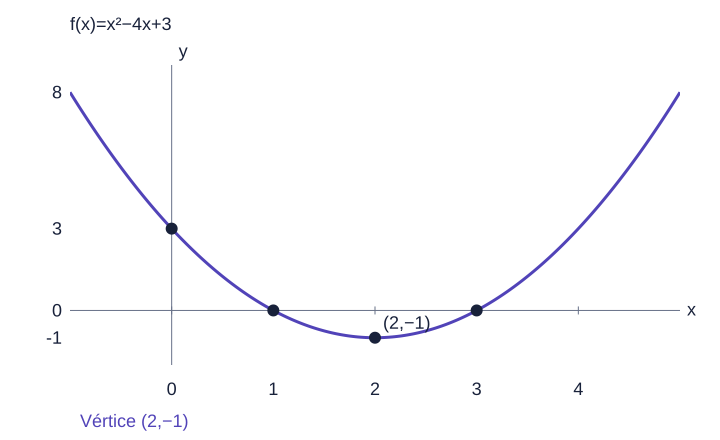

### Tela 5 · Pratique

Qual é a soma das raízes de 2x²−6x+4=0?

A) 2

B) 3

C) −3

Resposta comentada — consulte depois de tentar

**B.** A soma é −b/a=6/2=3.

### Tela 6 · Exemplo guiado

**1. Organizar as informações**

Resolva x²−5x+6=0. Precisamos de r+s=5 e rs=6. O par 2 e 3 satisfaz ambas as condições.

**2. Desenvolver o raciocínio**

A fatoração é (x−2)(x−3)=0. Pela propriedade do produto nulo, x=2 ou x=3.

**3. Concluir e conferir**

Pela fórmula: Δ=25−24=1 e x=(5±1)/2, dando os mesmos valores. A conferência revela dois métodos para uma mesma estrutura.

### Tela 7 · Pratique

Qual é o produto das raízes de 2x²−6x+4=0?

A) 2

B) 3

C) 4

Resposta comentada — consulte depois de tentar

**A.** O produto é c/a=4/2=2.

### Tela 8 · Pratique

Resolva x²−9=0 em ℝ.

A) {3}

B) {−9,9}

C) {−3,3}

Resposta comentada — consulte depois de tentar

**C.** A diferença de quadrados fatorada é (x−3)(x+3)=0.

### Tela 9 · O erro que vale investigar

O sinal da soma é −b/a, não b/a. E a propriedade do produto nulo só vale quando o produto é igual a zero: de uv=6 não concluímos u=6 ou v=6. Equações incompletas também podem ser quadráticas se a≠0.

Antes de seguir: explique o erro em suas palavras e construa um exemplo que o torne visível.

### Tela 10 · Pratique

Resolva x²−4x=0.

A) {−4,4}

B) {0,4}

C) {4}

Resposta comentada — consulte depois de tentar

**B.** x(x−4)=0 inclui x=0, que seria perdido ao dividir por x.

### Tela 11 · Pratique

Qual é o discriminante de x²+2x−3=0?

A) 16

B) −8

C) 4

Resposta comentada — consulte depois de tentar

**A.** Δ=2²−4·1·(−3)=4+12=16.

### Tela 12 · Levar a ideia para outra situação

Escolha o método conforme a forma: fator comum em x²−4x, diferença de quadrados em x²−9, soma e produto para pares simples e fórmula geral quando necessário. Saber justificar a escolha reduz contas e facilita revisar sinais.

### Tela 13 · Pratique

Quais são as raízes de x²+2x−3=0?

A) 3 e −1

B) 1 e 3

C) 1 e −3

Resposta comentada — consulte depois de tentar

**C.** x=(−2±4)/2 produz 1 e −3.

### Tela 14 · Pratique

O que caracteriza uma equação quadrática?

A) O termo independente é positivo

B) O coeficiente de x² é não nulo

C) Todos os coeficientes são não nulos

Resposta comentada — consulte depois de tentar

**B.** b ou c podem ser zero; a não pode.

### Tela 15 · Mapa de bolso

Uma quadrática tem ax²+bx+c=0, a≠0. Se puder fatorar como a(x−r)(x−s), o produto é zero exatamente em r ou s. As raízes reais, quando existem, têm soma −b/a e produto c/a, contando multiplicidade. Com Δ=b²−4ac≥0, a fórmula geral é x=(−b±√Δ)/(2a).

Verificação: Pela fórmula: Δ=25−24=1 e x=(5±1)/2, dando os mesmos valores. A conferência revela dois métodos para uma mesma estrutura.

Recuperação ativa: explique como resolver quadráticas por fatoração, soma e produto e fórmula geral. Depois reconstrua o exemplo sem consultar a solução.

Referência curricular: IMD1001_acervo_unificado_P1_P2_P3.md, fornecido pelo estudante; recorte P1/P2/P3 de 2025.2. Texto, exemplos e questões desta versão são autorais. Os PDFs de P2/P3 não foram conferidos diretamente nesta produção. As exclusões de 2025.2 não devem ser presumidas para outras ofertas.

### Tela 16 · Pratique

Se uv=0 em ℝ, qual conclusão vale?

A) u=0 ou v=0

B) u=v=0 obrigatoriamente

C) u+v=0

Resposta comentada — consulte depois de tentar

**A.** Um produto real só é zero se pelo menos um fator for zero.

### Tela 17 · Pratique

Qual é a forma fatorada de x²+x−6?

A) (x−3)(x+2)

B) (x−3)(x−2)

C) (x+3)(x−2)

Resposta comentada — consulte depois de tentar

**C.** Expandir dá x²+x−6, com raízes −3 e 2.

---

## Passo 14 · Discriminante e o parâmetro suspeito

### Tela 1 · Discriminante e o parâmetro suspeito

Um problema esconde um número sob a letra k e exige ‘exatamente uma raiz real’. É um enigma com pista forte: duas raízes estão tentando ocupar o mesmo endereço. O discriminante detecta o encontro.

Ao concluir: Determinar condições para raízes reais e raízes duplas.

Para começar: Métodos para equações quadráticas (passo 13).

### Tela 2 · Dar nome às ideias

Para ax²+bx+c=0, a≠0, Δ=b²−4ac. Se Δ>0, há duas raízes reais distintas; se Δ=0, há uma raiz real distinta de multiplicidade dois; se Δ<0, não há raízes reais. A fórmula é x=(−b±√Δ)/(2a). Antes de usar Δ com parâmetros, confira se o coeficiente de x² continua diferente de zero.

**Δ=b²−4ac**

Leitura: Delta é b ao quadrado menos quatro vezes a vezes c.

### Tela 3 · Pratique

Em x²−6x+k=0, qual k produz raiz dupla?

A) 36

B) 9

C) 6

Resposta comentada — consulte depois de tentar

**B.** Δ=36−4k=0 implica k=9.

### Tela 4 · Por que isso funciona?

Completar o quadrado transforma a equação em (x+b/(2a))²=Δ/(4a²). Como 4a²>0 e um quadrado real é não negativo, o sinal de Δ explica os três casos. Esta justificativa retoma a ideia geométrica; a dedução geral não é prioridade da P1 2025.2, segundo o acervo.

### Tela 5 · Pratique

Para x²−6x+k=0 ter duas raízes reais distintas, qual condição vale?

A) k<9

B) k>9

C) k=9

Resposta comentada — consulte depois de tentar

**A.** Precisamos de Δ=36−4k>0.

### Tela 6 · Exemplo guiado

**1. Organizar as informações**

Em x²−6x+k=0, temos a=1, b=−6 e c=k. Portanto Δ=36−4k.

**2. Desenvolver o raciocínio**

Uma raiz real distinta exige Δ=0: 36−4k=0, logo k=9.

**3. Concluir e conferir**

A equação vira (x−3)²=0, com raiz dupla x=3. Para k<9 há duas raízes reais; para k>9 não há raízes reais.

### Tela 7 · Pratique

Qual é Δ de 2x²−3x+1=0?

A) 17

B) 5

C) 1

Resposta comentada — consulte depois de tentar

**C.** Δ=(−3)²−4·2·1=9−8=1.

### Tela 8 · Pratique

Quais são as raízes de 2x²−3x+1=0?

A) −1 e −1/2

B) 1 e 1/2

C) 1 e 2

Resposta comentada — consulte depois de tentar

**B.** Pela fórmula, x=(3±1)/4.

### Tela 9 · O erro que vale investigar

Se a=0, a equação deixa de ser quadrática e precisa de análise própria. Em kx²+x−1=0, k=0 produz a equação linear x−1=0, que também possui uma solução real. Ignorar esse caso perde soluções do problema com parâmetro.

Antes de seguir: explique o erro em suas palavras e construa um exemplo que o torne visível.

### Tela 10 · Pratique

Quantas raízes reais distintas tem x²+4=0?

A) 0

B) 1

C) 2

Resposta comentada — consulte depois de tentar

**A.** O discriminante é −16; nenhum quadrado real vale −4.

### Tela 11 · Pratique

Qual é a raiz de x²+4x+4=0?

A) 2

B) −4

C) −2

Resposta comentada — consulte depois de tentar

**C.** A expressão é (x+2)², cujo zero é −2.

### Tela 12 · Levar a ideia para outra situação

Ao escrever uma solução discursiva, registre os coeficientes, o discriminante, a condição pedida e a verificação. ‘Uma raiz’ deve ser interpretado com cuidado: uma raiz distinta pode ter multiplicidade dois. Faça essa distinção em suas próprias palavras.

### Tela 13 · Pratique

Em kx²+x−1=0, o caso k=0 é qual equação?

A) −1=0

B) x−1=0

C) x²−1=0

Resposta comentada — consulte depois de tentar

**B.** O termo quadrático desaparece e resta uma equação linear.

### Tela 14 · Pratique

Qual condição precisa vir antes da fórmula quadrática?

A) a≠0

B) b≠0

C) c≠0

Resposta comentada — consulte depois de tentar

**A.** O denominador 2a e a classificação quadrática exigem a diferente de zero.

### Tela 15 · Mapa de bolso

Para ax²+bx+c=0, a≠0, Δ=b²−4ac. Se Δ>0, há duas raízes reais distintas; se Δ=0, há uma raiz real distinta de multiplicidade dois; se Δ<0, não há raízes reais. A fórmula é x=(−b±√Δ)/(2a). Antes de usar Δ com parâmetros, confira se o coeficiente de x² continua diferente de zero.

Verificação: A equação vira (x−3)²=0, com raiz dupla x=3. Para k<9 há duas raízes reais; para k>9 não há raízes reais.

Recuperação ativa: explique como determinar condições para raízes reais e raízes duplas. Depois reconstrua o exemplo sem consultar a solução.

Referência curricular: IMD1001_acervo_unificado_P1_P2_P3.md, fornecido pelo estudante; recorte P1/P2/P3 de 2025.2. Texto, exemplos e questões desta versão são autorais. Os PDFs de P2/P3 não foram conferidos diretamente nesta produção. As exclusões de 2025.2 não devem ser presumidas para outras ofertas.

### Tela 16 · Pratique

Se Δ=0 numa quadrática, quantas raízes reais distintas existem?

A) 2

B) 0

C) 1

Resposta comentada — consulte depois de tentar

**C.** As duas expressões da fórmula coincidem; a raiz tem multiplicidade dois.

### Tela 17 · Pratique

Qual condição dá raízes reais a x²+k=0?

A) k>0

B) k≤0

C) k≥0

Resposta comentada — consulte depois de tentar

**B.** Precisamos de x²=−k≥0, portanto k≤0.

---

## Passo 15 · Biquadradas: a troca que precisa voltar

### Tela 1 · Biquadradas: a troca que precisa voltar

Uma equação de quarto grau chega usando apenas x⁴ e x². Ela parece enorme, mas repete a mesma peça. Trocar x² por t é como perceber que o monstro final usa o mesmo padrão do tutorial. Só não esqueça de voltar para x.

Ao concluir: Resolver equações biquadradas e controlar a restrição t≥0.

Para começar: Equações quadráticas e raízes (passos 13 e 14).

### Tela 2 · Dar nome às ideias

Uma biquadrada tem a forma ax⁴+bx²+c=0, a≠0. Com t=x², obtemos at²+bt+c=0. No universo real, somente t≥0 pode gerar x. Se t>0, aparecem x=±√t; se t=0, apenas x=0; se t<0, não há x real associado.

**t=x²≥0**

Leitura: A substituição t igual a x ao quadrado exige t não negativo no universo real.

### Tela 3 · Pratique

Com t=x², em que se transforma x⁴−5x²+4=0?

A) t²−5t+4=0

B) t⁴−5t+4=0

C) t²−5t²+4=0

Resposta comentada — consulte depois de tentar

**A.** Substituímos x⁴ por t² e x² por t.

### Tela 4 · Por que isso funciona?

A substituição funciona porque x⁴=(x²)²=t². Resolver a quadrática em t fornece candidatos, não as respostas finais. O mapa x↦x² junta os valores opostos x e −x: por isso cada t positivo produz duas raízes reais. A simetria explica por que raízes não nulas vêm aos pares.

- **Objetivo:** Resolver equações biquadradas e controlar a restrição t≥0. Resolva x⁴−5x²+4=0. Com t=x²: t²−5t+4=(t−1)(t−4)=0.
- **Conferência:** Volte às condições da expressão original. Logo S={−2,−1,1,2}. Conferindo x=2: 16−20+4=0; as raízes opostas funcionam porque só há potências pares.

### Tela 5 · Pratique

Se t=9, quais x reais correspondem a t=x²?

A) Apenas 3

B) −9 e 9

C) −3 e 3

Resposta comentada — consulte depois de tentar

**C.** As duas raízes quadradas com sinais opostos têm quadrado 9.

### Tela 6 · Exemplo guiado

**1. Organizar as informações**

Resolva x⁴−5x²+4=0. Com t=x²: t²−5t+4=(t−1)(t−4)=0.

**2. Desenvolver o raciocínio**

As possibilidades t=1 e t=4 são não negativas. Retorne: x²=1 ou x²=4.

**3. Concluir e conferir**

Logo S={−2,−1,1,2}. Conferindo x=2: 16−20+4=0; as raízes opostas funcionam porque só há potências pares.

### Tela 7 · Pratique

Se t=−4, quantos x reais correspondem?

A) 1

B) 0

C) 2

Resposta comentada — consulte depois de tentar

**B.** Um quadrado real nunca é negativo.

### Tela 8 · Pratique

Se t=0, qual é o conjunto de valores de x?

A) {0}

B) {−1,1}

C) ∅

Resposta comentada — consulte depois de tentar

**A.** x²=0 só é possível para x=0.

### Tela 9 · O erro que vale investigar

Não escreva x=1 ou x=4 depois de resolver t. Também não aceite x=±√(−1) como raízes reais. O exercício pode ter zero, uma, duas, três ou quatro raízes reais distintas; a raiz zero não ganha uma cópia por usar ±0.

Antes de seguir: explique o erro em suas palavras e construa um exemplo que o torne visível.

### Tela 10 · Pratique

Qual é a solução real de x⁴−5x²+4=0?

A) {1,4}

B) {−4,−1,1,4}

C) {−2,−1,1,2}

Resposta comentada — consulte depois de tentar

**C.** Os valores de t são 1 e 4; suas raízes quadradas geram os quatro x.

### Tela 11 · Pratique

Resolva x⁴−9=0 em ℝ.

A) ∅

B) {−√3,√3}

C) {−3,3}

Resposta comentada — consulte depois de tentar

**B.** t²=9 dá t=3 ou −3; apenas t=3 gera x real.

### Tela 12 · Levar a ideia para outra situação

Use um roteiro de três verbos: substituir, filtrar, retornar. Em problemas de medidas, ainda pode haver uma condição extra x≥0. As quatro soluções algébricas não são automaticamente quatro medidas possíveis.

### Tela 13 · Pratique

Quantas raízes reais distintas tem x⁴−4x²=0?

A) 3

B) 4

C) 2

Resposta comentada — consulte depois de tentar

**A.** x²(x²−4)=0 gera x=0 e x=±2.

### Tela 14 · Pratique

Qual é a solução real de x⁴+x²+1=0?

A) {−1,1}

B) {0}

C) ∅

Resposta comentada — consulte depois de tentar

**C.** Todos os termos são não negativos e o termo constante é positivo; a soma nunca zera.

### Tela 15 · Mapa de bolso

Uma biquadrada tem a forma ax⁴+bx²+c=0, a≠0. Com t=x², obtemos at²+bt+c=0. No universo real, somente t≥0 pode gerar x. Se t>0, aparecem x=±√t; se t=0, apenas x=0; se t<0, não há x real associado.

Verificação: Logo S={−2,−1,1,2}. Conferindo x=2: 16−20+4=0; as raízes opostas funcionam porque só há potências pares.

Recuperação ativa: explique como resolver equações biquadradas e controlar a restrição t≥0. Depois reconstrua o exemplo sem consultar a solução.

Referência curricular: IMD1001_acervo_unificado_P1_P2_P3.md, fornecido pelo estudante; recorte P1/P2/P3 de 2025.2. Texto, exemplos e questões desta versão são autorais. Os PDFs de P2/P3 não foram conferidos diretamente nesta produção. As exclusões de 2025.2 não devem ser presumidas para outras ofertas.

### Tela 16 · Pratique

Se uma medida x≥0 satisfaz x⁴−5x²+4=0, quais valores são admissíveis?

A) 1 e 4

B) 1 e 2

C) −2 e −1

Resposta comentada — consulte depois de tentar

**B.** Filtramos as quatro raízes pela condição de medida não negativa.

### Tela 17 · Pratique

Por que raízes não nulas aparecem aos pares numa biquadrada?

A) Substituir x por −x preserva as potências pares

B) Toda equação tem raízes opostas

C) O grau sempre dá quatro raízes reais

Resposta comentada — consulte depois de tentar

**A.** A simetria vem dos expoentes pares; não vale para qualquer equação.

---

## Passo 16 · Desigualdades: virando o sinal com motivo

### Tela 1 · Desigualdades: virando o sinal com motivo

Uma pessoa tem no máximo 90 minutos para leitura e deslocamento. A frase ‘no máximo’ abre um conjunto de possibilidades, não uma resposta única. A desigualdade é uma ferramenta para negociar limites — sem pedir que todo mundo chegue ao mesmo minuto.

Ao concluir: Resolver inequações lineares e combinar condições simultâneas.

Para começar: Equações lineares e intervalos.

### Tela 2 · Dar nome às ideias

Inequações usam <,≤,> ou ≥. Somar o mesmo real aos dois lados preserva a ordem. Multiplicar por positivo preserva o sentido; por negativo inverte. Condições simultâneas são combinadas por interseção. No universo real, a resposta costuma ser um intervalo; em contagens, depois filtramos os inteiros admissíveis.

**a<b, c<0 ⇒ ac>bc**

Leitura: Multiplicar uma desigualdade por um número negativo inverte seu sentido.

### Tela 3 · Pratique

Resolva −2x≥−6.

A) x≥3

B) x≤−3

C) x≤3

Resposta comentada — consulte depois de tentar

**C.** Dividir por −2 inverte o sentido e produz x≤3.

### Tela 4 · Por que isso funciona?

Se a<b, então b−a>0. Multiplicando essa diferença por c<0 resulta c(b−a)<0, isto é, cb<ca. Portanto ca>cb: a ordem foi invertida. A regra não é uma penalidade por usar números negativos; ela expressa a reflexão da reta em torno de zero.

![Reta com intervalo (1,4]: 1 está excluído por círculo aberto, 4 incluído por círculo fechado; o trecho entre eles está destacado.](../../public/materiais/elementar/intervalo.svg)

### Tela 5 · Pratique

Resolva 3x+1<10.

A) x≤3

B) x<3

C) x>3

Resposta comentada — consulte depois de tentar

**B.** Subtraia 1 e divida por 3 positivo; a desigualdade continua estrita.

### Tela 6 · Exemplo guiado

**1. Organizar as informações**

Resolva −2x+6≥0 e x<5. Na primeira, subtraia 6: −2x≥−6.

**2. Desenvolver o raciocínio**

Divida por −2 e inverta o sentido: x≤3. A outra condição é x<5.

**3. Concluir e conferir**

A interseção é (−∞,3]. Teste x=3: a primeira expressão vale 0 e a segunda condição é verdadeira.

### Tela 7 · Pratique

Resolva x−4≥2.

A) x≥6

B) x≤6

C) x≥−2

Resposta comentada — consulte depois de tentar

**A.** Somar 4 aos dois lados preserva a ordem.

### Tela 8 · Pratique

Qual é a solução de x≥2 e x<5?

A) (2,5]

B) (−∞,5)

C) [2,5)

Resposta comentada — consulte depois de tentar

**C.** A interseção inclui 2 e exclui 5.

### Tela 9 · O erro que vale investigar

Nem toda movimentação de um número negativo inverte o sinal. Somar ou subtrair negativos preserva a ordem; a inversão ocorre ao multiplicar ou dividir por um número negativo. E ‘e’ não é união: precisa cumprir as condições ao mesmo tempo.

Antes de seguir: explique o erro em suas palavras e construa um exemplo que o torne visível.

### Tela 10 · Pratique

Qual é a solução de x>4 e x≤1?

A) ℝ

B) ∅

C) (1,4)

Resposta comentada — consulte depois de tentar

**B.** As exigências são incompatíveis.

### Tela 11 · Pratique

Qual operação inverte uma desigualdade?

A) Multiplicar ambos os lados por −3

B) Subtrair 3 dos dois lados

C) Somar −3 aos dois lados

Resposta comentada — consulte depois de tentar

**A.** A inversão depende da multiplicação por número negativo.

### Tela 12 · Levar a ideia para outra situação

Monte uma desigualdade a partir de um limite de tempo ou capacidade, registrando unidades. Para estudar, resolva a mesma inequação por álgebra e por alguns testes na reta. Os testes ajudam a conferir, enquanto a transformação equivalente garante o intervalo completo.

### Tela 13 · Pratique

Resolva −x<2.

A) x<−2

B) x>2

C) x>−2

Resposta comentada — consulte depois de tentar

**C.** Multiplicar por −1 troca o sentido.

### Tela 14 · Pratique

Qual é a solução de 2x≤8 e x≥0?

A) (−∞,4]

B) [0,4]

C) (0,4)

Resposta comentada — consulte depois de tentar

**B.** A primeira dá x≤4; a segunda elimina os negativos.

### Tela 15 · Mapa de bolso

Inequações usam <,≤,> ou ≥. Somar o mesmo real aos dois lados preserva a ordem. Multiplicar por positivo preserva o sentido; por negativo inverte. Condições simultâneas são combinadas por interseção. No universo real, a resposta costuma ser um intervalo; em contagens, depois filtramos os inteiros admissíveis.

Verificação: A interseção é (−∞,3]. Teste x=3: a primeira expressão vale 0 e a segunda condição é verdadeira.

Recuperação ativa: explique como resolver inequações lineares e combinar condições simultâneas. Depois reconstrua o exemplo sem consultar a solução.

Referência curricular: IMD1001_acervo_unificado_P1_P2_P3.md, fornecido pelo estudante; recorte P1/P2/P3 de 2025.2. Texto, exemplos e questões desta versão são autorais. Os PDFs de P2/P3 não foram conferidos diretamente nesta produção. As exclusões de 2025.2 não devem ser presumidas para outras ofertas.

### Tela 16 · Pratique

Se x é uma contagem inteira e 0≤x<3, quais valores servem?

A) 0,1,2

B) 0,1,2,3

C) Todos os reais de [0,3)

Resposta comentada — consulte depois de tentar

**A.** O domínio inteiro seleciona apenas 0, 1 e 2.

### Tela 17 · Pratique

Qual é a solução de 0x≤1 em ℝ?

A) ∅

B) {1}

C) ℝ

Resposta comentada — consulte depois de tentar

**C.** O lado esquerdo sempre vale 0, e 0≤1 é sempre verdadeiro.

---

## Passo 17 · A régua dos sinais

### Tela 1 · A régua dos sinais

Um produto fica positivo quando seus dois fatores são negativos. Isso pode parecer uma conspiração até você olhar cada intervalo. A missão é montar uma régua em que nenhuma troca de sinal aconteça escondida.

Ao concluir: Construir e justificar tabelas de sinais de produtos.

Para começar: Fatoração e inequações lineares (passos 13 e 16).

### Tela 2 · Dar nome às ideias

Para estudar um produto, encontre os zeros dos fatores e divida a reta nesses pontos. Em cada intervalo sem zeros, fatores lineares mantêm o sinal. Um produto é positivo com um número par de fatores negativos e negativo com um número ímpar. Nas desigualdades ≥ ou ≤, zeros do produto podem entrar se a expressão estiver definida.

**(x−r)(x−s)≤0, r<s ⇒ x∈[r,s]**

Leitura: Um produto de dois fatores lineares com raízes r e s ordenadas é não positivo entre as raízes, incluindo os extremos.

### Tela 3 · Pratique

Qual é a solução de (x−1)(x−3)≤0?

A) (1,3)

B) [1,3]

C) (−∞,1]∪[3,∞)

Resposta comentada — consulte depois de tentar

**B.** O produto é negativo entre as raízes e zero nos extremos.

### Tela 4 · Por que isso funciona?

O fator x−a é negativo antes de a e positivo depois de a. Uma raiz de multiplicidade ímpar provoca troca de sinal; de multiplicidade par não provoca. Isso explica o comportamento de (x−a)²: nunca é negativo. Não basta alternar sinais mecanicamente sem observar multiplicidades.

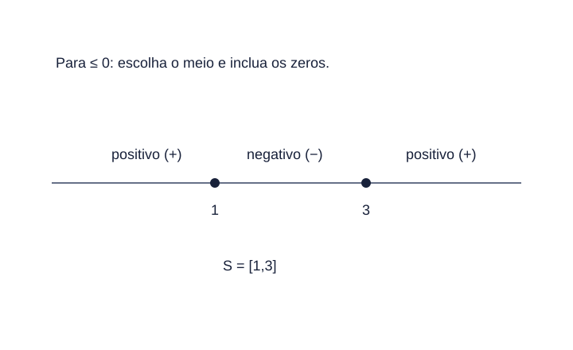

### Tela 5 · Pratique

Qual é a solução de (x−1)(x−3)>0?

A) (−∞,1)∪(3,∞)

B) (1,3)

C) [1,3]

Resposta comentada — consulte depois de tentar

**A.** O produto é positivo fora das raízes, que não entram na desigualdade estrita.

### Tela 6 · Exemplo guiado

**1. Organizar as informações**

Resolva (x−1)(x−3)≤0. Os pontos críticos são 1 e 3; eles dividem a reta em três intervalos.

**2. Desenvolver o raciocínio**

Antes de 1, ambos os fatores são negativos: produto positivo. Entre 1 e 3, os sinais são + e −: produto negativo. Depois de 3: ambos positivos.

**3. Concluir e conferir**

Escolhemos o intervalo central e incluímos os zeros, pois ≤ aceita igualdade. S=[1,3]. Testar x=2 confirma o produto −1.

### Tela 7 · Pratique

Qual é o sinal de (x−1)(x−3) em x=2?

A) Positivo

B) Zero

C) Negativo

Resposta comentada — consulte depois de tentar

**C.** Os fatores valem 1 e −1, com produto −1.

### Tela 8 · Pratique

Em x<1, quais são os sinais de x−1 e x−3?

A) Um positivo e outro negativo

B) Ambos negativos

C) Ambos positivos

Resposta comentada — consulte depois de tentar

**B.** Um número menor que 1 também é menor que 3.

### Tela 9 · O erro que vale investigar

‘O produto é negativo, então os dois fatores são negativos’ está errado: dois negativos produzem positivo. E uma raiz dupla pode apenas encostar no zero. Em (x−2)²>0, todos os reais servem exceto 2; não há intervalo negativo.

Antes de seguir: explique o erro em suas palavras e construa um exemplo que o torne visível.

### Tela 10 · Pratique

Qual é a solução de (x−2)²>0?

A) ℝ sem 2

B) x>2

C) ℝ

Resposta comentada — consulte depois de tentar

**A.** O quadrado só deixa de ser positivo em x=2.

### Tela 11 · Pratique

Qual é a solução de (x−2)²<0?

A) x<2

B) ℝ sem 2

C) ∅

Resposta comentada — consulte depois de tentar

**C.** Um quadrado real nunca é negativo.

### Tela 12 · Levar a ideia para outra situação

Uma tabela de sinais é um argumento sobre intervalos inteiros, não só sobre números testados. Justifique por que não há novos zeros dentro de cada intervalo. Depois escreva a solução em frase e em notação de conjuntos: duas formas de detectar um extremo esquecido.

### Tela 13 · Pratique

Ao atravessar uma raiz dupla, o sinal necessariamente muda?

A) Só se a raiz for positiva

B) Não

C) Sim

Resposta comentada — consulte depois de tentar

**B.** Multiplicidade par mantém o sinal dos fatores restantes no entorno.

### Tela 14 · Pratique

Qual é a solução de x(x−2)≥0?

A) (−∞,0]∪[2,∞)

B) [0,2]

C) (0,2)

Resposta comentada — consulte depois de tentar

**A.** Os dois fatores têm o mesmo sinal fora do intervalo entre as raízes; os zeros entram.

### Tela 15 · Mapa de bolso

Para estudar um produto, encontre os zeros dos fatores e divida a reta nesses pontos. Em cada intervalo sem zeros, fatores lineares mantêm o sinal. Um produto é positivo com um número par de fatores negativos e negativo com um número ímpar. Nas desigualdades ≥ ou ≤, zeros do produto podem entrar se a expressão estiver definida.

Verificação: Escolhemos o intervalo central e incluímos os zeros, pois ≤ aceita igualdade. S=[1,3]. Testar x=2 confirma o produto −1.

Recuperação ativa: explique como construir e justificar tabelas de sinais de produtos. Depois reconstrua o exemplo sem consultar a solução.

Referência curricular: IMD1001_acervo_unificado_P1_P2_P3.md, fornecido pelo estudante; recorte P1/P2/P3 de 2025.2. Texto, exemplos e questões desta versão são autorais. Os PDFs de P2/P3 não foram conferidos diretamente nesta produção. As exclusões de 2025.2 não devem ser presumidas para outras ofertas.

### Tela 16 · Pratique

Um produto de três fatores estritamente negativos tem que sinal?

A) Positivo

B) Zero

C) Negativo

Resposta comentada — consulte depois de tentar

**C.** Três é uma quantidade ímpar de sinais negativos.

### Tela 17 · Pratique

Qual justificativa permite escolher um teste por intervalo para fatores lineares?

A) Todos os intervalos têm o mesmo sinal

B) Cada fator só muda de sinal no seu zero

C) Um único teste prova qualquer função positiva

Resposta comentada — consulte depois de tentar

**B.** A análise depende de termos identificado todos os pontos onde o sinal pode mudar.

---

## Passo 18 · Produtos com várias pistas

### Tela 1 · Produtos com várias pistas

Agora a régua ganhou três portas e uma delas aparece duas vezes. Será que o sinal troca em todas? Antes de sair alternando + e −, vale descobrir qual porta só encosta no zero e qual atravessa para o outro lado.

Ao concluir: Estudar sinais de produtos com três fatores e raízes repetidas.

Para começar: Sinais de fatores e quadráticas (passo 17).

### Tela 2 · Dar nome às ideias

Os zeros reais dos fatores dividem a reta em intervalos. Em cada intervalo, determine o sinal de cada fator. Potências pares são positivas fora do zero; potências ímpares mantêm o sinal da base. Ordene os pontos críticos e trate a inclusão dos zeros somente depois de escolher os sinais que atendem à desigualdade.

**(x−r)²≥0**

Leitura: O quadrado de x menos r é sempre não negativo.

### Tela 3 · Pratique

Qual é a multiplicidade de 1 em (x+2)(x−1)²(x−3)?

A) 2

B) 1

C) 4

Resposta comentada — consulte depois de tentar

**A.** O expoente do fator x−1 é dois.

### Tela 4 · Por que isso funciona?

Perto de uma raiz r, escreva o produto como (x−r)ᵐg(x), com g contínua e g(r)≠0. O fator g mantém sinal no entorno. Se m é par, (x−r)ᵐ é positivo dos dois lados; se m é ímpar, troca sinal. Para os produtos polinomiais deste passo, a fatoração identifica todas as trocas possíveis.

- **Objetivo:** Estudar sinais de produtos com três fatores e raízes repetidas. Resolva (x+2)(x−1)²(x−3)<0. Os zeros são −2,1,3; a raiz 1 tem multiplicidade dois.
- **Conferência:** Volte às condições da expressão original. Como a desigualdade é estrita, excluímos também o zero em 1. S=(−2,1)∪(1,3). Conferir x=0 e x=2 dá resultados negativos.

### Tela 5 · Pratique

Qual é o sinal de (x−1)² para x≠1?

A) Negativo

B) Depende do lado de 1

C) Positivo

Resposta comentada — consulte depois de tentar

**C.** Um quadrado não nulo é estritamente positivo.

### Tela 6 · Exemplo guiado

**1. Organizar as informações**

Resolva (x+2)(x−1)²(x−3)<0. Os zeros são −2,1,3; a raiz 1 tem multiplicidade dois.

**2. Desenvolver o raciocínio**

Fora de x=1, o fator quadrado é positivo. O sinal depende de (x+2)(x−3), que é negativo entre −2 e 3.

**3. Concluir e conferir**

Como a desigualdade é estrita, excluímos também o zero em 1. S=(−2,1)∪(1,3). Conferir x=0 e x=2 dá resultados negativos.

### Tela 7 · Pratique

Qual é a solução de (x+2)(x−1)²(x−3)<0?

A) [−2,3]

B) (−2,1)∪(1,3)

C) (−2,3)

Resposta comentada — consulte depois de tentar

**B.** O produto é negativo entre −2 e 3, mas zera em 1, que deve ser excluído.

### Tela 8 · Pratique

Se a desigualdade do exemplo fosse ≤0, qual seria a solução?

A) [−2,3]

B) (−2,1)∪(1,3)

C) ℝ

Resposta comentada — consulte depois de tentar

**A.** Os três zeros seriam aceitos e todo o intervalo entre −2 e 3 teria produto não positivo.

### Tela 9 · O erro que vale investigar

Ignorar uma raiz par na troca de sinal não significa incluí-la em uma desigualdade estrita. Em x=1, o produto do exemplo é zero, portanto não serve. Multiplicidade regula a troca; o símbolo da desigualdade regula a aceitação do zero.

Antes de seguir: explique o erro em suas palavras e construa um exemplo que o torne visível.

### Tela 10 · Pratique

Qual é o sinal de x(x−1)(x−2) para x>2?

A) Negativo

B) Zero

C) Positivo

Resposta comentada — consulte depois de tentar

**C.** Os três fatores são positivos nesse intervalo.

### Tela 11 · Pratique

Qual é o sinal de x(x−1)(x−2) para x<0?

A) Zero

B) Negativo

C) Positivo

Resposta comentada — consulte depois de tentar

**B.** Os três fatores são negativos, e três sinais negativos produzem negativo.

### Tela 12 · Levar a ideia para outra situação

Um caminho eficiente é estudar fatores pares separadamente, sem apagá-los do conjunto de zeros. Desenhe os quatro intervalos do exemplo, escreva os sinais por extenso e explique por que os dois intervalos centrais têm o mesmo sinal apesar do ponto excluído entre eles.

### Tela 13 · Pratique

Qual é a solução de x(x−1)(x−2)>0?

A) (0,1)∪(2,∞)

B) (−∞,0)∪(1,2)

C) [0,2]

Resposta comentada — consulte depois de tentar

**A.** Os sinais da esquerda para a direita são −,+,−,+, com raízes excluídas.

### Tela 14 · Pratique

Ao atravessar uma raiz de multiplicidade três, o sinal de um produto polinomial muda?

A) Não

B) Só se a raiz for zero

C) Sim

Resposta comentada — consulte depois de tentar

**C.** Multiplicidade ímpar provoca troca de sinal.

### Tela 15 · Mapa de bolso

Os zeros reais dos fatores dividem a reta em intervalos. Em cada intervalo, determine o sinal de cada fator. Potências pares são positivas fora do zero; potências ímpares mantêm o sinal da base. Ordene os pontos críticos e trate a inclusão dos zeros somente depois de escolher os sinais que atendem à desigualdade.

Verificação: Como a desigualdade é estrita, excluímos também o zero em 1. S=(−2,1)∪(1,3). Conferir x=0 e x=2 dá resultados negativos.

Recuperação ativa: explique como estudar sinais de produtos com três fatores e raízes repetidas. Depois reconstrua o exemplo sem consultar a solução.

Referência curricular: IMD1001_acervo_unificado_P1_P2_P3.md, fornecido pelo estudante; recorte P1/P2/P3 de 2025.2. Texto, exemplos e questões desta versão são autorais. Os PDFs de P2/P3 não foram conferidos diretamente nesta produção. As exclusões de 2025.2 não devem ser presumidas para outras ofertas.

### Tela 16 · Pratique

Em (x−1)²(x+2)≥0, qual é a solução?

A) [1,∞)

B) [−2,∞)

C) (−∞,−2]

Resposta comentada — consulte depois de tentar

**B.** O fator quadrado é positivo exceto em 1, onde o produto é zero; o sinal restante depende de x+2.

### Tela 17 · Pratique

Por que testar apenas x=0 não resolve qualquer inequação polinomial?

A) Pode haver outros intervalos separados por zeros

B) Todo produto tem o mesmo sinal

C) O teste sempre inclui todas as raízes

Resposta comentada — consulte depois de tentar

**A.** É necessário localizar todos os zeros e estudar cada intervalo determinado por eles.

---

## Passo 19 · Quocientes: o ponto que nunca entra

### Tela 1 · Quocientes: o ponto que nunca entra

Você simplifica (x−2)/(x−2) e obtém 1. Tudo parece resolvido, até x=2 bater à porta. O cancelamento apagou o fator da expressão, mas não pode apagar a restrição que veio com ele.

Ao concluir: Resolver inequações racionais sem perder o domínio.

Para começar: Produtos e tabelas de sinais (passos 17 e 18).

### Tela 2 · Dar nome às ideias

Um quociente exige denominador diferente de zero. Para resolver uma inequação racional, registre o domínio, encontre zeros do numerador e do denominador, estude os sinais e só depois selecione os intervalos. Zeros do denominador nunca entram; zeros do numerador entram apenas quando a desigualdade aceita igualdade e o domínio permite.

**N(x)/D(x): D(x)≠0**

Leitura: Uma fração algébrica só está definida quando seu denominador não é zero.

### Tela 3 · Pratique

Qual é o domínio de (x−2)/(x−2)?

A) ℝ

B) ℝ sem 0

C) ℝ sem 2

Resposta comentada — consulte depois de tentar

**C.** O denominador zera em 2 e a simplificação não muda essa restrição.

### Tela 4 · Por que isso funciona?

Multiplicar uma desigualdade por um denominador de sinal desconhecido pode inverter o sentido sem aviso. A tabela evita isso: o sinal do quociente é positivo quando numerador e denominador têm o mesmo sinal. Uma simplificação algébrica é uma igualdade no domínio comum, não uma permissão para reinserir pontos proibidos.

- **Objetivo:** Resolver inequações racionais sem perder o domínio. Resolva ((x−2)(x−4))/((x+3)(x−1))≥0. Primeiro x≠−3 e x≠1. Os pontos críticos ordenados são −3,1,2,4.
- **Conferência:** Volte às condições da expressão original. Escolhendo sinais não negativos: S=(−∞,−3)∪(1,2]∪[4,∞). −3 e 1 ficam excluídos pelo domínio; 2 e 4 entram como zeros válidos.

### Tela 5 · Pratique

Qual é a solução de (x−2)/(x−2)≥0?

A) [2,∞)

B) ℝ sem 2

C) ℝ

Resposta comentada — consulte depois de tentar

**B.** No domínio o quociente vale 1; x=2 permanece proibido.

### Tela 6 · Exemplo guiado

**1. Organizar as informações**

Resolva ((x−2)(x−4))/((x+3)(x−1))≥0. Primeiro x≠−3 e x≠1. Os pontos críticos ordenados são −3,1,2,4.

**2. Desenvolver o raciocínio**

Da esquerda para a direita, os sinais nos cinco intervalos são +,−,+,−,+. Todos os fatores têm multiplicidade um, logo o sinal troca a cada ponto crítico.

**3. Concluir e conferir**

Escolhendo sinais não negativos: S=(−∞,−3)∪(1,2]∪[4,∞). −3 e 1 ficam excluídos pelo domínio; 2 e 4 entram como zeros válidos.

### Tela 7 · Pratique

Qual é a solução de (x−2)/(x−1)≥0?

A) (−∞,1)∪[2,∞)

B) [1,2]

C) (1,2)

Resposta comentada — consulte depois de tentar

**A.** Antes de 1 os sinais são iguais; entre 1 e 2 são opostos; a partir de 2 o quociente é não negativo.

### Tela 8 · Pratique

Na expressão do exemplo, quais pontos são proibidos?

A) 2 e 4

B) −3 e 4

C) −3 e 1

Resposta comentada — consulte depois de tentar

**C.** São os zeros do denominador (x+3)(x−1).

### Tela 9 · O erro que vale investigar

Não multiplique por x−1 como se ele fosse positivo em toda a reta. Se preferir multiplicar, separe explicitamente os casos x>1 e x<1. Em (x−2)/(x−2)≥0, a resposta continua ℝ sem 2, mesmo que a forma reduzida seja 1.

Antes de seguir: explique o erro em suas palavras e construa um exemplo que o torne visível.

### Tela 10 · Pratique

Na expressão do exemplo, quais zeros podem entrar em ≥0?

A) Todos os quatro

B) 2 e 4

C) −3 e 1

Resposta comentada — consulte depois de tentar

**B.** Os zeros do numerador são permitidos porque não anulam o denominador.

### Tela 11 · Pratique

Qual é o sinal de 1/(x−1) quando x<1?

A) Negativo

B) Positivo

C) Zero

Resposta comentada — consulte depois de tentar

**A.** O numerador é positivo e o denominador negativo.

### Tela 12 · Levar a ideia para outra situação

A organização do argumento importa tanto quanto a conta: domínio, pontos críticos, sinais, resposta e conferência. O exemplo corresponde à expressão destacada no acervo para P1 D2; a solução aqui foi calculada diretamente, sem depender de um gabarito oficial não conferido.

### Tela 13 · Pratique

Qual é a solução de 1/(x−1)>0?

A) [1,∞)

B) (−∞,1)

C) (1,∞)

Resposta comentada — consulte depois de tentar

**C.** O denominador precisa ser positivo; x=1 não pertence ao domínio.

### Tela 14 · Pratique

Pode-se multiplicar por x−1 sem analisar seu sinal?

A) Sim, se a desigualdade for ≥

B) Não

C) Sim, sempre

Resposta comentada — consulte depois de tentar

**B.** O sentido da desigualdade depende do sinal do fator multiplicador.

### Tela 15 · Mapa de bolso

Um quociente exige denominador diferente de zero. Para resolver uma inequação racional, registre o domínio, encontre zeros do numerador e do denominador, estude os sinais e só depois selecione os intervalos. Zeros do denominador nunca entram; zeros do numerador entram apenas quando a desigualdade aceita igualdade e o domínio permite.

Verificação: Escolhendo sinais não negativos: S=(−∞,−3)∪(1,2]∪[4,∞). −3 e 1 ficam excluídos pelo domínio; 2 e 4 entram como zeros válidos.

Recuperação ativa: explique como resolver inequações racionais sem perder o domínio. Depois reconstrua o exemplo sem consultar a solução.

Referência curricular: IMD1001_acervo_unificado_P1_P2_P3.md, fornecido pelo estudante; recorte P1/P2/P3 de 2025.2. Texto, exemplos e questões desta versão são autorais. Os PDFs de P2/P3 não foram conferidos diretamente nesta produção. As exclusões de 2025.2 não devem ser presumidas para outras ofertas.

### Tela 16 · Pratique

Qual é a solução de (x−2)²/(x+1)≤0?

A) (−∞,−1)∪{2}

B) (−∞,−1]

C) [−1,2]

Resposta comentada — consulte depois de tentar

**A.** O numerador é positivo exceto em 2; o quociente é negativo antes de −1 e zero em 2.

### Tela 17 · Pratique

Qual é o sinal da expressão do exemplo para x>4?

A) Negativo

B) Zero

C) Positivo

Resposta comentada — consulte depois de tentar

**C.** Os quatro fatores são estritamente positivos nesse intervalo.

---

## Passo 20 · Missão P1: defender uma solução

### Tela 1 · Missão P1: defender uma solução

Chegou a banca da sua própria solução. Ela aceita calculadora mental, rascunho e uma dose moderada de café imaginário. Mas vai pedir: ‘Por que esse intervalo? De onde saiu essa raiz?’ A missão é fazer o raciocínio sobreviver a essas perguntas.

Ao concluir: Integrar os fundamentos e construir justificativas completas.

Para começar: Passos 1 a 19; retome o tema de cada erro.

### Tela 2 · Dar nome às ideias

Resolver é produzir valores que satisfazem condições; justificar é mostrar por que todos os valores obtidos servem e nenhum outro serve. Uma resposta discursiva precisa declarar universo, restrições, transformações equivalentes e conjunto solução. Esta revisão é autoral e combina habilidades do mapa da P1 2025.2, sem reproduzir a prova.

**Hipóteses → método → verificação → solução**

Leitura: Uma solução organizada declara hipóteses, desenvolve o método, verifica e conclui.

### Tela 3 · Pratique

Se A={1,2,3} e B={3,4}, qual é A∩B?

A) ∅

B) {3}

C) {1,2,3,4}

Resposta comentada — consulte depois de tentar

**B.** A interseção contém apenas o elemento comum 3.

### Tela 4 · Por que isso funciona?

Cada transformação deve preservar as soluções ou ter seus candidatos conferidos ao final. Dividir por uma expressão que pode zerar exige separar casos. Elevar ao quadrado pode introduzir soluções. Testar candidatos confirma inclusão, mas a garantia de completude vem do método, não de experimentar alguns números.

- **Objetivo:** Integrar os fundamentos e construir justificativas completas. Determine k para que x²−4x+k=0 tenha uma raiz real distinta. A equação é quadrática porque a=1.
- **Conferência:** Volte às condições da expressão original. Conclua: k=4, com raiz dupla x=2. Verifique 2²−4·2+4=0 e explique que qualquer k diferente muda o sinal de Δ para um dos outros casos.

### Tela 5 · Pratique

Um conjunto com 5 elementos tem quantos subconjuntos próprios?

A) 31

B) 32

C) 30

Resposta comentada — consulte depois de tentar

**A.** Há 2⁵=32 subconjuntos e só o completo é excluído.

### Tela 6 · Exemplo guiado

**1. Organizar as informações**

Determine k para que x²−4x+k=0 tenha uma raiz real distinta. A equação é quadrática porque a=1.

**2. Desenvolver o raciocínio**

Calcule Δ=16−4k e imponha Δ=0. Então k=4 e a equação fica (x−2)²=0.

**3. Concluir e conferir**

Conclua: k=4, com raiz dupla x=2. Verifique 2²−4·2+4=0 e explique que qualquer k diferente muda o sinal de Δ para um dos outros casos.

### Tela 7 · Pratique

Quanto vale 8^(2/3)·2⁻¹?

A) 4

B) 8

C) 2

Resposta comentada — consulte depois de tentar

**C.** A raiz cúbica de 8 é 2; 2²·1/2=2.

### Tela 8 · Pratique

Quanto vale ln(e²)+log₃27?

A) 2

B) 5

C) 6

Resposta comentada — consulte depois de tentar

**B.** As duas parcelas valem 2 e 3.

### Tela 9 · O erro que vale investigar

Uma lista de respostas sem restrições não permite revisar o método. Também evite justificar uma identidade por um único exemplo: exemplos podem refutar uma afirmação universal, mas não demonstrá-la. Quando errar, identifique a decisão incorreta, não apenas o número final.

Antes de seguir: explique o erro em suas palavras e construa um exemplo que o torne visível.

### Tela 10 · Pratique

Resolva 3x−5=7 em ℝ.

A) {4}

B) {2/3}

C) {−4}

Resposta comentada — consulte depois de tentar

**A.** Somando 5 e dividindo por 3, obtemos x=4.

### Tela 11 · Pratique

Resolva x+y=6 e x−y=2.

A) {(2,4)}

B) {(3,3)}

C) {(4,2)}

Resposta comentada — consulte depois de tentar

**C.** Somando as equações: 2x=8; depois y=2.

### Tela 12 · Levar a ideia para outra situação

Faça esta revisão em duas passagens: primeiro sem consulta; depois explique cada alternativa escolhida com uma frase e uma conta. Se um tema travar, retorne ao passo indicado pelo assunto. O objetivo é autonomia: contar, transformar, resolver e comunicar.

### Tela 13 · Pratique

Qual k dá raiz dupla a x²−4x+k=0?

A) 16

B) 4

C) 2

Resposta comentada — consulte depois de tentar

**B.** Δ=16−4k=0 implica k=4.

### Tela 14 · Pratique

Quais são as raízes reais de x⁴−10x²+9=0?

A) −3,−1,1,3

B) 1 e 9

C) −9,−1,1,9

Resposta comentada — consulte depois de tentar

**A.** t²−10t+9=(t−1)(t−9); retornar a x dá ±1 e ±3.

### Tela 15 · Mapa de bolso

Resolver é produzir valores que satisfazem condições; justificar é mostrar por que todos os valores obtidos servem e nenhum outro serve. Uma resposta discursiva precisa declarar universo, restrições, transformações equivalentes e conjunto solução. Esta revisão é autoral e combina habilidades do mapa da P1 2025.2, sem reproduzir a prova.

Verificação: Conclua: k=4, com raiz dupla x=2. Verifique 2²−4·2+4=0 e explique que qualquer k diferente muda o sinal de Δ para um dos outros casos.

Recuperação ativa: explique como integrar os fundamentos e construir justificativas completas. Depois reconstrua o exemplo sem consultar a solução.

Referência curricular: IMD1001_acervo_unificado_P1_P2_P3.md, fornecido pelo estudante; recorte P1/P2/P3 de 2025.2. Texto, exemplos e questões desta versão são autorais. Os PDFs de P2/P3 não foram conferidos diretamente nesta produção. As exclusões de 2025.2 não devem ser presumidas para outras ofertas.

### Tela 16 · Pratique

Qual é a solução de 2x−1≥3 e x<5?

A) (2,5]

B) [2,∞)

C) [2,5)

Resposta comentada — consulte depois de tentar

**C.** A primeira condição dá x≥2; intersectando com x<5 resulta [2,5).

### Tela 17 · Pratique

Qual é a solução de (x−1)/(x+2)<0?

A) (−∞,−2)∪(1,∞)

B) (−2,1)

C) [−2,1]

Resposta comentada — consulte depois de tentar

**B.** O quociente é negativo entre os pontos críticos; −2 é proibido e 1 não satisfaz a desigualdade estrita.

---

## Passo 21 · Polinômios: uma expressão com estrutura

### Tela 1 · Polinômios: uma expressão com estrutura

Uma equipe descreve o custo fictício de um projeto por 2x²+3x+5. Outra escreve 5+3x+2x². As duas planilhas estão discutindo a mesma coisa com a mobília em outra ordem. Vamos descobrir a estrutura que permanece.

Ao concluir: Identificar coeficientes, termos e grau de um polinômio.

Para começar: Potências inteiras e expressões algébricas da Unidade 1.

### Tela 2 · Dar nome às ideias

Um polinômio real em x é uma soma finita aₙxⁿ+…+a₁x+a₀, com expoentes inteiros não negativos e coeficientes reais. Se aₙ≠0, seu grau é n e aₙ é o coeficiente líder. Termos ausentes têm coeficiente zero. O polinômio nulo tem todos os coeficientes zero; seu grau fica indefinido nesta trilha.

**P(x)=aₙxⁿ+⋯+a₀**

Leitura: Um polinômio é uma soma finita de coeficientes reais multiplicando potências inteiras não negativas.

### Tela 3 · Pratique

Qual é o grau de 5−2x³+x?

A) 3

B) 5

C) 1

Resposta comentada — consulte depois de tentar

**A.** O maior expoente com coeficiente não nulo é 3.

### Tela 4 · Por que isso funciona?

Coeficientes são organizados pelas potências de x, não pela posição em que foram escritos. Dois polinômios são idênticos quando todos os coeficientes correspondentes coincidem. Igualdade em apenas um valor de x não garante identidade: x e x² coincidem em x=0 e x=1, mas diferem em x=2.

- **Objetivo:** Identificar coeficientes, termos e grau de um polinômio. Em P(x)=4−2x³+x, ordene por grau: −2x³+0x²+x+4.
- **Conferência:** Volte às condições da expressão original. Para avaliar P(−1), substitua com parênteses: 4−2(−1)³+(−1)=4+2−1=5.

### Tela 5 · Pratique

Qual é o coeficiente de x² em −2x³+x+4?

A) 1

B) −2

C) 0

Resposta comentada — consulte depois de tentar

**C.** O termo x² está ausente, portanto seu coeficiente é zero.

### Tela 6 · Exemplo guiado

**1. Organizar as informações**

Em P(x)=4−2x³+x, ordene por grau: −2x³+0x²+x+4.

**2. Desenvolver o raciocínio**

O grau é 3; os coeficientes, do maior grau ao constante, são −2,0,1,4.

**3. Concluir e conferir**

Para avaliar P(−1), substitua com parênteses: 4−2(−1)³+(−1)=4+2−1=5.

### Tela 7 · Pratique

Qual expressão é polinomial em x?

A) √x+1

B) √2·x²+1

C) 1/x+1

Resposta comentada — consulte depois de tentar

**B.** Coeficientes podem ser irracionais; expoentes precisam ser inteiros não negativos.

### Tela 8 · Pratique

Qual é o grau de 7?

A) 0

B) 1

C) 7

Resposta comentada — consulte depois de tentar

**A.** Uma constante não nula é 7x⁰.

### Tela 9 · O erro que vale investigar

1/x=x⁻¹ e √x=x^(1/2) não são termos polinomiais em x. Já √2·x² é permitido: √2 é um coeficiente real. Se o coeficiente aparentemente líder zera por causa de um parâmetro, determine o grau olhando os termos restantes.

Antes de seguir: explique o erro em suas palavras e construa um exemplo que o torne visível.

### Tela 10 · Pratique

Qual é o grau do polinômio nulo nesta trilha?

A) 0

B) 1

C) Indefinido

Resposta comentada — consulte depois de tentar

**C.** Não há maior expoente com coeficiente não nulo.

### Tela 11 · Pratique

Se P(x)=x²−3x+2, quanto vale P(−1)?

A) −2

B) 6

C) 0

Resposta comentada — consulte depois de tentar

**B.** Substituindo: 1+3+2=6.

### Tela 12 · Levar a ideia para outra situação

Polinômios podem modelar áreas, tendências idealizadas e relações entre grandezas. O modelo não vale automaticamente para qualquer x: uma área exige medidas admissíveis. Descreva separadamente o grau algébrico e o domínio que o contexto permite.

### Tela 13 · Pratique

Se (a−2)x³+4x tem a=2, qual é o grau?

A) 1

B) 3

C) 0

Resposta comentada — consulte depois de tentar

**A.** O termo cúbico desaparece e resta 4x.

### Tela 14 · Pratique

Se ax²+bx+1 é idêntico a 3x²−2x+1, qual é (a,b)?

A) (−2,3)

B) (3,2)

C) (3,−2)

Resposta comentada — consulte depois de tentar

**C.** Compare coeficientes das mesmas potências.

### Tela 15 · Mapa de bolso

Um polinômio real em x é uma soma finita aₙxⁿ+…+a₁x+a₀, com expoentes inteiros não negativos e coeficientes reais. Se aₙ≠0, seu grau é n e aₙ é o coeficiente líder. Termos ausentes têm coeficiente zero. O polinômio nulo tem todos os coeficientes zero; seu grau fica indefinido nesta trilha.

Verificação: Para avaliar P(−1), substitua com parênteses: 4−2(−1)³+(−1)=4+2−1=5.

Recuperação ativa: explique como identificar coeficientes, termos e grau de um polinômio. Depois reconstrua o exemplo sem consultar a solução.

Referência curricular: IMD1001_acervo_unificado_P1_P2_P3.md, fornecido pelo estudante; recorte P1/P2/P3 de 2025.2. Texto, exemplos e questões desta versão são autorais. Os PDFs de P2/P3 não foram conferidos diretamente nesta produção. As exclusões de 2025.2 não devem ser presumidas para outras ofertas.

### Tela 16 · Pratique

P(0)=Q(0) garante P=Q como polinômios?

A) Só se os coeficientes forem inteiros

B) Não

C) Sim

Resposta comentada — consulte depois de tentar

**B.** Polinômios diferentes podem coincidir num ponto; x e x² são um exemplo.

### Tela 17 · Pratique

Qual é o termo constante de 2x⁴−x+8?

A) 8

B) 2

C) −1

Resposta comentada — consulte depois de tentar

**A.** O termo constante multiplica x⁰ e não varia com x.

---

## Passo 22 · Operações: organizar antes de calcular

### Tela 1 · Operações: organizar antes de calcular

Dois grupos somam recursos para uma feira. Um registra x²+2x; outro, 3x²−x+4. Somar por colunas funciona, desde que as colunas representem a mesma potência. Misturar x com x² é como somar horas com metros e esperar diplomacia.

Ao concluir: Somar, subtrair e multiplicar polinômios pela distributiva.

Para começar: Termos e coeficientes (passo 21).

### Tela 2 · Dar nome às ideias

Termos semelhantes têm a mesma potência de x. Na soma, somamos seus coeficientes. Na subtração, distribuímos o sinal negativo por todos os termos do segundo polinômio. No produto, multiplicamos cada termo de um fator por cada termo do outro e reunimos os semelhantes.

**axᵏ+bxᵏ=(a+b)xᵏ**

Leitura: Termos da mesma potência podem ter seus coeficientes somados.

### Tela 3 · Pratique

Qual é (x²+2x)+(3x²−x+4)?

A) 4x³+x+4

B) 4x²+3x+4

C) 4x²+x+4

Resposta comentada — consulte depois de tentar

**C.** Somamos apenas coeficientes de termos semelhantes.

### Tela 4 · Por que isso funciona?

A distributividade explica as operações: axᵏ+bxᵏ=(a+b)xᵏ e axʳ·bxˢ=abxʳ⁺ˢ. Para polinômios não nulos, o grau do produto é a soma dos graus, porque o produto dos coeficientes líderes é não nulo. Na soma, os termos líderes podem se cancelar e reduzir o grau.

- **Objetivo:** Somar, subtrair e multiplicar polinômios pela distributiva. Calcule (x+2)(2x−3). Distribua x: 2x²−3x. Distribua 2: 4x−6.
- **Conferência:** Volte às condições da expressão original. Confira em x=1: o produto original é 3·(−1)=−3 e o polinômio obtido é 2+1−6=−3. A distributiva garante a identidade; o teste apenas ajuda a conferir.

### Tela 5 · Pratique

Qual é (x²+1)−(x²−2x+3)?

A) 2x+4

B) 2x−2

C) −2x+4

Resposta comentada — consulte depois de tentar

**B.** Distribuir o sinal dá x²+1−x²+2x−3.

### Tela 6 · Exemplo guiado

**1. Organizar as informações**

Calcule (x+2)(2x−3). Distribua x: 2x²−3x. Distribua 2: 4x−6.

**2. Desenvolver o raciocínio**

Some os resultados: 2x²−3x+4x−6=2x²+x−6.

**3. Concluir e conferir**

Confira em x=1: o produto original é 3·(−1)=−3 e o polinômio obtido é 2+1−6=−3. A distributiva garante a identidade; o teste apenas ajuda a conferir.

### Tela 7 · Pratique

Qual é x²·x³?

A) x⁵

B) x⁶

C) 2x⁵

Resposta comentada — consulte depois de tentar

**A.** No produto de potências da mesma base, somamos expoentes.

### Tela 8 · Pratique

Qual é 2x(3x²−1)?

A) 6x²−1

B) 6x³−1

C) 6x³−2x

Resposta comentada — consulte depois de tentar

**C.** O fator 2x multiplica os dois termos.

### Tela 9 · O erro que vale investigar

O sinal de menos antes de parênteses atinge todos os termos: −(x²−2x+3)=−x²+2x−3. E (P+Q) pode ter grau menor que ambos: (x²+x)+(−x²+1)=x+1.

Antes de seguir: explique o erro em suas palavras e construa um exemplo que o torne visível.

### Tela 10 · Pratique

Qual é (x+2)(2x−3)?

A) 2x²+7x−6

B) 2x²+x−6

C) 2x²−6

Resposta comentada — consulte depois de tentar

**B.** Os termos centrais são −3x e 4x, cuja soma é x.

### Tela 11 · Pratique

Qual é o grau do produto de dois polinômios não nulos de graus 2 e 3?

A) 5

B) 6

C) 3

Resposta comentada — consulte depois de tentar

**A.** Os termos líderes se multiplicam e os graus se somam.

### Tela 12 · Levar a ideia para outra situação

Use o teste numérico como detector de erros, sem confundi-lo com demonstração. Escolha x=0 para conferir constantes e x=1 para conferir somas de coeficientes. Se falhar em um desses testes, há erro; se passar, ainda é preciso confiar na expansão correta.

### Tela 13 · Pratique

Qual é (x²+x)+(−x²+1)?

A) 2x²+x+1

B) 0

C) x+1

Resposta comentada — consulte depois de tentar

**C.** Os termos x² se cancelam, reduzindo o grau.

### Tela 14 · Pratique

Qual é −(x²−2x+3)?

A) −x²+2x+3

B) −x²+2x−3

C) −x²−2x+3

Resposta comentada — consulte depois de tentar

**B.** O fator −1 troca o sinal de todos os termos.

### Tela 15 · Mapa de bolso

Termos semelhantes têm a mesma potência de x. Na soma, somamos seus coeficientes. Na subtração, distribuímos o sinal negativo por todos os termos do segundo polinômio. No produto, multiplicamos cada termo de um fator por cada termo do outro e reunimos os semelhantes.

Verificação: Confira em x=1: o produto original é 3·(−1)=−3 e o polinômio obtido é 2+1−6=−3. A distributiva garante a identidade; o teste apenas ajuda a conferir.

Recuperação ativa: explique como somar, subtrair e multiplicar polinômios pela distributiva. Depois reconstrua o exemplo sem consultar a solução.

Referência curricular: IMD1001_acervo_unificado_P1_P2_P3.md, fornecido pelo estudante; recorte P1/P2/P3 de 2025.2. Texto, exemplos e questões desta versão são autorais. Os PDFs de P2/P3 não foram conferidos diretamente nesta produção. As exclusões de 2025.2 não devem ser presumidas para outras ofertas.

### Tela 16 · Pratique

Se uma expansão falha em x=1, o que se conclui?

A) A identidade proposta está errada

B) Apenas x=1 é proibido

C) Os polinômios são iguais

Resposta comentada — consulte depois de tentar

**A.** Uma identidade precisa valer em todos os reais; um contraexemplo basta para refutá-la.

### Tela 17 · Pratique

Qual é (x−1)(x+1)?

A) x²+1

B) x²−2x+1

C) x²−1

Resposta comentada — consulte depois de tentar

**C.** Os termos +x e −x se cancelam.

---

## Passo 23 · Produtos notáveis sem feitiçaria

### Tela 1 · Produtos notáveis sem feitiçaria

Um quadrado de lado a+b pode ser dividido em quatro peças. Duas delas são retângulos iguais. É justamente uma dessas peças que costuma desaparecer quando alguém escreve (a+b)²=a²+b². A geometria pode chamar a peça de volta.

Ao concluir: Demonstrar quadrados de binômios e diferença de quadrados.

Para começar: Distributividade e multiplicação de polinômios.

### Tela 2 · Dar nome às ideias

As identidades são (a+b)²=a²+2ab+b², (a−b)²=a²−2ab+b² e (a+b)(a−b)=a²−b². Valem para reais a,b e também para expressões polinomiais substituídas em seus lugares. O sinal do termo central depende do produto dos dois termos do binômio.

**(a+b)²=a²+2ab+b²**

Leitura: O quadrado de uma soma tem dois quadrados e o termo central duas vezes a vezes b.

### Tela 3 · Pratique

Qual é (x+3)²?

A) x²+3x+9

B) x²+6x+9

C) x²+9

Resposta comentada — consulte depois de tentar

**B.** O termo central é 2·x·3=6x.

### Tela 4 · Por que isso funciona?

Expanda (a+b)(a+b): aparecem a², ab, ba e b². Como ab=ba em ℝ, os dois termos centrais somam 2ab. Na diferença de quadrados, −ab e +ab se cancelam. O desenho por áreas é intuitivo para medidas positivas; a distributiva demonstra as identidades para todos os reais.

- **Objetivo:** Demonstrar quadrados de binômios e diferença de quadrados. Expanda (2x−3)². Identifique a=2x e b=3.
- **Conferência:** Volte às condições da expressão original. Logo (2x−3)²=4x²−12x+9. Em x=0, ambos os lados valem 9; em x=1, ambos valem 1.

### Tela 5 · Pratique

Qual é (x−4)²?

A) x²−8x+16

B) x²−16

C) x²−4x+16

Resposta comentada — consulte depois de tentar

**A.** O termo central é −2·x·4.

### Tela 6 · Exemplo guiado

**1. Organizar as informações**

Expanda (2x−3)². Identifique a=2x e b=3.

**2. Desenvolver o raciocínio**

Calcule a²=4x², −2ab=−12x e b²=9.

**3. Concluir e conferir**

Logo (2x−3)²=4x²−12x+9. Em x=0, ambos os lados valem 9; em x=1, ambos valem 1.

### Tela 7 · Pratique

Qual é (2x−3)²?

A) 4x²−9

B) 4x²−6x+9

C) 4x²−12x+9

Resposta comentada — consulte depois de tentar

**C.** É preciso elevar 2x ao quadrado e calcular o termo central.

### Tela 8 · Pratique

Qual é (x+5)(x−5)?

A) x²−10x+25

B) x²−25

C) x²+25

Resposta comentada — consulte depois de tentar

**B.** Os termos cruzados se cancelam.

### Tela 9 · O erro que vale investigar

(a−b)² não é a²−b²: o primeiro é quadrado de uma diferença; o segundo é produto de conjugados. Use a=b=1 para ver a diferença: os dois podem coincidir nesse caso, mas a=2,b=1 produz 1 contra 3. Um teste mal escolhido pode esconder o erro.

Antes de seguir: explique o erro em suas palavras e construa um exemplo que o torne visível.

### Tela 10 · Pratique

Quanto vale 99²?

A) 9801

B) 9999

C) 9601

Resposta comentada — consulte depois de tentar

**A.** (100−1)²=10000−200+1=9801.

### Tela 11 · Pratique

Qual termo falta em (a+b)²=a²+___+b²?

A) ab

B) a+b

C) 2ab

Resposta comentada — consulte depois de tentar

**C.** A expansão tem dois produtos iguais ab.

### Tela 12 · Levar a ideia para outra situação

Produtos notáveis ajudam no cálculo mental e na fatoração. 99²=(100−1)²=10000−200+1=9801. Reconstrua uma identidade pela distributiva quando esquecer o sinal; a memória vira consequência do raciocínio.

### Tela 13 · Pratique

Qual expressão é sempre não negativa para x real?

A) x−2

B) (x−2)²

C) x²−4

Resposta comentada — consulte depois de tentar

**B.** Todo quadrado real é não negativo.

### Tela 14 · Pratique

Qual é (3x+1)²?

A) 9x²+6x+1

B) 9x²+1

C) 3x²+6x+1

Resposta comentada — consulte depois de tentar

**A.** O quadrado de 3x é 9x² e o termo cruzado é 6x.

### Tela 15 · Mapa de bolso

As identidades são (a+b)²=a²+2ab+b², (a−b)²=a²−2ab+b² e (a+b)(a−b)=a²−b². Valem para reais a,b e também para expressões polinomiais substituídas em seus lugares. O sinal do termo central depende do produto dos dois termos do binômio.

Verificação: Logo (2x−3)²=4x²−12x+9. Em x=0, ambos os lados valem 9; em x=1, ambos valem 1.

Recuperação ativa: explique como demonstrar quadrados de binômios e diferença de quadrados. Depois reconstrua o exemplo sem consultar a solução.

Referência curricular: IMD1001_acervo_unificado_P1_P2_P3.md, fornecido pelo estudante; recorte P1/P2/P3 de 2025.2. Texto, exemplos e questões desta versão são autorais. Os PDFs de P2/P3 não foram conferidos diretamente nesta produção. As exclusões de 2025.2 não devem ser presumidas para outras ofertas.

### Tela 16 · Pratique

Qual fatoração corresponde a a²−b²?

A) (a−b)²

B) (a+b)²

C) (a−b)(a+b)

Resposta comentada — consulte depois de tentar

**C.** O produto de conjugados cancela os termos cruzados.

### Tela 17 · Pratique

Qual exemplo refuta (a+b)²=a²+b²?

A) a=1,b=0

B) a=1,b=1

C) a=0,b=1

Resposta comentada — consulte depois de tentar

**B.** Com a=b=1, o lado esquerdo é 4 e o direito é 2.

---

## Passo 24 · Fatorar é enxergar as peças

### Tela 1 · Fatorar é enxergar as peças

Você recebe x³+2x²+3x+6 e a missão de achar um padrão. Os quatro termos não parecem combinar até você formar duas duplas. Fatorar é esse trabalho de edição: a expressão é a mesma, mas sua organização revela outra informação.

Ao concluir: Escolher entre fator comum, agrupamento e identidades.

Para começar: Produtos notáveis e propriedade do produto nulo.

### Tela 2 · Dar nome às ideias

Fatorar significa escrever uma soma como produto. Procure primeiro fator comum; depois identidades ou agrupamentos. Exemplos: ax+ay=a(x+y), x²−9=(x−3)(x+3) e x²+6x+9=(x+3)². A fatoração pode depender do universo: x²+1 não tem fatores lineares reais.

**ax+ay=a(x+y)**

Leitura: Um fator comum pode ser colocado em evidência.

### Tela 3 · Pratique

Qual é a fatoração de 3x²+6x?

A) 3x(x+2)

B) 3x(x+6)

C) 3(x²+6x)

Resposta comentada — consulte depois de tentar

**A.** O fator comum máximo é 3x.

### Tela 4 · Por que isso funciona?

A fatoração usa a distributiva ao contrário. No agrupamento, x³+2x²+3x+6=x²(x+2)+3(x+2)=(x+2)(x²+3). O fator repetido x+2 funciona como uma única peça. Expandir o resultado sempre recupera a expressão original e é uma verificação completa por identidade.

- **Objetivo:** Escolher entre fator comum, agrupamento e identidades. Fatore 2x³−8x. Todos os termos têm 2x: 2x(x²−4).
- **Conferência:** Volte às condições da expressão original. Assim 2x³−8x=2x(x−2)(x+2). Se a expressão for igual a zero, as raízes reais serão 0,2,−2.

### Tela 5 · Pratique

Qual é a fatoração de x²−16?

A) (x−4)²

B) (x−8)(x+2)

C) (x−4)(x+4)

Resposta comentada — consulte depois de tentar

**C.** É uma diferença de quadrados.

### Tela 6 · Exemplo guiado

**1. Organizar as informações**

Fatore 2x³−8x. Todos os termos têm 2x: 2x(x²−4).

**2. Desenvolver o raciocínio**

O fator x²−4 é uma diferença de quadrados: (x−2)(x+2).

**3. Concluir e conferir**

Assim 2x³−8x=2x(x−2)(x+2). Se a expressão for igual a zero, as raízes reais serão 0,2,−2.

### Tela 7 · Pratique

Qual é a fatoração de x²+6x+9?

A) (x+9)(x+1)

B) (x+3)²

C) (x−3)²

Resposta comentada — consulte depois de tentar

**B.** O termo central 6x é 2·x·3.

### Tela 8 · Pratique

Qual é a fatoração de x³+2x²+3x+6?

A) (x+2)(x²+3)

B) (x+3)(x²+2)

C) (x+2)(x²+6)

Resposta comentada — consulte depois de tentar

**A.** Agrupamos x²(x+2)+3(x+2).

### Tela 9 · O erro que vale investigar

Fatorar não autoriza cancelar termos de uma soma. Em (x+2)/x, o x do denominador não cancela ‘com o x de cima’. Cancelamento é de fatores multiplicativos, sempre respeitando o domínio da fração original.

Antes de seguir: explique o erro em suas palavras e construa um exemplo que o torne visível.

### Tela 10 · Pratique

Quais são as raízes de 2x³−8x?

A) −4,4

B) 0,4

C) −2,0,2

Resposta comentada — consulte depois de tentar

**C.** A fatoração é 2x(x−2)(x+2).

### Tela 11 · Pratique

Qual polinômio não tem raízes reais?

A) x²−4

B) x²+1

C) x²−1

Resposta comentada — consulte depois de tentar

**B.** x²+1 é estritamente positivo em ℝ.

### Tela 12 · Levar a ideia para outra situação

Compare forma expandida e fatorada: a primeira facilita ler coeficientes; a segunda facilita ler zeros e sinais. A melhor escrita depende da pergunta. Crie uma expressão fatorada, expanda e peça a si mesmo para reconstruir as peças.

### Tela 13 · Pratique

É válido cancelar x em (x+2)/x e obter 2?

A) Não

B) Sim

C) Só quando x>0

Resposta comentada — consulte depois de tentar

**A.** x não é fator do numerador inteiro; por exemplo, em x=2 o quociente é 2, mas em x=1 é 3.

### Tela 14 · Pratique

Qual é a fatoração de x²−5x+6?

A) (x+2)(x+3)

B) (x−1)(x−6)

C) (x−2)(x−3)

Resposta comentada — consulte depois de tentar

**C.** As raízes 2 e 3 têm soma 5 e produto 6.

### Tela 15 · Mapa de bolso

Fatorar significa escrever uma soma como produto. Procure primeiro fator comum; depois identidades ou agrupamentos. Exemplos: ax+ay=a(x+y), x²−9=(x−3)(x+3) e x²+6x+9=(x+3)². A fatoração pode depender do universo: x²+1 não tem fatores lineares reais.

Verificação: Assim 2x³−8x=2x(x−2)(x+2). Se a expressão for igual a zero, as raízes reais serão 0,2,−2.

Recuperação ativa: explique como escolher entre fator comum, agrupamento e identidades. Depois reconstrua o exemplo sem consultar a solução.

Referência curricular: IMD1001_acervo_unificado_P1_P2_P3.md, fornecido pelo estudante; recorte P1/P2/P3 de 2025.2. Texto, exemplos e questões desta versão são autorais. Os PDFs de P2/P3 não foram conferidos diretamente nesta produção. As exclusões de 2025.2 não devem ser presumidas para outras ofertas.

### Tela 16 · Pratique

Como verificar uma fatoração algebricamente?

A) Comparando apenas o grau

B) Expandindo os fatores

C) Testando apenas x=0

Resposta comentada — consulte depois de tentar

**B.** Expandir e comparar todos os coeficientes demonstra a identidade.

### Tela 17 · Pratique

Na expressão ax+ay, qual peça pode ser colocada em evidência?

A) a

B) x+y como coeficiente de x

C) x

Resposta comentada — consulte depois de tentar

**A.** Ambos os termos têm o fator multiplicativo a.

---

## Passo 25 · Raízes e multiplicidades

### Tela 1 · Raízes e multiplicidades

Dois polinômios zeram em x=1. Um atravessa o eixo; outro apenas encosta e volta. A raiz tem o mesmo endereço, mas uma história diferente. A multiplicidade registra quantas vezes aquele fator aparece.

Ao concluir: Relacionar zeros, fatores e multiplicidade sem prometer raízes reais inexistentes.

Para começar: Fatoração e avaliação polinomial.

### Tela 2 · Dar nome às ideias

r é raiz de P quando P(r)=0. Pelo teorema do fator, isso equivale a x−r dividir P. A multiplicidade m de r é o maior expoente tal que (x−r)ᵐ divide P. Um polinômio não nulo de grau n tem no máximo n raízes reais distintas. Sobre ℂ, o teorema fundamental da álgebra garante n raízes contando multiplicidades; algumas podem não ser reais.

**P(r)=0 ⇔ (x−r) divide P**

Leitura: Um número r é raiz de P exatamente quando x menos r é fator do polinômio.

### Tela 3 · Pratique

Quais são as raízes de 2(x−1)²(x+3)?

A) −1 e 3

B) 1 e 3

C) 1 e −3

Resposta comentada — consulte depois de tentar

**C.** Cada fator linear zera quando x é 1 ou −3.

### Tela 4 · Por que isso funciona?

Se P=(x−r)ᵐQ e Q(r)≠0, nenhuma cópia adicional de x−r pode ser extraída. Em torno de r, o fator Q mantém sinal; a paridade de m decide se P muda de sinal. O limite no número de raízes vem de extrair um fator linear para cada raiz distinta: o grau não pode diminuir mais de n vezes.

- **Objetivo:** Relacionar zeros, fatores e multiplicidade sem prometer raízes reais inexistentes. Em P(x)=2(x−1)²(x+3), as raízes são 1 e −3.
- **Conferência:** Volte às condições da expressão original. O grau é 3 e o coeficiente líder é 2. A raiz 1 não muda o sinal no entorno; a raiz −3 muda. P(0)=2·1·3=6.

### Tela 5 · Pratique

Qual é a multiplicidade da raiz 1 no exemplo?

A) 3

B) 2

C) 1

Resposta comentada — consulte depois de tentar

**B.** O expoente do fator x−1 é 2.

### Tela 6 · Exemplo guiado

**1. Organizar as informações**

Em P(x)=2(x−1)²(x+3), as raízes são 1 e −3.

**2. Desenvolver o raciocínio**

O fator x−1 aparece duas vezes: 1 tem multiplicidade 2. O fator x+3 aparece uma vez: −3 tem multiplicidade 1.

**3. Concluir e conferir**

O grau é 3 e o coeficiente líder é 2. A raiz 1 não muda o sinal no entorno; a raiz −3 muda. P(0)=2·1·3=6.

### Tela 7 · Pratique

Qual é o grau de 2(x−1)²(x+3)?

A) 3

B) 2

C) 4

Resposta comentada — consulte depois de tentar

**A.** Somamos os graus dos fatores: 2+1=3.

### Tela 8 · Pratique

Qual é o coeficiente líder do exemplo?

A) 1

B) −3

C) 2

Resposta comentada — consulte depois de tentar

**C.** Multiplicar os termos líderes produz 2x³.

### Tela 9 · O erro que vale investigar

Um polinômio de grau 4 não precisa ter quatro raízes reais distintas: x⁴+1 não tem nenhuma real. E listar raízes não determina sozinho o coeficiente líder: x²−1 e 7x²−7 têm os mesmos zeros.

Antes de seguir: explique o erro em suas palavras e construa um exemplo que o torne visível.

### Tela 10 · Pratique

Um polinômio não nulo de grau 3 pode ter quatro raízes reais distintas?

A) Apenas se uma for zero

B) Não

C) Sim

Resposta comentada — consulte depois de tentar

**B.** Cada raiz distinta fornece um fator linear; quatro excederiam o grau.

### Tela 11 · Pratique

Se P(4)=0, qual fator divide P?

A) x−4

B) x+4

C) 4x+1

Resposta comentada — consulte depois de tentar

**A.** O teorema do fator liga a raiz 4 ao divisor x−4.

### Tela 12 · Levar a ideia para outra situação

A forma fatorada fornece uma biografia dos zeros. Para reconstruir um polinômio, você precisa das raízes, multiplicidades e de uma escala, como o coeficiente líder ou um valor P(t) não nulo. Separe ‘distintas’ de ‘contadas com multiplicidade’ em toda resposta.

### Tela 13 · Pratique

Se uma raiz tem multiplicidade par, o sinal muda no entorno dela?

A) Sim

B) Sempre zera em um intervalo inteiro

C) Não

Resposta comentada — consulte depois de tentar

**C.** O fator com expoente par tem o mesmo sinal dos dois lados da raiz.

### Tela 14 · Pratique

Qual é o polinômio mônico de grau 2 com raízes 1 e 2?

A) (x+1)(x+2)

B) (x−1)(x−2)

C) 2(x−1)(x−2)

Resposta comentada — consulte depois de tentar

**B.** Mônico significa coeficiente líder 1.

### Tela 15 · Mapa de bolso

r é raiz de P quando P(r)=0. Pelo teorema do fator, isso equivale a x−r dividir P. A multiplicidade m de r é o maior expoente tal que (x−r)ᵐ divide P. Um polinômio não nulo de grau n tem no máximo n raízes reais distintas. Sobre ℂ, o teorema fundamental da álgebra garante n raízes contando multiplicidades; algumas podem não ser reais.

Verificação: O grau é 3 e o coeficiente líder é 2. A raiz 1 não muda o sinal no entorno; a raiz −3 muda. P(0)=2·1·3=6.

Recuperação ativa: explique como relacionar zeros, fatores e multiplicidade sem prometer raízes reais inexistentes. Depois reconstrua o exemplo sem consultar a solução.

Referência curricular: IMD1001_acervo_unificado_P1_P2_P3.md, fornecido pelo estudante; recorte P1/P2/P3 de 2025.2. Texto, exemplos e questões desta versão são autorais. Os PDFs de P2/P3 não foram conferidos diretamente nesta produção. As exclusões de 2025.2 não devem ser presumidas para outras ofertas.

### Tela 16 · Pratique

Qual é P(0) para P=2(x−1)²(x+3)?

A) 6

B) −6

C) 0

Resposta comentada — consulte depois de tentar

**A.** Substituindo x=0: 2·(−1)²·3=6.

### Tela 17 · Pratique

Qual afirmação sobre x⁴+1 é verdadeira?

A) Possui quatro raízes reais distintas

B) Tem raiz 0

C) Não possui raízes reais

Resposta comentada — consulte depois de tentar

**C.** Para todo real x, x⁴≥0 e x⁴+1≥1.

---

## Passo 26 · Divisão polinomial, passo a passo

### Tela 1 · Divisão polinomial, passo a passo

Dividir um polinômio parece uma conta de escola que mudou de figurino. O truque continua sendo retirar a maior peça possível e acompanhar o que sobra. O resto tem uma regra de tamanho: seu grau precisa ficar abaixo do divisor.

Ao concluir: Aplicar o algoritmo da divisão e conferir P=DQ+R.

Para começar: Operações e grau de polinômios.

### Tela 2 · Dar nome às ideias

Para D≠0, existem únicos Q e R tais que P=DQ+R, com R=0 ou grau R<grau D. P é dividendo, D divisor, Q quociente e R resto. Na divisão longa, ordene os termos e preencha potências ausentes com coeficiente zero antes de dividir os termos líderes.

**P=DQ+R**

Leitura: O dividendo é igual ao divisor vezes o quociente mais o resto.

### Tela 3 · Pratique

Na divisão de P por D≠0, qual identidade deve valer?

A) P=D+Q+R

B) P=DQ+R

C) P=Q+DR

Resposta comentada — consulte depois de tentar

**B.** O dividendo é divisor vezes quociente mais resto.

### Tela 4 · Por que isso funciona?

A cada rodada, subtraímos de P um múltiplo de D que cancela seu termo de maior grau. O grau do restante diminui até ficar menor que o de D. Se duas respostas existissem, teríamos D(Q₁−Q₂)=R₂−R₁; um lado não nulo teria grau ao menos o de D e o outro teria grau menor, uma contradição.

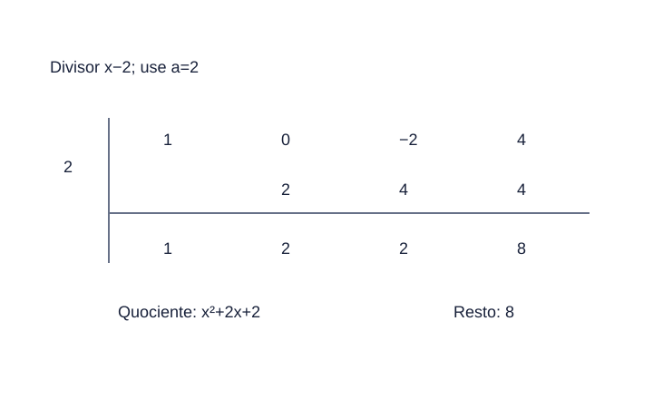

### Tela 5 · Pratique

Se D tem grau 2 e R≠0, quais graus R pode ter?

A) 0 ou 1

B) 2 ou 3

C) Apenas 2

Resposta comentada — consulte depois de tentar

**A.** O resto precisa ter grau estritamente menor que o divisor.

### Tela 6 · Exemplo guiado

**1. Organizar as informações**

Divida x³−2x+4 por x−2. Escreva x³+0x²−2x+4. O primeiro termo do quociente é x²; subtraia x³−2x² e obtenha 2x²−2x+4.

**2. Desenvolver o raciocínio**

O próximo termo é 2x; subtraia 2x²−4x e obtenha 2x+4. O próximo é 2; subtraia 2x−4 e obtenha 8.

**3. Concluir e conferir**

Logo Q=x²+2x+2 e R=8. Confira: (x−2)(x²+2x+2)+8=x³−2x+4.

### Tela 7 · Pratique

Qual é o quociente de x³−2x+4 por x−2?

A) x²−2

B) x²+2x+4

C) x²+2x+2

Resposta comentada — consulte depois de tentar

**C.** A divisão longa produz os coeficientes 1,2,2.

### Tela 8 · Pratique

Qual é o resto da divisão anterior?

A) 0

B) 8

C) 4

Resposta comentada — consulte depois de tentar

**B.** A conferência P=(x−2)(x²+2x+2)+8 confirma o resto.

### Tela 9 · O erro que vale investigar

Ao subtrair o múltiplo do divisor, troque o sinal de todos os seus termos. E a divisão não terminou se o restante ainda tem grau igual ao do divisor. Uma lacuna de coeficiente muda as colunas e pode arruinar uma conta correta até ali.

Antes de seguir: explique o erro em suas palavras e construa um exemplo que o torne visível.

### Tela 10 · Pratique

Qual coeficiente precisa ser inserido em x³−2x+4?

A) 0 para x²

B) 1 para x²

C) 0 para x

Resposta comentada — consulte depois de tentar

**A.** O termo de grau 2 está ausente, mas sua posição precisa ser mantida.

### Tela 11 · Pratique

Ao dividir 3x³ por x, qual primeiro termo aparece?

A) 3x³

B) 2x²

C) 3x²

Resposta comentada — consulte depois de tentar

**C.** Dividimos coeficientes e subtraímos expoentes.

### Tela 12 · Levar a ideia para outra situação

A identidade P=DQ+R é seu contrato de conferência. Faça a multiplicação de volta em vez de apenas olhar o formato da resposta. Essa estrutura vai tornar os teoremas do resto e de Ruffini consequências naturais, e não mais duas regras soltas.

### Tela 13 · Pratique

Qual é (2x²−2x+4)−(2x²−4x)?

A) 4x²−6x+4

B) 2x+4

C) −6x+4

Resposta comentada — consulte depois de tentar

**B.** Distribua o sinal negativo: −2x²+4x.

### Tela 14 · Pratique

Qual é o resto de (x²+1) dividido por x?

A) 1

B) x

C) 0

Resposta comentada — consulte depois de tentar

**A.** x²+1=x·x+1, com resto constante.

### Tela 15 · Mapa de bolso

Para D≠0, existem únicos Q e R tais que P=DQ+R, com R=0 ou grau R<grau D. P é dividendo, D divisor, Q quociente e R resto. Na divisão longa, ordene os termos e preencha potências ausentes com coeficiente zero antes de dividir os termos líderes.

Verificação: Logo Q=x²+2x+2 e R=8. Confira: (x−2)(x²+2x+2)+8=x³−2x+4.

Recuperação ativa: explique como aplicar o algoritmo da divisão e conferir P=DQ+R. Depois reconstrua o exemplo sem consultar a solução.

Referência curricular: IMD1001_acervo_unificado_P1_P2_P3.md, fornecido pelo estudante; recorte P1/P2/P3 de 2025.2. Texto, exemplos e questões desta versão são autorais. Os PDFs de P2/P3 não foram conferidos diretamente nesta produção. As exclusões de 2025.2 não devem ser presumidas para outras ofertas.

### Tela 16 · Pratique

É permitido dividir por polinômio nulo?

A) Sim

B) Só se o dividendo também for nulo

C) Não

Resposta comentada — consulte depois de tentar

**C.** O algoritmo exige D≠0; divisão por zero não é definida.

### Tela 17 · Pratique

Como conferir Q e R obtidos?

A) Substituir sempre x=0 e encerrar

B) Expandir DQ+R e comparar com P

C) Comparar só o grau de Q

Resposta comentada — consulte depois de tentar

**B.** A identidade inteira confirma todos os coeficientes.

---

## Passo 27 · O resto pode ser descoberto sem dividir

### Tela 1 · O resto pode ser descoberto sem dividir

Alguém oferece uma divisão longa de grau alto. A pergunta, porém, só quer o resto ao dividir por x−2. Você pode fazer a conta inteira… ou descobrir que um único valor do polinômio contém exatamente a informação pedida.

Ao concluir: Demonstrar e aplicar o teorema do resto e o teorema do fator.

Para começar: Divisão polinomial e avaliação.

### Tela 2 · Dar nome às ideias

Ao dividir P(x) por x−a, o resto é a constante P(a). Se P(a)=0, o divisor x−a é fator de P. Para um divisor linear ux−v, com u≠0, seu zero é a=v/u; o resto também é P(v/u), mas o quociente muda em relação à divisão pelo fator mônico x−v/u.

**R=P(a) ao dividir por x−a**

Leitura: O resto da divisão por x menos a é o valor do polinômio em a.

### Tela 3 · Pratique

Qual é o resto de x³−2x+4 por x−2?

A) 8

B) 4

C) −8

Resposta comentada — consulte depois de tentar

**A.** O teorema do resto fornece P(2)=8−4+4=8.

### Tela 4 · Por que isso funciona?

Como o divisor tem grau 1, o resto é constante r. Na identidade P(x)=(x−a)Q(x)+r, faça x=a. O produto zera e resta P(a)=r. Se r=0, a identidade passa a ser P=(x−a)Q, demonstrando o teorema do fator.

### Tela 5 · Pratique

Qual valor se usa para divisor x+3?

A) 3

B) 0

C) −3

Resposta comentada — consulte depois de tentar

**C.** x+3=x−(−3), cujo zero é −3.

### Tela 6 · Exemplo guiado

**1. Organizar as informações**

Ache o resto de P(x)=x³−2x+4 por x−2. O zero do divisor é 2, não −2.

**2. Desenvolver o raciocínio**

Avalie P(2)=8−4+4=8.

**3. Concluir e conferir**

O resto é 8, como na divisão longa do passo anterior. Não precisamos do quociente para responder à pergunta sobre o resto.

### Tela 7 · Pratique

Se P(5)=0, qual divisor tem resto zero?

A) x²−5

B) x−5

C) x+5

Resposta comentada — consulte depois de tentar

**B.** O teorema do fator usa o zero 5 no fator x−5.

### Tela 8 · Pratique

Qual é o resto de x²+2x+1 por x+1?

A) 0

B) 1

C) 4

Resposta comentada — consulte depois de tentar

**A.** Avaliamos P(−1)=1−2+1=0.

### Tela 9 · O erro que vale investigar

Para divisor x+3, usamos a=−3. Para divisor de grau 2, o resto pode ser linear: uma avaliação isolada não determina todos os seus coeficientes. O teorema com resto constante depende de o divisor ser linear.

Antes de seguir: explique o erro em suas palavras e construa um exemplo que o torne visível.

### Tela 10 · Pratique

Qual k faz x²+kx+2 ser divisível por x−1?

A) 3

B) −2

C) −3

Resposta comentada — consulte depois de tentar

**C.** P(1)=1+k+2=0 implica k=−3.

### Tela 11 · Pratique

Qual é o resto de x⁴+1 por x?

A) 2

B) 1

C) 0

Resposta comentada — consulte depois de tentar

**B.** O divisor zera em 0, e P(0)=1.

### Tela 12 · Levar a ideia para outra situação

Procure a pergunta antes de escolher a técnica. Para resto por fator linear, avalie; para obter quociente, divida. Para encontrar um parâmetro que torna a divisão exata, imponha P(a)=0 e resolva a equação resultante.

### Tela 13 · Pratique

Ao dividir por 2x−4, em que ponto avaliar para achar o resto?

A) 2

B) 4

C) −2

Resposta comentada — consulte depois de tentar

**A.** O zero de 2x−4 é x=2.

### Tela 14 · Pratique

O resto da divisão por x²+1 precisa ser constante?

A) Sim

B) Precisa ter grau 2

C) Não

Resposta comentada — consulte depois de tentar

**C.** O resto pode ter grau 1 ou ser constante ou nulo.

### Tela 15 · Mapa de bolso

Ao dividir P(x) por x−a, o resto é a constante P(a). Se P(a)=0, o divisor x−a é fator de P. Para um divisor linear ux−v, com u≠0, seu zero é a=v/u; o resto também é P(v/u), mas o quociente muda em relação à divisão pelo fator mônico x−v/u.

Verificação: O resto é 8, como na divisão longa do passo anterior. Não precisamos do quociente para responder à pergunta sobre o resto.

Recuperação ativa: explique como demonstrar e aplicar o teorema do resto e o teorema do fator. Depois reconstrua o exemplo sem consultar a solução.

Referência curricular: IMD1001_acervo_unificado_P1_P2_P3.md, fornecido pelo estudante; recorte P1/P2/P3 de 2025.2. Texto, exemplos e questões desta versão são autorais. Os PDFs de P2/P3 não foram conferidos diretamente nesta produção. As exclusões de 2025.2 não devem ser presumidas para outras ofertas.

### Tela 16 · Pratique

Qual etapa demonstra o teorema do resto?

A) Dividir r por a

B) Substituir x=a em P=(x−a)Q+r

C) Igualar Q a zero

Resposta comentada — consulte depois de tentar

**B.** A substituição anula o termo com divisor e deixa P(a)=r.

### Tela 17 · Pratique

Qual é o resto de 3x²−x+2 por x−1?

A) 4

B) 6

C) 0

Resposta comentada — consulte depois de tentar

**A.** P(1)=3−1+2=4.

---

## Passo 28 · Ruffini: a divisão em modo compacto

### Tela 1 · Ruffini: a divisão em modo compacto

A divisão longa do passo 26 repete uma rotina. Ruffini guarda só os coeficientes e transforma a rotina numa sequência: baixar, multiplicar, somar. É uma compactação de trabalho, sem eliminar a necessidade de saber o que cada número representa.

Ao concluir: Executar Briot–Ruffini com zeros de coeficientes e sinal correto.

Para começar: Divisão por x−a e teorema do resto.

### Tela 2 · Dar nome às ideias

Para dividir por x−a, escreva os coeficientes de P em ordem decrescente, inclusive os zeros. Baixe o primeiro; multiplique-o por a; some ao coeficiente seguinte; repita. O último resultado é o resto; os anteriores são os coeficientes do quociente, cujo grau é uma unidade menor.

**Baixar → multiplicar por a → somar**

Leitura: Ruffini repete as operações baixar, multiplicar pelo zero do divisor e somar.

### Tela 3 · Pratique

Quais coeficientes representam x³−2x+4?

A) 1,−2,4

B) 1,2,4

C) 1,0,−2,4

Resposta comentada — consulte depois de tentar

**C.** O coeficiente zero de x² mantém as posições corretas.

### Tela 4 · Por que isso funciona?

Comparar coeficientes em P=(x−a)Q+r gera exatamente a recorrência do algoritmo. Se P começa por cₙxⁿ, o primeiro coeficiente de Q é cₙ; o seguinte é cₙ₋₁+a·cₙ. Cada nova soma cancela o próximo termo da divisão longa. O último valor coincide com P(a), como exige o teorema do resto.

### Tela 5 · Pratique

Qual a é usado para divisor x+2?

A) 1/2

B) −2

C) 2

Resposta comentada — consulte depois de tentar

**B.** O divisor é x−(−2).

### Tela 6 · Exemplo guiado

**1. Organizar as informações**

Divida x³−2x+4 por x−2. Coeficientes: 1,0,−2,4; usamos a=2. Baixe 1.

**2. Desenvolver o raciocínio**

Multiplique 1·2=2 e some a 0, obtendo 2. Multiplique 2·2=4 e some a −2, obtendo 2.

**3. Concluir e conferir**

Multiplique 2·2=4 e some a 4, obtendo 8. A linha final é 1,2,2,8: Q=x²+2x+2 e R=8.

### Tela 7 · Pratique

Qual é a primeira ação de Ruffini?

A) Baixar o coeficiente líder

B) Somar todos os coeficientes

C) Trocar todos os sinais

Resposta comentada — consulte depois de tentar

**A.** O coeficiente líder inicia os coeficientes do quociente.

### Tela 8 · Pratique

Qual é a linha final para x³−2x+4 dividido por x−2?

A) 1,0,−2,4

B) 1,−2,2,0

C) 1,2,2,8

Resposta comentada — consulte depois de tentar

**C.** A recorrência baixar, multiplicar por 2 e somar produz esses valores.

### Tela 9 · O erro que vale investigar

O zero do divisor x+2 é −2. Use esse valor, não o coeficiente +2. Ruffini nesta forma dá o quociente para x−a; para 2x−4, divida o quociente obtido com a=2 por 2, conservando o resto.

Antes de seguir: explique o erro em suas palavras e construa um exemplo que o torne visível.

### Tela 10 · Pratique

Na linha 1,2,2,8, qual é o resto?

A) 2

B) 8

C) 1

Resposta comentada — consulte depois de tentar

**B.** O último resultado da sequência é o resto.

### Tela 11 · Pratique

Qual quociente corresponde à linha 1,2,2,8?

A) x²+2x+2

B) x³+2x²+2x+8

C) x²+2x+8

Resposta comentada — consulte depois de tentar

**A.** Os três primeiros valores são coeficientes do quociente de grau 2.

### Tela 12 · Levar a ideia para outra situação

Faça uma execução com a tabela e outra pela identidade P=DQ+R. O objetivo não é apenas decorar o movimento da mão: é conseguir dizer onde começa o quociente e por que o último número é diferente dos anteriores.

### Tela 13 · Pratique

Se o último resultado é zero, o que se conclui?

A) O quociente é zero

B) P é o polinômio nulo

C) O divisor divide P exatamente

Resposta comentada — consulte depois de tentar

**C.** Resto zero significa divisibilidade, não ausência de quociente.

### Tela 14 · Pratique

Qual é o quociente de x²−1 por x−1?

A) x²+1

B) x+1

C) x−1

Resposta comentada — consulte depois de tentar

**B.** Ruffini com a=1 e coeficientes 1,0,−1 dá linha 1,1,0.

### Tela 15 · Mapa de bolso

Para dividir por x−a, escreva os coeficientes de P em ordem decrescente, inclusive os zeros. Baixe o primeiro; multiplique-o por a; some ao coeficiente seguinte; repita. O último resultado é o resto; os anteriores são os coeficientes do quociente, cujo grau é uma unidade menor.

Verificação: Multiplique 2·2=4 e some a 4, obtendo 8. A linha final é 1,2,2,8: Q=x²+2x+2 e R=8.

Recuperação ativa: explique como executar Briot–Ruffini com zeros de coeficientes e sinal correto. Depois reconstrua o exemplo sem consultar a solução.

Referência curricular: IMD1001_acervo_unificado_P1_P2_P3.md, fornecido pelo estudante; recorte P1/P2/P3 de 2025.2. Texto, exemplos e questões desta versão são autorais. Os PDFs de P2/P3 não foram conferidos diretamente nesta produção. As exclusões de 2025.2 não devem ser presumidas para outras ofertas.

### Tela 16 · Pratique

Qual é o resto de x²−1 por x+1?

A) 0

B) 2

C) −2

Resposta comentada — consulte depois de tentar

**A.** P(−1)=1−1=0.

### Tela 17 · Pratique

Após usar Ruffini com a=2 para divisor 2x−4, o que fazer com o quociente encontrado?

A) Multiplicá-lo por 2

B) Dividir o resto por 2

C) Dividi-lo por 2

Resposta comentada — consulte depois de tentar

**C.** Como 2x−4=2(x−2), o quociente precisa compensar o fator 2; o resto permanece.

---

## Passo 29 · Raízes racionais: candidatos não são garantias

### Tela 1 · Raízes racionais: candidatos não são garantias

Procurar raízes tentando números ao acaso é uma investigação com orçamento infinito. O teorema das raízes racionais reduz a lista de suspeitos. Ele não promete que alguém da lista será culpado; promete que uma raiz racional não escapará dela.

Ao concluir: Gerar candidatos racionais, testar e fatorar um polinômio.

Para começar: Divisibilidade inteira, avaliação e Ruffini.

### Tela 2 · Dar nome às ideias

Para um polinômio com coeficientes inteiros, uma raiz racional p/q em forma reduzida, q>0, satisfaz: p divide o termo constante e q divide o coeficiente líder. Se o termo constante é zero, extraia primeiro a potência de x. Depois teste candidatos por P(p/q) ou Ruffini; uma lista de candidatos não é uma lista de raízes.

**p divide a₀; q divide aₙ**

Leitura: Numa raiz racional reduzida p sobre q de um polinômio inteiro, p divide o termo constante e q divide o coeficiente líder.

### Tela 3 · Pratique

Para x³−2x²−x+2, quais são os candidatos racionais?

A) Apenas 1 e 2

B) ±1 e ±2

C) Todos os inteiros

Resposta comentada — consulte depois de tentar

**B.** O coeficiente líder é 1 e os divisores do termo constante 2 são ±1,±2.

### Tela 4 · Por que isso funciona?

Substituir p/q e multiplicar por qⁿ dá aₙpⁿ+…+a₀qⁿ=0. Como p e q são coprimos, a igualdade força q a dividir aₙ e p a dividir a₀. Para polinômios mônicos inteiros, q=1: toda raiz racional é inteira. Isso não exclui raízes irracionais.

- **Objetivo:** Gerar candidatos racionais, testar e fatorar um polinômio. Fatore P=x³−2x²−x+2. Os candidatos racionais são ±1 e ±2.
- **Conferência:** Volte às condições da expressão original. Q=(x−2)(x+1). Assim P=(x−1)(x−2)(x+1), com raízes 1,2,−1. O candidato −2 foi só candidato: P(−2)=−12.

### Tela 5 · Pratique

Quanto vale P(1) no exemplo?

A) 0

B) 2

C) −2

Resposta comentada — consulte depois de tentar

**A.** Substituir 1 dá 1−2−1+2=0.

### Tela 6 · Exemplo guiado

**1. Organizar as informações**

Fatore P=x³−2x²−x+2. Os candidatos racionais são ±1 e ±2.

**2. Desenvolver o raciocínio**

P(1)=1−2−1+2=0. Ruffini por x−1 produz Q=x²−x−2.

**3. Concluir e conferir**

Q=(x−2)(x+1). Assim P=(x−1)(x−2)(x+1), com raízes 1,2,−1. O candidato −2 foi só candidato: P(−2)=−12.

### Tela 7 · Pratique

Qual quociente resulta da divisão do exemplo por x−1?

A) x²+x+2

B) x²−2x+2

C) x²−x−2

Resposta comentada — consulte depois de tentar

**C.** Ruffini com 1 dá coeficientes 1,−1,−2 e resto 0.

### Tela 8 · Pratique

Qual é a fatoração completa do exemplo?

A) (x−1)²(x+2)

B) (x−1)(x−2)(x+1)

C) (x+1)(x+2)(x−1)

Resposta comentada — consulte depois de tentar

**B.** As raízes obtidas são 1,2,−1.

### Tela 9 · O erro que vale investigar

O teorema não diz que todas as raízes são racionais. x²−2 é mônico inteiro e só tem raízes irracionais ±√2. Também não use divisores de coeficientes decimais sem antes obter uma forma com coeficientes inteiros equivalente.

Antes de seguir: explique o erro em suas palavras e construa um exemplo que o torne visível.

### Tela 10 · Pratique

Todos os candidatos racionais precisam ser raízes?

A) Não

B) Sim

C) Apenas nos polinômios mônicos

Resposta comentada — consulte depois de tentar

**A.** O teorema dá uma condição necessária, e cada candidato precisa ser testado.

### Tela 11 · Pratique

Uma raiz racional de 2x²−3x+1 pode ter qual denominador positivo reduzido?

A) Apenas 3

B) Qualquer natural

C) 1 ou 2

Resposta comentada — consulte depois de tentar

**C.** O denominador precisa dividir o coeficiente líder 2.

### Tela 12 · Levar a ideia para outra situação

Este é um treino de investigação controlada: gerar possibilidades por uma condição necessária, testar, reduzir o problema e concluir. Uma boa solução discursiva deixa clara essa diferença entre condição necessária e suficiente.

### Tela 13 · Pratique

Qual número não é candidato racional para 2x²−3x+1?

A) −1

B) 3

C) 1/2

Resposta comentada — consulte depois de tentar

**B.** Numeradores reduzidos dividem 1; 3 não divide 1.

### Tela 14 · Pratique

Se o polinômio é mônico com coeficientes inteiros, uma raiz racional precisa ser qual tipo?

A) Inteira

B) Positiva

C) Natural diferente de zero

Resposta comentada — consulte depois de tentar

**A.** O denominador reduzido divide 1, portanto vale 1.

### Tela 15 · Mapa de bolso

Para um polinômio com coeficientes inteiros, uma raiz racional p/q em forma reduzida, q>0, satisfaz: p divide o termo constante e q divide o coeficiente líder. Se o termo constante é zero, extraia primeiro a potência de x. Depois teste candidatos por P(p/q) ou Ruffini; uma lista de candidatos não é uma lista de raízes.

Verificação: Q=(x−2)(x+1). Assim P=(x−1)(x−2)(x+1), com raízes 1,2,−1. O candidato −2 foi só candidato: P(−2)=−12.

Recuperação ativa: explique como gerar candidatos racionais, testar e fatorar um polinômio. Depois reconstrua o exemplo sem consultar a solução.

Referência curricular: IMD1001_acervo_unificado_P1_P2_P3.md, fornecido pelo estudante; recorte P1/P2/P3 de 2025.2. Texto, exemplos e questões desta versão são autorais. Os PDFs de P2/P3 não foram conferidos diretamente nesta produção. As exclusões de 2025.2 não devem ser presumidas para outras ofertas.

### Tela 16 · Pratique

Qual exemplo mostra que nem toda raiz de polinômio inteiro é racional?

A) x²−1

B) x−2

C) x²−2

Resposta comentada — consulte depois de tentar

**C.** Suas raízes são ±√2, ambas irracionais.

### Tela 17 · Pratique

Se o termo constante é zero, qual é uma boa primeira ação?

A) Declarar que não há raízes

B) Extrair um fator x

C) Dividir por zero

Resposta comentada — consulte depois de tentar

**B.** x=0 já é raiz; extrair a potência de x reduz o problema sem perder esse caso.

---

## Passo 30 · Oficina de prova: remontar um polinômio

### Tela 1 · Oficina de prova: remontar um polinômio

Uma expressão chega desmontada: raízes numa anotação, coeficiente líder em outra e um valor calculado numa terceira. Você vai verificar se as pistas contam a mesma história. É uma auditoria algébrica com direito a desconfiar do próprio rascunho.

Ao concluir: Integrar operações, fatoração, resto e raízes racionais.

Para começar: Passos 21 a 29.

### Tela 2 · Dar nome às ideias

Para reconstruir um polinômio a partir de raízes e multiplicidades, use P(x)=a∏(x−rᵢ)ᵐⁱ e determine a escala a. Quando só algumas raízes são conhecidas, pode restar um fator sem raízes reais. Esta revisão é autoral e prepara habilidades associadas à P2, sem reproduzir enunciados oficiais.

**P(x)=a∏(x−rᵢ)ᵐⁱ**

Leitura: A forma fatorada combina uma escala e fatores associados às raízes e suas multiplicidades.

### Tela 3 · Pratique

Qual polinômio de grau 2 tem raízes 1 e 3 e coeficiente líder 2?

A) 2(x−1)(x−3)

B) (x−1)(x−3)

C) 2(x+1)(x+3)

Resposta comentada — consulte depois de tentar

**A.** As raízes determinam os fatores; o coeficiente líder fixa a escala 2.

### Tela 4 · Por que isso funciona?

Os fatores lineares garantem os zeros informados, mas multiplicar por uma constante não nula preserva esses zeros. Um valor adicional P(t), com t diferente das raízes, determina essa constante quando a estrutura de fatores já está fixada. A soma das multiplicidades precisa ser compatível com o grau.

- **Objetivo:** Integrar operações, fatoração, resto e raízes racionais. Ache o polinômio de grau 3, com raiz 1 dupla e raiz −2 simples, cujo coeficiente líder é 3. Escreva P=3(x−1)²(x+2).
- **Conferência:** Volte às condições da expressão original. Logo P=3x³−9x+6. Confira P(1)=0, P(−2)=0 e o termo líder 3x³. Há duas raízes distintas e três contadas com multiplicidade.

### Tela 5 · Pratique

Qual é o termo constante de 2(x−1)(x−3)?

A) −6

B) 2

C) 6

Resposta comentada — consulte depois de tentar

**C.** Avaliar em zero dá 2·(−1)·(−3)=6.

### Tela 6 · Exemplo guiado

**1. Organizar as informações**

Ache o polinômio de grau 3, com raiz 1 dupla e raiz −2 simples, cujo coeficiente líder é 3. Escreva P=3(x−1)²(x+2).

**2. Desenvolver o raciocínio**

Expanda: (x−1)²=x²−2x+1 e o produto por x+2 é x³−3x+2.

**3. Concluir e conferir**

Logo P=3x³−9x+6. Confira P(1)=0, P(−2)=0 e o termo líder 3x³. Há duas raízes distintas e três contadas com multiplicidade.

### Tela 7 · Pratique

Qual é o resto de 3x³−9x+6 por x−1?

A) 3

B) 0

C) 6

Resposta comentada — consulte depois de tentar

**B.** P(1)=3−9+6=0.

### Tela 8 · Pratique

Qual é a multiplicidade de 1 em 3(x−1)²(x+2)?

A) 2

B) 1

C) 3

Resposta comentada — consulte depois de tentar

**A.** O fator x−1 aparece elevado ao quadrado.

### Tela 9 · O erro que vale investigar

Se você sabe apenas duas raízes de um polinômio de grau 4, faltam informações. Não complete com zeros imaginados. E escrever a expressão fatorada já é uma resposta válida quando ela mostra claramente o objeto solicitado.

Antes de seguir: explique o erro em suas palavras e construa um exemplo que o torne visível.

### Tela 10 · Pratique

Qual é a expansão de 3(x−1)²(x+2)?

A) 3x³−3x+6

B) 3x³+9x+6

C) 3x³−9x+6

Resposta comentada — consulte depois de tentar

**C.** Primeiro (x−1)²(x+2)=x³−3x+2; depois multiplique por 3.

### Tela 11 · Pratique

Se P=a(x−1)(x+2) e P(0)=−8, qual é a?

A) 8

B) 4

C) −4

Resposta comentada — consulte depois de tentar

**B.** Em x=0, P(0)=−2a=−8, logo a=4.

### Tela 12 · Levar a ideia para outra situação

Faça as primeiras questões sem consultar fórmulas e depois explique cada escolha. Classifique os erros: coeficiente, sinal, hipótese ou método. Essa classificação torna a volta aos passos anteriores mais útil do que repetir tudo no piloto automático.

### Tela 13 · Pratique

Qual é o grau de (x−1)³(x+1)²?

A) 5

B) 6

C) 2

Resposta comentada — consulte depois de tentar

**A.** Os graus dos fatores se somam: 3+2.

### Tela 14 · Pratique

Qual é o resto de x³+1 por x+1?

A) 2

B) −2

C) 0

Resposta comentada — consulte depois de tentar

**C.** Avaliamos em −1: −1+1=0.

### Tela 15 · Mapa de bolso

Para reconstruir um polinômio a partir de raízes e multiplicidades, use P(x)=a∏(x−rᵢ)ᵐⁱ e determine a escala a. Quando só algumas raízes são conhecidas, pode restar um fator sem raízes reais. Esta revisão é autoral e prepara habilidades associadas à P2, sem reproduzir enunciados oficiais.

Verificação: Logo P=3x³−9x+6. Confira P(1)=0, P(−2)=0 e o termo líder 3x³. Há duas raízes distintas e três contadas com multiplicidade.

Recuperação ativa: explique como integrar operações, fatoração, resto e raízes racionais. Depois reconstrua o exemplo sem consultar a solução.

Referência curricular: IMD1001_acervo_unificado_P1_P2_P3.md, fornecido pelo estudante; recorte P1/P2/P3 de 2025.2. Texto, exemplos e questões desta versão são autorais. Os PDFs de P2/P3 não foram conferidos diretamente nesta produção. As exclusões de 2025.2 não devem ser presumidas para outras ofertas.

### Tela 16 · Pratique

Raízes 1 e 2, sem outras informações, determinam um único polinômio?

A) Apenas se forem inteiras

B) Não

C) Sim

Resposta comentada — consulte depois de tentar

**B.** Há diferentes escalas e graus possíveis; faltam condições.

### Tela 17 · Pratique

Qual justifica que uma fatoração está correta?

A) A expansão coincide em todos os coeficientes

B) Os graus são iguais

C) Uma única raiz coincide

Resposta comentada — consulte depois de tentar

**A.** Igualdade de coeficientes demonstra a identidade inteira.

---

## Passo 31 · Pares ordenados: a ordem conta

### Tela 1 · Pares ordenados: a ordem conta

Um encontro universitário oferece duas oficinas e três horários. ‘Oficina, horário’ forma uma escolha; inverter para ‘horário, oficina’ muda a leitura. Conjuntos ignoram ordem dos elementos, mas pares ordenados fazem questão dela.

Ao concluir: Construir produtos cartesianos e interpretar pares e coordenadas.

Para começar: Conjuntos e contagem finita.

### Tela 2 · Dar nome às ideias

O par (a,b) tem primeira e segunda coordenadas. (a,b)=(c,d) exatamente quando a=c e b=d. A×B={(a,b):a∈A e b∈B}. Para conjuntos finitos, |A×B|=|A|·|B|. No plano ℝ², a primeira coordenada é horizontal e a segunda vertical.

**|A×B|=|A|·|B|**

Leitura: A quantidade de pares de dois conjuntos finitos é o produto de suas cardinalidades.

### Tela 3 · Pratique

Se A={1,2} e B={a,b,c}, quantos pares há em A×B?

A) 5

B) 9

C) 6

Resposta comentada — consulte depois de tentar

**C.** Cada um dos dois elementos de A combina com três de B: 2·3=6.

### Tela 4 · Por que isso funciona?

Para cada elemento de A há |B| escolhas na segunda posição. Como há |A| escolhas na primeira, o princípio multiplicativo fornece a cardinalidade. A×B e B×A geralmente não são iguais, embora suas cardinalidades finitas coincidam. Se algum fator é vazio, não existe par possível.

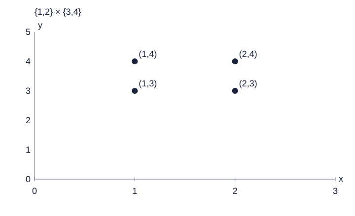

### Tela 5 · Pratique

Qual par pertence a {1,2}×{3,4}?

A) (1,2)

B) (2,3)

C) (3,2)

Resposta comentada — consulte depois de tentar

**B.** A primeira coordenada deve estar em {1,2} e a segunda em {3,4}.

### Tela 6 · Exemplo guiado

**1. Organizar as informações**

Se A={cinema,música} e B={manhã,tarde}, comece com cinema: (cinema,manhã) e (cinema,tarde).

**2. Desenvolver o raciocínio**

Depois música: (música,manhã) e (música,tarde). Reúna os quatro pares em A×B.

**3. Concluir e conferir**

No caso numérico (−2,3), ande duas unidades para a esquerda no eixo horizontal e três para cima no vertical. A ordem define o ponto.

### Tela 7 · Pratique

Os pares (1,2) e (2,1) são iguais?

A) Não

B) Sim

C) Só se estiverem no plano

Resposta comentada — consulte depois de tentar

**A.** Pares ordenados são comparados posição a posição.

### Tela 8 · Pratique

Se (x,3)=(2,y), qual é (x,y)?

A) (3,2)

B) (2,2)

C) (2,3)

Resposta comentada — consulte depois de tentar

**C.** As primeiras coordenadas dão x=2 e as segundas dão y=3.

### Tela 9 · O erro que vale investigar

O conjunto {1,2} e o par (1,2) não são a mesma estrutura. Também não troque ℝ² por ‘o quadrado de cada real’: ℝ² é o conjunto dos pares de reais. O expoente em uma notação de conjunto tem significado próprio.

Antes de seguir: explique o erro em suas palavras e construa um exemplo que o torne visível.

### Tela 10 · Pratique

Qual é A×∅?

A) {∅}

B) ∅

C) A

Resposta comentada — consulte depois de tentar

**B.** Não existe segunda coordenada disponível para formar um par.

### Tela 11 · Pratique

Em (−2,3), qual é a coordenada horizontal?

A) −2

B) 3

C) 2

Resposta comentada — consulte depois de tentar

**A.** A primeira coordenada indica a posição horizontal.

### Tela 12 · Levar a ideia para outra situação

Pares podem descrever locais e horários, participantes e respostas ou medidas e instantes. Declare o significado de cada posição antes de construir a tabela; assim a notação serve estudantes de qualquer área sem exigir conhecimento técnico adicional.

### Tela 13 · Pratique

O que é ℝ²?

A) O conjunto dos quadrados reais

B) O conjunto dos reais positivos

C) O conjunto dos pares ordenados de reais

Resposta comentada — consulte depois de tentar

**C.** O produto ℝ×ℝ é o plano cartesiano.

### Tela 14 · Pratique

Se A={1} e B={2}, A×B é igual a B×A?

A) São ambos vazios

B) Não

C) Sim

Resposta comentada — consulte depois de tentar

**B.** O primeiro contém (1,2); o segundo contém (2,1).

### Tela 15 · Mapa de bolso

O par (a,b) tem primeira e segunda coordenadas. (a,b)=(c,d) exatamente quando a=c e b=d. A×B={(a,b):a∈A e b∈B}. Para conjuntos finitos, |A×B|=|A|·|B|. No plano ℝ², a primeira coordenada é horizontal e a segunda vertical.

Verificação: No caso numérico (−2,3), ande duas unidades para a esquerda no eixo horizontal e três para cima no vertical. A ordem define o ponto.

Recuperação ativa: explique como construir produtos cartesianos e interpretar pares e coordenadas. Depois reconstrua o exemplo sem consultar a solução.

Referência curricular: IMD1001_acervo_unificado_P1_P2_P3.md, fornecido pelo estudante; recorte P1/P2/P3 de 2025.2. Texto, exemplos e questões desta versão são autorais. Os PDFs de P2/P3 não foram conferidos diretamente nesta produção. As exclusões de 2025.2 não devem ser presumidas para outras ofertas.

### Tela 16 · Pratique

Qual é {1,2}×{0}?

A) {(1,0),(2,0)}

B) {(0,1),(0,2)}

C) {0,1,2}

Resposta comentada — consulte depois de tentar

**A.** O único elemento de B é a segunda coordenada em cada par.

### Tela 17 · Pratique

Se |A|=4 e |A×B|=12, com conjuntos finitos, quanto vale |B|?

A) 8

B) 48

C) 3

Resposta comentada — consulte depois de tentar

**C.** A igualdade 4·|B|=12 fornece |B|=3.

---

## Passo 32 · Relações e a regra de uma única saída

### Tela 1 · Relações e a regra de uma única saída

Uma pessoa pode participar de várias atividades culturais: essa relação é perfeitamente legítima. Mas se a regra pedida for ‘a sala reservada para cada atividade num mesmo horário’, duas salas indicadas para uma única reserva podem violar a função definida. O contexto não decide sozinho; a regra formal decide.

Ao concluir: Distinguir relações binárias de funções com domínio declarado.

Para começar: Produto cartesiano e pares ordenados.

### Tela 2 · Dar nome às ideias

Uma relação de A em B é um subconjunto de A×B. Uma função f:A→B é uma relação em que cada elemento de A possui exatamente uma imagem em B. Pode haver elementos diferentes de A com a mesma imagem. No gráfico de uma função real, qualquer reta vertical corta o gráfico em no máximo um ponto, e cada x do domínio deve aparecer.

**Cada x∈A tem exatamente um f(x)∈B**

Leitura: Uma função associa exatamente uma saída válida a cada entrada do domínio.

### Tela 3 · Pratique

Qual condição define uma função A→B?

A) Cada entrada tem pelo menos duas saídas

B) Cada elemento de A tem exatamente uma imagem em B

C) Cada elemento de B recebe exatamente uma seta

Resposta comentada — consulte depois de tentar

**B.** A definição exige existência e unicidade de saída para as entradas do domínio.

### Tela 4 · Por que isso funciona?

‘Exatamente uma’ combina existência e unicidade: nenhuma entrada do domínio pode ficar sem saída e nenhuma pode ter duas saídas distintas. No teste vertical, dois pontos diferentes na mesma vertical teriam o mesmo x e diferentes y, violando a unicidade. O teste não determina sozinho um domínio declarado maior que a projeção do gráfico.

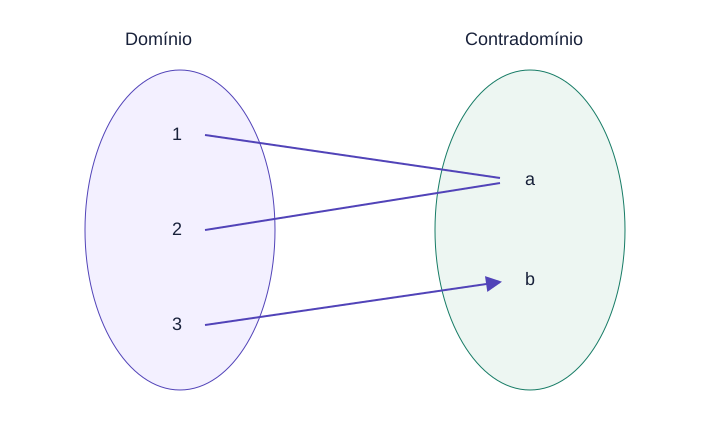

### Tela 5 · Pratique

A={1,2}, B={a,b}. R={(1,a),(2,a)} é função?

A) Sim

B) Não, porque a se repete

C) Não, porque b não é usado

Resposta comentada — consulte depois de tentar

**A.** Repetir saída e deixar elementos de B sem uso são permitidos.

### Tela 6 · Exemplo guiado

**1. Organizar as informações**

Considere A={1,2,3}, B={a,b} e R={(1,a),(2,a),(3,b)}. Cada elemento de A aparece uma vez na primeira coordenada.

**2. Desenvolver o raciocínio**

Logo R define uma função A→B. A repetição da saída a é permitida.

**3. Concluir e conferir**

Se acrescentarmos (1,b), a entrada 1 terá duas saídas distintas e a relação deixará de ser função. Se retirarmos (3,b), a entrada 3 ficará sem saída e também falhará.

### Tela 7 · Pratique

No mesmo A e B, {(1,a),(1,b),(2,a)} é função?

A) Sim

B) Só se a=b no conjunto dado

C) Não

Resposta comentada — consulte depois de tentar

**C.** A entrada 1 tem duas saídas distintas a e b.

### Tela 8 · Pratique

No mesmo A e B, {(1,a)} é função A→B?

A) Só se B tiver dois elementos

B) Não

C) Sim

Resposta comentada — consulte depois de tentar

**B.** A entrada 2 do domínio não recebeu saída.

### Tela 9 · O erro que vale investigar

Não confunda ‘uma imagem para cada entrada’ com ‘uma entrada para cada imagem’. A segunda frase se relaciona à injetividade, um conceito adicional. Uma função não precisa usar todos os elementos do contradomínio.

Antes de seguir: explique o erro em suas palavras e construa um exemplo que o torne visível.

### Tela 10 · Pratique

Uma relação de A em B é um subconjunto de qual conjunto?

A) A×B

B) A∩B

C) A∪B

Resposta comentada — consulte depois de tentar

**A.** A relação é formada por pares com primeira coordenada em A e segunda em B.

### Tela 11 · Pratique

O gráfico de x²+y²=1 representa y como função de x em [−1,1]?

A) Sim

B) Apenas por ser um círculo

C) Não

Resposta comentada — consulte depois de tentar

**C.** Para x=0 aparecem y=1 e y=−1, violando a unicidade.

### Tela 12 · Levar a ideia para outra situação

Construa duas relações com os mesmos conjuntos: uma função e uma que falha por ausência de saída. Depois construa outra que falha por duplicidade. Explicar o motivo exato é melhor do que apenas marcar ‘não é função’.

### Tela 13 · Pratique

O gráfico y=x² representa uma função ℝ→ℝ?

A) Só para x≥0

B) Sim

C) Não

Resposta comentada — consulte depois de tentar

**B.** Cada real x determina um único quadrado.

### Tela 14 · Pratique

O teste da reta vertical verifica qual parte da definição?

A) Unicidade da saída para cada x representado

B) Sobrejetividade

C) Existência de inversa

Resposta comentada — consulte depois de tentar

**A.** Duas interseções na mesma vertical representam duas saídas para a mesma entrada.

### Tela 15 · Mapa de bolso

Uma relação de A em B é um subconjunto de A×B. Uma função f:A→B é uma relação em que cada elemento de A possui exatamente uma imagem em B. Pode haver elementos diferentes de A com a mesma imagem. No gráfico de uma função real, qualquer reta vertical corta o gráfico em no máximo um ponto, e cada x do domínio deve aparecer.

Verificação: Se acrescentarmos (1,b), a entrada 1 terá duas saídas distintas e a relação deixará de ser função. Se retirarmos (3,b), a entrada 3 ficará sem saída e também falhará.

Recuperação ativa: explique como distinguir relações binárias de funções com domínio declarado. Depois reconstrua o exemplo sem consultar a solução.

Referência curricular: IMD1001_acervo_unificado_P1_P2_P3.md, fornecido pelo estudante; recorte P1/P2/P3 de 2025.2. Texto, exemplos e questões desta versão são autorais. Os PDFs de P2/P3 não foram conferidos diretamente nesta produção. As exclusões de 2025.2 não devem ser presumidas para outras ofertas.

### Tela 16 · Pratique

Uma função precisa usar todo o contradomínio?

A) Sim

B) Só quando é constante

C) Não

Resposta comentada — consulte depois de tentar

**C.** Essa exigência adicional caracteriza sobrejetividade.

### Tela 17 · Pratique

Se a mesma relação é escrita com um par repetido, surge outra saída?

A) Sempre deixa de ser função

B) Não

C) Sim

Resposta comentada — consulte depois de tentar

**B.** Relações são conjuntos; repetir o mesmo par não cria um elemento diferente.

---

## Passo 33 · Domínio, contradomínio e imagem

### Tela 1 · Domínio, contradomínio e imagem

Uma função tem uma lista de entradas permitidas, uma lista de saídas anunciadas e as saídas que ela realmente alcança. É como o programa de uma mostra e as sessões efetivamente realizadas: comparar as duas listas pode revelar informação importante.

Ao concluir: Separar conjuntos de entrada e saída e calcular domínios algébricos básicos.

Para começar: Funções, raízes e restrições de divisão.

### Tela 2 · Dar nome às ideias

Em f:A→B, A é domínio, B é contradomínio e Im(f)={f(x):x∈A}⊆B é imagem. Quando o enunciado pede domínio real máximo de uma expressão, excluímos divisões por zero e exigimos radicando não negativo em raízes de índice par. O domínio de uma função também pode ser restringido pelo próprio enunciado.

**Im(f)={f(x):x∈A}⊆B**

Leitura: A imagem reúne as saídas alcançadas e está contida no contradomínio.

### Tela 3 · Pratique

Em f:{1,2,3}→{a,b,c}, com saídas a,a,b, qual é a imagem?

A) {a,b}

B) {a,b,c}

C) {1,2,3}

Resposta comentada — consulte depois de tentar

**A.** A imagem contém apenas saídas efetivamente atingidas, sem repetições.

### Tela 4 · Por que isso funciona?

Para f:ℝ→ℝ, f(x)=x², o domínio e contradomínio são ℝ, mas a imagem é [0,∞). Cada saída é não negativa e todo y≥0 é atingido por x=√y. A dupla verificação demonstra a imagem: mostrar que nenhum valor externo aparece e que todos os valores propostos aparecem.

- **Objetivo:** Separar conjuntos de entrada e saída e calcular domínios algébricos básicos. Determine o domínio real máximo de f(x)=√(x−1)/(x−3). A raiz exige x−1≥0, isto é, x≥1.
- **Conferência:** Volte às condições da expressão original. D=[1,3)∪(3,∞). x=1 entra porque raiz zero é permitida e o denominador não zera; x=3 fica fora.

### Tela 5 · Pratique

Qual é o domínio real máximo de 1/(x−2)?

A) ℝ

B) [2,∞)

C) ℝ sem 2

Resposta comentada — consulte depois de tentar

**C.** O denominador não pode zerar.

### Tela 6 · Exemplo guiado

**1. Organizar as informações**

Determine o domínio real máximo de f(x)=√(x−1)/(x−3). A raiz exige x−1≥0, isto é, x≥1.

**2. Desenvolver o raciocínio**

O denominador exige x≠3. Combine por interseção.

**3. Concluir e conferir**

D=[1,3)∪(3,∞). x=1 entra porque raiz zero é permitida e o denominador não zera; x=3 fica fora.

### Tela 7 · Pratique

Qual é o domínio real máximo de √(x−1)?

A) ℝ sem 1

B) [1,∞)

C) (1,∞)

Resposta comentada — consulte depois de tentar

**B.** A raiz quadrada permite radicando zero, exigindo x−1≥0.

### Tela 8 · Pratique

Qual é o domínio real máximo de √(x−1)/(x−3)?

A) [1,3)∪(3,∞)

B) [1,∞)

C) (−∞,3)

Resposta comentada — consulte depois de tentar

**A.** É necessário x≥1 e x≠3 simultaneamente.

### Tela 9 · O erro que vale investigar

A expressão sozinha não informa necessariamente o contradomínio. E cancelar fatores em uma fração não autoriza recuperar entradas proibidas. Para imagem em domínio finito, avalie todas as entradas e retire saídas repetidas.

Antes de seguir: explique o erro em suas palavras e construa um exemplo que o torne visível.

### Tela 10 · Pratique

Qual é a imagem de x² com domínio ℝ?

A) ℝ

B) (0,∞)

C) [0,∞)

Resposta comentada — consulte depois de tentar

**C.** Os quadrados são não negativos e zero é atingido.

### Tela 11 · Pratique

Qual é a imagem de x² com domínio {−2,0,1}?

A) [0,4]

B) {0,1,4}

C) {−2,0,1}

Resposta comentada — consulte depois de tentar

**B.** Avaliar as três entradas dá 4,0,1; o domínio finito não preenche o intervalo.

### Tela 12 · Levar a ideia para outra situação

Ao ler um problema, procure a declaração f:A→B antes de calcular. Registre as restrições de cada parte da expressão e cruze os conjuntos. Essa disciplina será útil em composições, inversas e aplicações contextualizadas.

### Tela 13 · Pratique

Em f:A→B, qual inclusão sempre vale?

A) Im(f)⊆B

B) B⊆Im(f)

C) A⊆B

Resposta comentada — consulte depois de tentar

**A.** Todas as saídas de uma função precisam estar no contradomínio.

### Tela 14 · Pratique

Qual é o domínio original de (x²−1)/(x−1)?

A) ℝ

B) ℝ sem −1

C) ℝ sem 1

Resposta comentada — consulte depois de tentar

**C.** O fator cancelável não remove a restrição original x≠1.

### Tela 15 · Mapa de bolso

Em f:A→B, A é domínio, B é contradomínio e Im(f)={f(x):x∈A}⊆B é imagem. Quando o enunciado pede domínio real máximo de uma expressão, excluímos divisões por zero e exigimos radicando não negativo em raízes de índice par. O domínio de uma função também pode ser restringido pelo próprio enunciado.

Verificação: D=[1,3)∪(3,∞). x=1 entra porque raiz zero é permitida e o denominador não zera; x=3 fica fora.

Recuperação ativa: explique como separar conjuntos de entrada e saída e calcular domínios algébricos básicos. Depois reconstrua o exemplo sem consultar a solução.

Referência curricular: IMD1001_acervo_unificado_P1_P2_P3.md, fornecido pelo estudante; recorte P1/P2/P3 de 2025.2. Texto, exemplos e questões desta versão são autorais. Os PDFs de P2/P3 não foram conferidos diretamente nesta produção. As exclusões de 2025.2 não devem ser presumidas para outras ofertas.

### Tela 16 · Pratique

Pode haver dois contradomínios diferentes para a mesma fórmula e domínio?

A) Só se a função for vazia

B) Sim, se ambos contiverem a imagem

C) Não

Resposta comentada — consulte depois de tentar

**B.** O contradomínio faz parte da especificação e pode ser maior que a imagem.

### Tela 17 · Pratique

Qual procedimento demonstra uma imagem proposta I?

A) Mostrar que só há saídas em I e que cada valor de I é atingido

B) Testar apenas x=0

C) Declarar que I é o contradomínio

Resposta comentada — consulte depois de tentar

**A.** As duas inclusões estabelecem a igualdade entre a imagem e I.

---

## Passo 34 · Injetora, sobrejetora e bijetora

### Tela 1 · Injetora, sobrejetora e bijetora

Uma distribuição de mesas pode deixar mesas vazias e pode colocar duas pessoas na mesma mesa. São duas perguntas independentes: houve compartilhamento? Sobrou mesa? Injeção e sobrejeção separam exatamente essas duas dimensões.

Ao concluir: Classificar funções com atenção aos conjuntos declarados.

Para começar: Domínio, contradomínio e imagem.

### Tela 2 · Dar nome às ideias

f:A→B é injetora se f(x₁)=f(x₂) implica x₁=x₂; sobrejetora se Im(f)=B; bijetora se satisfaz ambas. A identidade id_A(x)=x é bijetora A→A. Uma função constante em domínio com ao menos dois elementos não é injetora, pois entradas distintas têm a mesma saída.

**Bijetora = injetora e sobrejetora**

Leitura: Uma bijeção não tem colisões e atinge todo o contradomínio.

### Tela 3 · Pratique

Uma função é injetora quando qual situação não ocorre?

A) Uma saída do contradomínio ficar sem uso

B) Uma entrada ter saída

C) Entradas distintas com a mesma saída

Resposta comentada — consulte depois de tentar

**C.** Injetividade impede colisões de imagens.

### Tela 4 · Por que isso funciona?

Em f:ℝ→ℝ, x² não é injetora porque f(1)=f(−1), nem sobrejetora porque não atinge −1. Ao mudar para f:[0,∞)→[0,∞), a mesma fórmula é bijetora: quadrados preservam a ordem nesse domínio e todo y≥0 tem preimagem √y. A classificação pertence à função completa, não só à fórmula.

### Tela 5 · Pratique

Uma função é sobrejetora quando qual igualdade vale?

A) Im(f)=A

B) Im(f)=B

C) A=B

Resposta comentada — consulte depois de tentar

**B.** Todas as saídas do contradomínio B precisam ser alcançadas.

### Tela 6 · Exemplo guiado

**1. Organizar as informações**

Considere f:{1,2,3}→{a,b,c}, com f(1)=a, f(2)=b, f(3)=c. Cada saída recebe uma única entrada.

**2. Desenvolver o raciocínio**

Não há repetição de saídas: é injetora. Todas as saídas anunciadas aparecem: é sobrejetora.

**3. Concluir e conferir**

Logo é bijetora. Se acrescentarmos d ao contradomínio sem mudar as saídas, continua injetora, mas perde a sobrejetividade.

### Tela 7 · Pratique

Uma bijeção é qual tipo de função?

A) Injetora e sobrejetora

B) Apenas constante

C) Apenas sobrejetora

Resposta comentada — consulte depois de tentar

**A.** Bijeção combina as duas propriedades.

### Tela 8 · Pratique

f:ℝ→ℝ, f(x)=x², é injetora?

A) Sim

B) Só porque é quadrática

C) Não

Resposta comentada — consulte depois de tentar

**C.** f(1)=f(−1)=1 fornece um contraexemplo.

### Tela 9 · O erro que vale investigar

Ver saídas diferentes em dois exemplos não prova injetividade no domínio inteiro. Para refutar basta um par de entradas distintas com mesma saída. Para provar, use um argumento válido para quaisquer x₁ e x₂ ou analise todas as entradas quando o domínio for finito.

Antes de seguir: explique o erro em suas palavras e construa um exemplo que o torne visível.

### Tela 10 · Pratique

f:ℝ→[0,∞), f(x)=x², é sobrejetora?

A) Apenas se x>0

B) Sim

C) Não

Resposta comentada — consulte depois de tentar

**B.** Todo y≥0 é imagem de x=√y, incluindo y=0.

### Tela 11 · Pratique

f:[0,∞)→[0,∞), f(x)=x², é bijetora?

A) Sim

B) Não

C) Só se excluir zero

Resposta comentada — consulte depois de tentar

**A.** No domínio não negativo não há colisões e todo valor do contradomínio é atingido.

### Tela 12 · Levar a ideia para outra situação

Pergunte separadamente ‘há colisões?’ e ‘há saídas sem preimagem?’. Não use o número de elementos sem olhar a regra: dois conjuntos finitos de mesmo tamanho podem receber uma função que não seja nem injetora nem sobrejetora.

### Tela 13 · Pratique

Uma constante f:ℝ→ℝ é injetora?

A) Sim

B) Depende do valor constante

C) Não

Resposta comentada — consulte depois de tentar

**C.** Qualquer par de entradas distintas tem a mesma imagem.

### Tela 14 · Pratique

A identidade id_A:A→A é qual tipo?

A) Sempre constante

B) Bijetora

C) Nunca sobrejetora

Resposta comentada — consulte depois de tentar

**B.** Cada elemento é enviado a si mesmo, sem colisões e sem omissões.

### Tela 15 · Mapa de bolso

f:A→B é injetora se f(x₁)=f(x₂) implica x₁=x₂; sobrejetora se Im(f)=B; bijetora se satisfaz ambas. A identidade id_A(x)=x é bijetora A→A. Uma função constante em domínio com ao menos dois elementos não é injetora, pois entradas distintas têm a mesma saída.

Verificação: Logo é bijetora. Se acrescentarmos d ao contradomínio sem mudar as saídas, continua injetora, mas perde a sobrejetividade.

Recuperação ativa: explique como classificar funções com atenção aos conjuntos declarados. Depois reconstrua o exemplo sem consultar a solução.

Referência curricular: IMD1001_acervo_unificado_P1_P2_P3.md, fornecido pelo estudante; recorte P1/P2/P3 de 2025.2. Texto, exemplos e questões desta versão são autorais. Os PDFs de P2/P3 não foram conferidos diretamente nesta produção. As exclusões de 2025.2 não devem ser presumidas para outras ofertas.

### Tela 16 · Pratique

Se ampliamos só o contradomínio com valores não atingidos, qual propriedade se perde?

A) Sobrejetividade

B) Injetividade

C) Ser função

Resposta comentada — consulte depois de tentar

**A.** A imagem fica menor que o novo contradomínio.

### Tela 17 · Pratique

Para refutar injetividade, o que basta?

A) Duas entradas com imagens diferentes

B) Uma saída positiva

C) Duas entradas distintas com igual imagem

Resposta comentada — consulte depois de tentar

**C.** Um único par que viole a definição é um contraexemplo suficiente.

---

## Passo 35 · Composição: a ordem muda o resultado

### Tela 1 · Composição: a ordem muda o resultado

Primeiro descontar uma quantidade fixa e depois dobrar não costuma dar o mesmo que dobrar e depois descontar. A composição registra processos em sequência. A notação lê da direita para a esquerda, o que é um bom motivo para respirar antes de calcular.

Ao concluir: Calcular composições e determinar entradas compatíveis.

Para começar: Funções e restrições de domínio.

### Tela 2 · Dar nome às ideias

(f∘g)(x)=f(g(x)): aplique g primeiro e f depois. Para a composição estar definida, x precisa pertencer ao domínio de g e g(x) ao domínio de f. Em geral f∘g≠g∘f. A composição é associativa quando todas as funções e domínios são compatíveis.

**(f∘g)(x)=f(g(x))**

Leitura: Na composição f de g, aplique g primeiro e depois f ao resultado.

### Tela 3 · Pratique

Em (f∘g)(x), qual função é aplicada primeiro?

A) As duas simultaneamente

B) g

C) f

Resposta comentada — consulte depois de tentar

**B.** A expressão é f(g(x)); o argumento interno é calculado primeiro.

### Tela 4 · Por que isso funciona?

Se f(x)=2x e g(x)=x+3, então f(g(x))=2(x+3)=2x+6, enquanto g(f(x))=2x+3. O intermediário inteiro entra como argumento da função seguinte. As restrições também são herdadas: f=1/x e g=x−2 dão f∘g=1/(x−2), exigindo x≠2.

- **Objetivo:** Calcular composições e determinar entradas compatíveis. Se f(x)=x² e g(x)=x−1 em ℝ, calcule f∘g: substitua o argumento de f por x−1.
- **Conferência:** Volte às condições da expressão original. Em x=2, os resultados são 1 e 3. Esse contraexemplo mostra que a ordem não pode ser trocada livremente.

### Tela 5 · Pratique

Se f(x)=2x e g(x)=x+3, qual é (f∘g)(x)?

A) 2x+6

B) 2x+3

C) 2x²+6x

Resposta comentada — consulte depois de tentar

**A.** Substituímos g(x) em f: 2(x+3).

### Tela 6 · Exemplo guiado

**1. Organizar as informações**

Se f(x)=x² e g(x)=x−1 em ℝ, calcule f∘g: substitua o argumento de f por x−1.

**2. Desenvolver o raciocínio**

O resultado é (x−1)². Já g∘f substitui o argumento de g por x² e produz x²−1.

**3. Concluir e conferir**

Em x=2, os resultados são 1 e 3. Esse contraexemplo mostra que a ordem não pode ser trocada livremente.

### Tela 7 · Pratique

Com as mesmas funções, qual é (g∘f)(x)?

A) 2x+6

B) x+6

C) 2x+3

Resposta comentada — consulte depois de tentar

**C.** Aplicamos g ao número 2x, somando 3.

### Tela 8 · Pratique

Se f(x)=x² e g(x)=x−1, qual é (f∘g)(2)?

A) 4

B) 1

C) 3

Resposta comentada — consulte depois de tentar

**B.** g(2)=1 e depois f(1)=1.

### Tela 9 · O erro que vale investigar

f(g(x)) não é f(x)·g(x). E uma simplificação da expressão composta pode esconder restrições intermediárias. Para f(x)=1/x e g(x)=1/x, a composição vale x somente para x≠0, pois a primeira aplicação já proíbe zero.

Antes de seguir: explique o erro em suas palavras e construa um exemplo que o torne visível.

### Tela 10 · Pratique

Com essas funções, qual é (g∘f)(2)?

A) 3

B) 1

C) 4

Resposta comentada — consulte depois de tentar

**A.** f(2)=4 e depois g(4)=3.

### Tela 11 · Pratique

Se f(x)=1/x e g(x)=x−2, qual é o domínio real da composição f∘g?

A) ℝ sem 0

B) ℝ

C) ℝ sem 2

Resposta comentada — consulte depois de tentar

**C.** Precisamos de g(x)≠0, portanto x−2≠0.

### Tela 12 · Levar a ideia para outra situação

Descreva a composição como um percurso com três posições: entrada, resultado intermediário e saída final. Esse esquema vale para conversões de medidas e etapas de processamento de dados, sem exigir nenhum software específico.

### Tela 13 · Pratique

Qual condição adicional é necessária além de x∈Dom(g)?

A) f(x)=g(x)

B) g(x)∈Dom(f)

C) x∈Im(f)

Resposta comentada — consulte depois de tentar

**B.** O resultado da primeira função precisa ser entrada válida da segunda.

### Tela 14 · Pratique

Se f(x)=1/x e g(x)=1/x, qual é o domínio original de f∘g?

A) ℝ sem 0

B) ℝ

C) Apenas {0}

Resposta comentada — consulte depois de tentar

**A.** A expressão reduzida é x, mas a primeira aplicação não aceita zero.

### Tela 15 · Mapa de bolso

(f∘g)(x)=f(g(x)): aplique g primeiro e f depois. Para a composição estar definida, x precisa pertencer ao domínio de g e g(x) ao domínio de f. Em geral f∘g≠g∘f. A composição é associativa quando todas as funções e domínios são compatíveis.

Verificação: Em x=2, os resultados são 1 e 3. Esse contraexemplo mostra que a ordem não pode ser trocada livremente.

Recuperação ativa: explique como calcular composições e determinar entradas compatíveis. Depois reconstrua o exemplo sem consultar a solução.

Referência curricular: IMD1001_acervo_unificado_P1_P2_P3.md, fornecido pelo estudante; recorte P1/P2/P3 de 2025.2. Texto, exemplos e questões desta versão são autorais. Os PDFs de P2/P3 não foram conferidos diretamente nesta produção. As exclusões de 2025.2 não devem ser presumidas para outras ofertas.

### Tela 16 · Pratique

A composição é sempre comutativa?

A) Sim

B) Só porque funções têm uma saída

C) Não

Resposta comentada — consulte depois de tentar

**C.** Os exemplos 2x+6 e 2x+3 diferem, refutando a comutatividade geral.

### Tela 17 · Pratique

Se id(x)=x, qual é f∘id no domínio de f?

A) Uma constante

B) f

C) id

Resposta comentada — consulte depois de tentar

**B.** A identidade não altera a entrada, de modo que f(id(x))=f(x).

---

## Passo 36 · Inversa: voltar pelo mesmo caminho

### Tela 1 · Inversa: voltar pelo mesmo caminho

Uma máquina multiplica por 3 e soma 2. Para desfazer o trabalho, você subtrai 2 e divide por 3. O caminho de volta inverte também a ordem das ações. Nem toda máquina permite voltar de modo único, e é aí que entra a bijeção.

Ao concluir: Construir inversas de bijeções e distinguir inversa de recíproco.

Para começar: Bijeção, composição e equações.

### Tela 2 · Dar nome às ideias

Se f:A→B é bijetora, existe f⁻¹:B→A tal que f⁻¹∘f=id_A e f∘f⁻¹=id_B. Para encontrar uma expressão, escreva y=f(x), isole x em termos de y e renomeie a variável. A inversa f⁻¹ não é o recíproco 1/f. Uma função injetora possui inversa da imagem para o domínio, ainda que não seja sobrejetora no contradomínio original.

**f⁻¹∘f=id_A; f∘f⁻¹=id_B**

Leitura: As composições de uma bijeção com sua inversa são as identidades nos conjuntos correspondentes.

### Tela 3 · Pratique

Qual é a inversa de f(x)=3x+2 em ℝ?

A) (x−2)/3

B) 1/(3x+2)

C) 3x−2

Resposta comentada — consulte depois de tentar

**A.** Isole x em y=3x+2 para obter x=(y−2)/3.

### Tela 4 · Por que isso funciona?

Sobrejetividade garante pelo menos uma preimagem para cada y∈B; injetividade garante no máximo uma. Juntas, garantem exatamente uma, permitindo a função de volta. Graficamente, trocar x e y reflete os pares em torno da reta y=x.

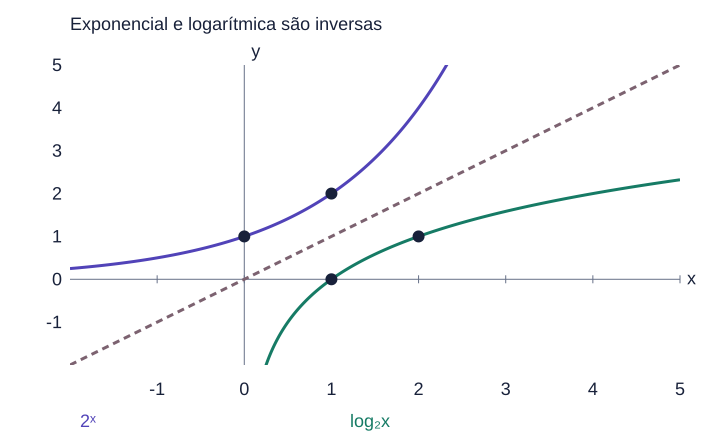

### Tela 5 · Pratique

f⁻¹ significa necessariamente 1/f?

A) Sim

B) Apenas para funções afins

C) Não

Resposta comentada — consulte depois de tentar

**C.** Inversa desfaz a função; recíproco divide 1 pelo seu valor.

### Tela 6 · Exemplo guiado

**1. Organizar as informações**

Para f:ℝ→ℝ, f(x)=3x+2, comece com y=3x+2. Subtraia 2 e divida por 3: x=(y−2)/3.

**2. Desenvolver o raciocínio**

Logo f⁻¹(x)=(x−2)/3. É diferente de 1/(3x+2).

**3. Concluir e conferir**

Confira as duas composições: ((3x+2)−2)/3=x e 3((x−2)/3)+2=x. Ambas valem para todo real.

### Tela 7 · Pratique

Qual condição garante inversa B→A para f:A→B?

A) Ser constante

B) Bijeção

C) Apenas sobrejeção

Resposta comentada — consulte depois de tentar

**B.** Precisamos de existência e unicidade de preimagem para cada elemento de B.

### Tela 8 · Pratique

f:ℝ→[0,∞), f(x)=x², tem inversa funcional nesse domínio?

A) Não

B) Sim

C) Só em zero

Resposta comentada — consulte depois de tentar

**A.** A função não é injetora: x e −x podem ter a mesma saída.

### Tela 9 · O erro que vale investigar

x² em ℝ não tem inversa funcional para sua imagem porque 1 e −1 viram a mesma saída. Restrinja o domínio a [0,∞) e a inversa será √x. Escrever ±√x como uma única saída destruiria a definição de função.

Antes de seguir: explique o erro em suas palavras e construa um exemplo que o torne visível.

### Tela 10 · Pratique

Qual é a inversa de x² quando domínio e contradomínio são [0,∞)?

A) ±√x

B) −√x

C) √x

Resposta comentada — consulte depois de tentar

**C.** A raiz principal retorna o único número não negativo com aquele quadrado.

### Tela 11 · Pratique

Qual é o gráfico da inversa em relação ao original?

A) Uma translação de uma unidade

B) Reflexo em y=x

C) Reflexo no eixo x sempre

Resposta comentada — consulte depois de tentar

**B.** Cada par (a,b) vira (b,a).

### Tela 12 · Levar a ideia para outra situação

Pense em perda de informação. Se duas entradas diferentes geram a mesma saída, o retorno não sabe qual escolher. Para conferir uma inversa, registre os conjuntos e teste as duas composições; uma manipulação de símbolos isolada não substitui essas condições.

### Tela 13 · Pratique

Se f(x)=x−5 em ℝ, qual é f⁻¹(x)?

A) x+5

B) x−5

C) 1/(x−5)

Resposta comentada — consulte depois de tentar

**A.** Somar 5 desfaz subtrair 5.

### Tela 14 · Pratique

Qual é f⁻¹(f(x)) para uma bijeção?

A) f(x)²

B) 1

C) x

Resposta comentada — consulte depois de tentar

**C.** A composição de ida e volta é a identidade no domínio.

### Tela 15 · Mapa de bolso

Se f:A→B é bijetora, existe f⁻¹:B→A tal que f⁻¹∘f=id_A e f∘f⁻¹=id_B. Para encontrar uma expressão, escreva y=f(x), isole x em termos de y e renomeie a variável. A inversa f⁻¹ não é o recíproco 1/f. Uma função injetora possui inversa da imagem para o domínio, ainda que não seja sobrejetora no contradomínio original.

Verificação: Confira as duas composições: ((3x+2)−2)/3=x e 3((x−2)/3)+2=x. Ambas valem para todo real.

Recuperação ativa: explique como construir inversas de bijeções e distinguir inversa de recíproco. Depois reconstrua o exemplo sem consultar a solução.

Referência curricular: IMD1001_acervo_unificado_P1_P2_P3.md, fornecido pelo estudante; recorte P1/P2/P3 de 2025.2. Texto, exemplos e questões desta versão são autorais. Os PDFs de P2/P3 não foram conferidos diretamente nesta produção. As exclusões de 2025.2 não devem ser presumidas para outras ofertas.

### Tela 16 · Pratique

Uma função injetora f:A→B não sobrejetora tem inversa em qual conjunto de partida?

A) Apenas A∩B

B) Im(f)

C) Todo B obrigatoriamente

Resposta comentada — consulte depois de tentar

**B.** Sobre a imagem, cada saída possui uma única preimagem.

### Tela 17 · Pratique

Se f(x)=2x−1, quanto vale f⁻¹(7)?

A) 4

B) 13

C) 3

Resposta comentada — consulte depois de tentar

**A.** Resolva 2x−1=7, obtendo x=4.

---

## Passo 37 · Função afim: duas informações desenham uma reta

### Tela 1 · Função afim: duas informações desenham uma reta

Um transporte fictício cobra 4 unidades fixas e 2 por trecho. A conta cresce sempre pelo mesmo incremento. Você consegue prever o desenho sem calcular todos os valores: uma reta está se formando, com um começo e uma inclinação.

Ao concluir: Interpretar coeficientes, monotonia, zero e equação por dois pontos.

Para começar: Funções, coordenadas e equações lineares.

### Tela 2 · Dar nome às ideias

A função afim é f(x)=ax+b. O coeficiente a é a variação de f por unidade de x; b=f(0) é o intercepto vertical. Para a>0 é estritamente crescente; a<0, estritamente decrescente; a=0, constante. Se a≠0, o zero é −b/a. Por dois pontos de abscissas distintas, a=(y₂−y₁)/(x₂−x₁) e b=y₁−ax₁.

**f(x)=ax+b; a=Δy/Δx**

Leitura: Uma função afim tem taxa constante a, obtida dividindo variação de saída por variação de entrada.

### Tela 3 · Pratique

Em f(x)=2x+4, qual é a taxa por unidade de x?

A) 4

B) 6

C) 2

Resposta comentada — consulte depois de tentar

**C.** O coeficiente de x é a inclinação da reta.

### Tela 4 · Por que isso funciona?

A diferença f(x₂)−f(x₁)=a(x₂−x₁) demonstra a monotonia e a taxa constante. Se x₂>x₁, o sinal da variação é o sinal de a. Para esboçar o gráfico, marque dois pontos e trace a reta no domínio indicado; num contexto discreto, a reta é apenas uma extensão do conjunto de pontos admissíveis.

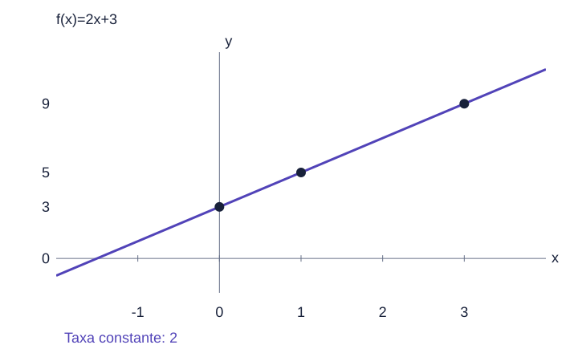

### Tela 5 · Pratique

Em f(x)=2x+4, quanto vale f(0)?

A) 0

B) 4

C) 2

Resposta comentada — consulte depois de tentar

**B.** O termo independente é o intercepto vertical.

### Tela 6 · Exemplo guiado

**1. Organizar as informações**

Uma reta passa por (1,5) e (3,9). A inclinação é (9−5)/(3−1)=4/2=2.

**2. Desenvolver o raciocínio**

Substitua o primeiro ponto em y=2x+b: 5=2+b, logo b=3.

**3. Concluir e conferir**

A função é f(x)=2x+3. Em ℝ, seu zero é −3/2 e sua imagem é ℝ; num domínio x≥0, a imagem passa a ser [3,∞).

### Tela 7 · Pratique

Qual é o zero de f(x)=2x+4?

A) −2

B) 2

C) −4

Resposta comentada — consulte depois de tentar

**A.** Resolva 2x+4=0.

### Tela 8 · Pratique

f(x)=−3x+1 é qual tipo em ℝ?

A) Estritamente crescente

B) Constante

C) Estritamente decrescente

Resposta comentada — consulte depois de tentar

**C.** A inclinação −3 é negativa.

### Tela 9 · O erro que vale investigar

O intercepto b não é a inclinação. E uma reta vertical não é o gráfico de y como função de x: a fórmula por dois pontos exige x₂≠x₁. Não estenda um modelo de custo para quantidades negativas sem justificativa do contexto.

Antes de seguir: explique o erro em suas palavras e construa um exemplo que o torne visível.

### Tela 10 · Pratique

Qual é a inclinação da reta pelos pontos (1,5) e (3,9)?

A) 1/2

B) 2

C) 4

Resposta comentada — consulte depois de tentar

**B.** A razão entre as variações é 4/2=2.

### Tela 11 · Pratique

Qual é a equação dessa reta?

A) y=2x+3

B) y=3x+2

C) y=2x+5

Resposta comentada — consulte depois de tentar

**A.** Usando (1,5), obtemos b=3.

### Tela 12 · Levar a ideia para outra situação

Taxas constantes podem modelar trajetos, escalas de pontuação e consumo idealizado. Para desenhar, registre os eixos e as unidades. Para argumentar crescimento, use a diferença entre duas imagens em vez de confiar só no desenho.

### Tela 13 · Pratique

Qual é a imagem de f(x)=2x+3 no domínio [0,∞)?

A) ℝ

B) (3,∞)

C) [3,∞)

Resposta comentada — consulte depois de tentar

**C.** A função é crescente e atinge o mínimo 3 em x=0.

### Tela 14 · Pratique

Qual função é constante?

A) f(x)=x+5

B) f(x)=5

C) f(x)=5x

Resposta comentada — consulte depois de tentar

**B.** O coeficiente angular é zero na função constante.

### Tela 15 · Mapa de bolso

A função afim é f(x)=ax+b. O coeficiente a é a variação de f por unidade de x; b=f(0) é o intercepto vertical. Para a>0 é estritamente crescente; a<0, estritamente decrescente; a=0, constante. Se a≠0, o zero é −b/a. Por dois pontos de abscissas distintas, a=(y₂−y₁)/(x₂−x₁) e b=y₁−ax₁.

Verificação: A função é f(x)=2x+3. Em ℝ, seu zero é −3/2 e sua imagem é ℝ; num domínio x≥0, a imagem passa a ser [3,∞).

Recuperação ativa: explique como interpretar coeficientes, monotonia, zero e equação por dois pontos. Depois reconstrua o exemplo sem consultar a solução.

Referência curricular: IMD1001_acervo_unificado_P1_P2_P3.md, fornecido pelo estudante; recorte P1/P2/P3 de 2025.2. Texto, exemplos e questões desta versão são autorais. Os PDFs de P2/P3 não foram conferidos diretamente nesta produção. As exclusões de 2025.2 não devem ser presumidas para outras ofertas.

### Tela 16 · Pratique

Por que dois pontos com mesma abscissa e ordenadas distintas não definem y=f(x)?

A) A mesma entrada teria duas saídas

B) A inclinação seria zero

C) Faltaria intercepto vertical

Resposta comentada — consulte depois de tentar

**A.** A reta vertical viola a unicidade da imagem.

### Tela 17 · Pratique

Se f(x)=ax+b, qual é f(x+h)−f(x)?

A) a+h

B) bh

C) ah

Resposta comentada — consulte depois de tentar

**C.** Substituir e cancelar os termos comuns deixa ah.

---

## Passo 38 · Parábolas: raízes, concavidade e esboço

### Tela 1 · Parábolas: raízes, concavidade e esboço

Uma bola num modelo idealizado sobe e desce, enquanto outra expressão mede um custo com mínimo. Ambas podem produzir parábolas, mas a abertura e o domínio contam histórias diferentes. O gráfico deve seguir a fórmula e as condições, não a nossa expectativa.

Ao concluir: Relacionar coeficientes e discriminante ao gráfico quadrático.

Para começar: Quadráticas da Unidade 1 e leitura de gráficos.

### Tela 2 · Dar nome às ideias

f(x)=ax²+bx+c, a≠0, tem gráfico parabólico: concavidade para cima se a>0, para baixo se a<0. O intercepto vertical é (0,c). Os zeros reais são as interseções com o eixo horizontal e dependem de Δ=b²−4ac. O eixo de simetria é x=−b/(2a).

**xᵥ=−b/(2a); yᵥ=f(xᵥ)**

Leitura: A entrada do vértice é menos b dividido por duas vezes a; a saída vem da substituição na função.

### Tela 3 · Pratique

Qual é a concavidade de f(x)=−2x²+3?

A) É uma reta

B) Para baixo

C) Para cima

Resposta comentada — consulte depois de tentar

**B.** O coeficiente de x² é negativo.

### Tela 4 · Por que isso funciona?

Completar quadrados dá f(x)=a(x−h)²+k, com h=−b/(2a) e k=f(h). Pontos h−t e h+t têm a mesma imagem porque (−t)²=t². Quando há duas raízes, o eixo fica no ponto médio delas. O sinal de a indica para onde os valores crescem ao se afastar do eixo.

### Tela 5 · Pratique

Qual é o intercepto vertical de x²−4x+3?

A) (0,3)

B) (3,0)

C) (0,−4)

Resposta comentada — consulte depois de tentar

**A.** Em x=0, a imagem é 3.

### Tela 6 · Exemplo guiado

**1. Organizar as informações**

Para f(x)=x²−4x+3, fatore: (x−1)(x−3). Marque (1,0) e (3,0), além de (0,3).

**2. Desenvolver o raciocínio**

O eixo está em x=2; f(2)=−1. O vértice é (2,−1) e a concavidade é para cima.

**3. Concluir e conferir**

Esboce uma curva simétrica passando pelos pontos. Entre 1 e 3, f é negativa; fora, positiva. O esboço e a tabela de sinais descrevem a mesma função.

### Tela 7 · Pratique

Quais são os zeros de x²−4x+3?

A) −1 e −3

B) 0 e 3

C) 1 e 3

Resposta comentada — consulte depois de tentar

**C.** A fatoração é (x−1)(x−3).

### Tela 8 · Pratique

Qual é o eixo de simetria dessa parábola?

A) x=−2

B) x=2

C) y=2

Resposta comentada — consulte depois de tentar

**B.** O eixo vertical passa por −b/(2a)=2.

### Tela 9 · O erro que vale investigar

Concavidade para cima não significa que f é crescente em toda a reta: ela decresce até o vértice e cresce depois. E Δ<0 não significa ausência de gráfico; significa ausência de interseções reais com o eixo x.

Antes de seguir: explique o erro em suas palavras e construa um exemplo que o torne visível.

### Tela 10 · Pratique

Qual é o vértice dessa função?

A) (2,−1)

B) (−1,2)

C) (2,1)

Resposta comentada — consulte depois de tentar

**A.** Substituir x=2 resulta 4−8+3=−1.

### Tela 11 · Pratique

Se Δ<0, qual afirmação é correta?

A) O gráfico não existe

B) A função é constante

C) O gráfico não cruza o eixo x

Resposta comentada — consulte depois de tentar

**C.** Não existem zeros reais, mas a parábola continua definida em ℝ.

### Tela 12 · Levar a ideia para outra situação

Antes de desenhar uma parábola, procure quatro informações: concavidade, intercepto, zeros e vértice. Não é necessário inventar dezenas de pontos. Descreva os pontos por coordenadas para que o entendimento não dependa apenas da imagem.

### Tela 13 · Pratique

Se Δ=0, quantos pontos distintos do gráfico estão no eixo x?

A) 0

B) 1

C) 2

Resposta comentada — consulte depois de tentar

**B.** A raiz dupla corresponde ao vértice tocando o eixo.

### Tela 14 · Pratique

Uma parábola com a>0 é crescente em toda ℝ?

A) Não

B) Sim

C) Só se c>0

Resposta comentada — consulte depois de tentar

**A.** Ela decresce antes do vértice e cresce depois.

### Tela 15 · Mapa de bolso

f(x)=ax²+bx+c, a≠0, tem gráfico parabólico: concavidade para cima se a>0, para baixo se a<0. O intercepto vertical é (0,c). Os zeros reais são as interseções com o eixo horizontal e dependem de Δ=b²−4ac. O eixo de simetria é x=−b/(2a).

Verificação: Esboce uma curva simétrica passando pelos pontos. Entre 1 e 3, f é negativa; fora, positiva. O esboço e a tabela de sinais descrevem a mesma função.

Recuperação ativa: explique como relacionar coeficientes e discriminante ao gráfico quadrático. Depois reconstrua o exemplo sem consultar a solução.

Referência curricular: IMD1001_acervo_unificado_P1_P2_P3.md, fornecido pelo estudante; recorte P1/P2/P3 de 2025.2. Texto, exemplos e questões desta versão são autorais. Os PDFs de P2/P3 não foram conferidos diretamente nesta produção. As exclusões de 2025.2 não devem ser presumidas para outras ofertas.

### Tela 16 · Pratique

Quanto vale f(1+t) em comparação com f(1−t), se o eixo é x=1?

A) São sempre opostos

B) Um deles é sempre zero

C) São iguais

Resposta comentada — consulte depois de tentar

**C.** A simetria da forma canônica garante igualdade para deslocamentos opostos.

### Tela 17 · Pratique

Qual é o sinal de (x−1)(x−3) para 1<x<3?

A) Zero

B) Negativo

C) Positivo

Resposta comentada — consulte depois de tentar

**B.** O primeiro fator é positivo e o segundo negativo.

---

## Passo 39 · Vértice: encontrar o melhor valor possível

### Tela 1 · Vértice: encontrar o melhor valor possível

Um projeto fictício usa R(x)=−x²+6x+7 para comparar resultados. A equipe quer o maior valor, não uma longa tabela de tentativas. O vértice oferece uma resposta exata e ainda explica por que nenhuma outra escolha supera aquela.

Ao concluir: Obter forma canônica, extremos e imagem inclusive com domínio restrito.

Para começar: Parábolas e completar quadrados.

### Tela 2 · Dar nome às ideias

Na forma f(x)=a(x−h)²+k, o vértice é (h,k). Como (x−h)²≥0, k é mínimo se a>0 e máximo se a<0, quando h pertence ao domínio. Em ℝ, a imagem é [k,∞) para a>0 e (−∞,k] para a<0. Em domínio restrito, verifique o vértice e as extremidades permitidas.

**f(x)=a(x−h)²+k**

Leitura: Na forma canônica, o vértice tem coordenadas h e k.

### Tela 3 · Pratique

Qual é a forma canônica de x²−4x+1?

A) (x−2)²−3

B) (x−4)²+1

C) (x+2)²−3

Resposta comentada — consulte depois de tentar

**A.** Expandir (x−2)²−3 dá x²−4x+1.

### Tela 4 · Por que isso funciona?

Para f(x)=ax²+bx+c, h=−b/(2a) e k=−Δ/(4a). Completar quadrados demonstra ambos. Em um intervalo fechado, se o vértice fica fora dele, a função é monótona naquele intervalo e o extremo ocorre em uma extremidade. A imagem pode mudar mesmo sem alterar a fórmula.

![R(x)=−(x−3)²+16 abre para baixo e tem máximo 16 em x=3. No domínio restrito [0,2], cresce de 7 até 15.](../../public/materiais/elementar/maximo.svg)

### Tela 5 · Pratique

Qual é o mínimo de x²−4x+1 em ℝ?

A) 2

B) 1

C) −3

Resposta comentada — consulte depois de tentar

**C.** O quadrado é mínimo em x=2 e vale zero ali.

### Tela 6 · Exemplo guiado

**1. Organizar as informações**

Complete quadrados em R(x)=−x²+6x+7: R(x)=−(x²−6x+9)+16=−(x−3)²+16.

**2. Desenvolver o raciocínio**

Como o quadrado é não negativo, R(x)≤16, com igualdade em x=3. No domínio ℝ, a imagem é (−∞,16].

**3. Concluir e conferir**

Se o domínio for [0,2], x=3 não é permitido. R cresce ali, com R(0)=7 e R(2)=15; a imagem restrita é [7,15].

### Tela 7 · Pratique

Qual é a imagem dessa função em ℝ?

A) ℝ

B) [−3,∞)

C) (−∞,−3]

Resposta comentada — consulte depois de tentar

**B.** A concavidade é para cima e o mínimo −3 é atingido.

### Tela 8 · Pratique

Qual é o vértice de −(x−3)²+16?

A) (3,16)

B) (−3,16)

C) (16,3)

Resposta comentada — consulte depois de tentar

**A.** O quadrado zera na entrada 3, cuja imagem é 16.

### Tela 9 · O erro que vale investigar

As coordenadas do vértice são (entrada,saída), não o contrário. E o valor máximo k da fórmula canônica só é atingido se h for uma entrada permitida. Em domínios abertos, um limite de valores pode não ser alcançado.

Antes de seguir: explique o erro em suas palavras e construa um exemplo que o torne visível.

### Tela 10 · Pratique

Qual é o máximo de −x²+6x+7 em ℝ?

A) 7

B) 3

C) 16

Resposta comentada — consulte depois de tentar

**C.** A forma canônica é −(x−3)²+16.

### Tela 11 · Pratique

Qual é a imagem de −x²+6x+7 em [0,2]?

A) [7,16]

B) [7,15]

C) (−∞,16]

Resposta comentada — consulte depois de tentar

**B.** A função cresce no intervalo e vai de R(0)=7 a R(2)=15.

### Tela 12 · Levar a ideia para outra situação

Modelos quadráticos aparecem em geometria, planejamento e análise de resultados hipotéticos. Declare o domínio do modelo antes de otimizar. Se x é uma contagem inteira, compare os inteiros próximos do vértice em vez de aceitar uma quantidade fracionária automaticamente.

### Tela 13 · Pratique

Qual é a imagem de x² em (0,1)?

A) (0,1)

B) [0,1]

C) [0,∞)

Resposta comentada — consulte depois de tentar

**A.** Nenhum extremo é atingido e os quadrados preenchem o intervalo aberto.

### Tela 14 · Pratique

Qual é o mínimo de (x−5)² em [0,2]?

A) 0

B) 25

C) 9

Resposta comentada — consulte depois de tentar

**C.** O vértice 5 está fora; o ponto permitido mais próximo é 2, com valor 9.

### Tela 15 · Mapa de bolso

Na forma f(x)=a(x−h)²+k, o vértice é (h,k). Como (x−h)²≥0, k é mínimo se a>0 e máximo se a<0, quando h pertence ao domínio. Em ℝ, a imagem é [k,∞) para a>0 e (−∞,k] para a<0. Em domínio restrito, verifique o vértice e as extremidades permitidas.

Verificação: Se o domínio for [0,2], x=3 não é permitido. R cresce ali, com R(0)=7 e R(2)=15; a imagem restrita é [7,15].

Recuperação ativa: explique como obter forma canônica, extremos e imagem inclusive com domínio restrito. Depois reconstrua o exemplo sem consultar a solução.

Referência curricular: IMD1001_acervo_unificado_P1_P2_P3.md, fornecido pelo estudante; recorte P1/P2/P3 de 2025.2. Texto, exemplos e questões desta versão são autorais. Os PDFs de P2/P3 não foram conferidos diretamente nesta produção. As exclusões de 2025.2 não devem ser presumidas para outras ofertas.

### Tela 16 · Pratique

Para contagem inteira x, se o vértice está em 2,4, o que é adequado?

A) Arredondar sem avaliar a função

B) Comparar os inteiros admissíveis próximos

C) Declarar 2,4 pessoas

Resposta comentada — consulte depois de tentar

**B.** Os valores em 2 e 3 precisam ser comparados, respeitando outras restrições.

### Tela 17 · Pratique

Qual fórmula dá a abscissa do vértice?

A) −b/(2a)

B) −Δ/(4a)

C) c/a

Resposta comentada — consulte depois de tentar

**A.** −b/(2a) fornece a entrada; −Δ/(4a) fornece a imagem correspondente.

---

## Passo 40 · Missão P2: da regra ao gráfico

### Tela 1 · Missão P2: da regra ao gráfico

Você recebe um conjunto de pares, uma expressão fatorada e um gráfico descrito por coordenadas. A missão é mostrar que sabe mudar de representação sem perder informações. Uma função tem várias maneiras de se apresentar; a matemática não deve mudar de personalidade a cada uma.

Ao concluir: Integrar polinômios, classificações, composições e funções afim e quadrática.

Para começar: Passos 21 a 39.

### Tela 2 · Dar nome às ideias

Nesta revisão autoral, conecte entradas e saídas, raízes e fatores, forma canônica e imagem. Para classificar uma função, declare domínio e contradomínio; para inverter, comprove bijeção; para dividir um polinômio, confira P=DQ+R. As tarefas retomam habilidades mapeadas no acervo para a P2 2025.2.

**Domínio + regra + contradomínio**

Leitura: A função é especificada pelos conjuntos e pela regra de associação.

### Tela 3 · Pratique

Quanto vale |{1,2}×{a,b,c}|?

A) 5

B) 3

C) 6

Resposta comentada — consulte depois de tentar

**C.** Multiplicamos as duas cardinalidades: 2·3=6.

### Tela 4 · Por que isso funciona?

A precisão vem de combinar representações que se conferem mutuamente. O zero de um polinômio aparece como fator linear, ponto no eixo x e resto nulo de uma divisão. A imagem de uma quadrática aparece como desigualdade na forma canônica e como alcance vertical de seu gráfico.

- **Objetivo:** Integrar polinômios, classificações, composições e funções afim e quadrática. Considere f:[1,∞)→[0,∞), f(x)=(x−1)². A forma canônica dá vértice (1,0).
- **Conferência:** Volte às condições da expressão original. De y=(x−1)² e x−1≥0, obtemos x=1+√y. Logo f⁻¹(x)=1+√x, com domínio [0,∞) e imagem [1,∞).

### Tela 5 · Pratique

R={(1,a),(2,a)}, com domínio {1,2} e contradomínio {a,b}, é qual tipo?

A) Não é função

B) Função não injetora nem sobrejetora

C) Bijeção

Resposta comentada — consulte depois de tentar

**B.** Cada entrada tem uma saída, mas há colisão em a e b não é atingido.

### Tela 6 · Exemplo guiado

**1. Organizar as informações**

Considere f:[1,∞)→[0,∞), f(x)=(x−1)². A forma canônica dá vértice (1,0).

**2. Desenvolver o raciocínio**

No domínio x≥1, a função é estritamente crescente e atinge todo y≥0; portanto é bijetora.

**3. Concluir e conferir**

De y=(x−1)² e x−1≥0, obtemos x=1+√y. Logo f⁻¹(x)=1+√x, com domínio [0,∞) e imagem [1,∞).

### Tela 7 · Pratique

Qual é o domínio de 1/(x²−4)?

A) ℝ sem −2 e 2

B) ℝ sem 4

C) [−2,2]

Resposta comentada — consulte depois de tentar

**A.** O denominador (x−2)(x+2) zera em ±2.

### Tela 8 · Pratique

Se f(x)=x+1 e g(x)=2x, qual é f(g(3))?

A) 8

B) 9

C) 7

Resposta comentada — consulte depois de tentar

**C.** Primeiro g(3)=6; depois f(6)=7.

### Tela 9 · O erro que vale investigar

No exemplo, usar 1−√x como ramo da inversa devolveria valores fora do domínio [1,∞), exceto em zero. Os conjuntos não são detalhes de cabeçalho: eles escolhem qual volta é válida.

Antes de seguir: explique o erro em suas palavras e construa um exemplo que o torne visível.

### Tela 10 · Pratique

Qual é a inversa de f(x)=2x+3 em ℝ?

A) 1/(2x+3)

B) (x−3)/2

C) (x+3)/2

Resposta comentada — consulte depois de tentar

**B.** Isolar x em y=2x+3 dá x=(y−3)/2.

### Tela 11 · Pratique

Qual é o resto de x³−4x por x−2?

A) 0

B) 2

C) −2

Resposta comentada — consulte depois de tentar

**A.** Avaliar em 2 dá 8−8=0.

### Tela 12 · Levar a ideia para outra situação

Depois de responder, escreva uma solução discursiva para o exemplo e outra para uma fatoração cúbica. Cada uma deve conter hipóteses, desenvolvimento e conferência. Se uma conta acertada foi baseada numa regra falsa, trate-a como lacuna a revisar.

### Tela 13 · Pratique

Qual é a forma fatorada de x³−4x?

A) (x−4)(x+4)

B) x(x−4)²

C) x(x−2)(x+2)

Resposta comentada — consulte depois de tentar

**C.** Extraímos x e depois usamos diferença de quadrados.

### Tela 14 · Pratique

Qual é a inclinação da reta por (0,1) e (2,5)?

A) 1/2

B) 2

C) 4

Resposta comentada — consulte depois de tentar

**B.** A variação vertical 4 dividida pela horizontal 2 dá 2.

### Tela 15 · Mapa de bolso

Nesta revisão autoral, conecte entradas e saídas, raízes e fatores, forma canônica e imagem. Para classificar uma função, declare domínio e contradomínio; para inverter, comprove bijeção; para dividir um polinômio, confira P=DQ+R. As tarefas retomam habilidades mapeadas no acervo para a P2 2025.2.

Verificação: De y=(x−1)² e x−1≥0, obtemos x=1+√y. Logo f⁻¹(x)=1+√x, com domínio [0,∞) e imagem [1,∞).

Recuperação ativa: explique como integrar polinômios, classificações, composições e funções afim e quadrática. Depois reconstrua o exemplo sem consultar a solução.

Referência curricular: IMD1001_acervo_unificado_P1_P2_P3.md, fornecido pelo estudante; recorte P1/P2/P3 de 2025.2. Texto, exemplos e questões desta versão são autorais. Os PDFs de P2/P3 não foram conferidos diretamente nesta produção. As exclusões de 2025.2 não devem ser presumidas para outras ofertas.

### Tela 16 · Pratique

Qual é a imagem de (x−1)²−2 em ℝ?

A) [−2,∞)

B) [1,∞)

C) ℝ

Resposta comentada — consulte depois de tentar

**A.** O mínimo é −2, atingido no vértice de abscissa 1.

### Tela 17 · Pratique

Qual é a inversa de (x−1)² com domínio [1,∞) e contradomínio [0,∞)?

A) 1−√x

B) ±√x

C) 1+√x

Resposta comentada — consulte depois de tentar

**C.** O domínio exige o ramo com x−1 não negativo, dando 1+√x.

---

## Passo 41 · Simetria: o espelho precisa de domínio

### Tela 1 · Simetria: o espelho precisa de domínio

Um gráfico parece um espelho. Mas será que é simétrico no eixo vertical ou em torno da origem? E se alguém recortar metade do domínio? A aparência dá pistas; substituir −x e conferir as entradas dá a decisão.

Ao concluir: Distinguir funções pares, ímpares e sem essas simetrias.

Para começar: Funções, polinômios e substituição com sinais.

### Tela 2 · Dar nome às ideias

Com domínio simétrico em relação a zero, f é par se f(−x)=f(x), e ímpar se f(−x)=−f(x), para todo x do domínio. Pares têm simetria no eixo y; ímpares, na origem. Uma função pode ser nenhuma das duas. A função nula em domínio simétrico é simultaneamente par e ímpar.

**Par: f(−x)=f(x); ímpar: f(−x)=−f(x)**

Leitura: Funções pares preservam a saída ao trocar o sinal da entrada; ímpares trocam também o sinal da saída.

### Tela 3 · Pratique

f(x)=x⁴−3x²+2 em ℝ é qual tipo?

A) Nenhuma

B) Par

C) Ímpar

Resposta comentada — consulte depois de tentar

**B.** Todos os expoentes são pares, incluindo o expoente zero da constante.

### Tela 4 · Por que isso funciona?

Trocar x por −x reflete horizontalmente os pontos. Para função par, a saída permanece; para ímpar, também troca de sinal. Um polinômio real em ℝ é par quando só tem potências pares com coeficientes não nulos; é ímpar quando só tem potências ímpares, sem constante não nula. Isso decorre de (−x)ⁿ=(−1)ⁿxⁿ.

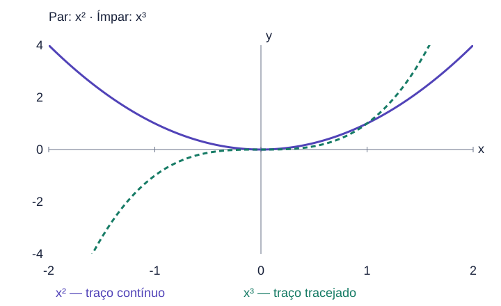

### Tela 5 · Pratique

g(x)=x³+x em ℝ é qual tipo?

A) Ímpar

B) Par

C) Nenhuma

Resposta comentada — consulte depois de tentar

**A.** g(−x)=−x³−x=−g(x).

### Tela 6 · Exemplo guiado

**1. Organizar as informações**

Para f(x)=x⁴−3x²+2 em ℝ, calcule f(−x)=(−x)⁴−3(−x)²+2.

**2. Desenvolver o raciocínio**

Como os expoentes são pares, o resultado é x⁴−3x²+2=f(x). A função é par.

**3. Concluir e conferir**

Já g(x)=x³+x é ímpar: g(−x)=−x³−x=−g(x). Em h(x)=x²+x, a substituição não dá nem h(x) nem −h(x) para todo x.

### Tela 7 · Pratique

h(x)=x²+x em ℝ é qual tipo?

A) Par

B) Ímpar

C) Nem par nem ímpar

Resposta comentada — consulte depois de tentar

**C.** h(−x)=x²−x não é identicamente igual a h(x) nem a −h(x).

### Tela 8 · Pratique

Qual igualdade define função par?

A) f(x)=x

B) f(−x)=f(x)

C) f(−x)=−f(x)

Resposta comentada — consulte depois de tentar

**B.** A reflexão da entrada preserva a saída.

### Tela 9 · O erro que vale investigar

O expoente de um único termo não classifica toda a expressão. Além disso, f(x)=x² com domínio [0,∞) não é par pela definição adotada: o domínio não é simétrico. O desenho recortado perdeu o espelho.

Antes de seguir: explique o erro em suas palavras e construa um exemplo que o torne visível.

### Tela 10 · Pratique

Qual simetria corresponde à função ímpar?

A) Em relação à origem

B) Apenas em relação ao eixo y

C) Apenas em relação ao eixo x

Resposta comentada — consulte depois de tentar

**A.** O ponto (x,y) acompanha (−x,−y).

### Tela 11 · Pratique

Qual condição sobre o domínio vem antes da classificação?

A) Conter apenas positivos

B) Ser finito

C) Ser simétrico em relação a zero

Resposta comentada — consulte depois de tentar

**C.** Se x está no domínio, −x também precisa estar.

### Tela 12 · Levar a ideia para outra situação

Descreva simetria por uma igualdade, não só por um adjetivo. Testes em alguns pontos podem refutar paridade, mas não a provam em domínio infinito. Use a transformação simbólica para cobrir todas as entradas.

### Tela 13 · Pratique

f(x)=x² em [0,∞) é par nesta trilha?

A) Só por ter expoente par

B) Não

C) Sim

Resposta comentada — consulte depois de tentar

**B.** O domínio não é simétrico em relação a zero.

### Tela 14 · Pratique

Como classificar f(x)=0 em ℝ?

A) Par e ímpar

B) Só par

C) Só ímpar

Resposta comentada — consulte depois de tentar

**A.** Zero satisfaz simultaneamente f(−x)=f(x)=−f(x).

### Tela 15 · Mapa de bolso

Com domínio simétrico em relação a zero, f é par se f(−x)=f(x), e ímpar se f(−x)=−f(x), para todo x do domínio. Pares têm simetria no eixo y; ímpares, na origem. Uma função pode ser nenhuma das duas. A função nula em domínio simétrico é simultaneamente par e ímpar.

Verificação: Já g(x)=x³+x é ímpar: g(−x)=−x³−x=−g(x). Em h(x)=x²+x, a substituição não dá nem h(x) nem −h(x) para todo x.

Recuperação ativa: explique como distinguir funções pares, ímpares e sem essas simetrias. Depois reconstrua o exemplo sem consultar a solução.

Referência curricular: IMD1001_acervo_unificado_P1_P2_P3.md, fornecido pelo estudante; recorte P1/P2/P3 de 2025.2. Texto, exemplos e questões desta versão são autorais. Os PDFs de P2/P3 não foram conferidos diretamente nesta produção. As exclusões de 2025.2 não devem ser presumidas para outras ofertas.

### Tela 16 · Pratique

Se f é ímpar e 0 está no domínio, quanto vale f(0)?

A) 1

B) Não é possível concluir

C) 0

Resposta comentada — consulte depois de tentar

**C.** f(0)=−f(0) implica 2f(0)=0.

### Tela 17 · Pratique

Uma função constante não nula em ℝ é qual tipo?

A) Nem par nem ímpar

B) Par e não ímpar

C) Ímpar e não par

Resposta comentada — consulte depois de tentar

**B.** A saída não muda com x, mas não é igual ao próprio oposto.

---

## Passo 42 · Funções por partes: escolha o ramo antes da conta

### Tela 1 · Funções por partes: escolha o ramo antes da conta

Uma sala tem uma regra de acesso antes do meio-dia e outra depois. Você não aplica as duas ao mesmo instante: primeiro localiza o horário, depois segue a regra. Funções por partes pedem exatamente essa ordem.

Ao concluir: Avaliar e esboçar funções definidas por intervalos.

Para começar: Intervalos e gráficos afins e quadráticos.

### Tela 2 · Dar nome às ideias

Uma função por partes associa expressões diferentes a regiões do domínio. Os intervalos indicam qual expressão usar. Cada entrada deve ter uma única saída; sobreposição de regras com resultados diferentes viola a definição. No gráfico, ponto fechado indica extremo incluído e ponto aberto, excluído. Lacunas de domínio devem ser explicitadas.

**Entrada → intervalo → regra**

Leitura: Numa função por partes, localize a entrada no intervalo antes de escolher a expressão.

### Tela 3 · Pratique

Se f(x)=x+1 para x<0 e x² para x≥0, quanto vale f(−2)?

A) −1

B) 4

C) 3

Resposta comentada — consulte depois de tentar

**A.** A entrada −2 pertence ao primeiro ramo, dando −2+1=−1.

### Tela 4 · Por que isso funciona?

Considere f(x)=x+1 para x<0 e f(x)=x² para x≥0. O conjunto dos dois intervalos cobre ℝ e eles não se sobrepõem. Para x=0 só a segunda regra vale: f(0)=0. O primeiro ramo se aproxima do ponto (0,1), que é aberto; isso não o transforma em valor da função no zero.

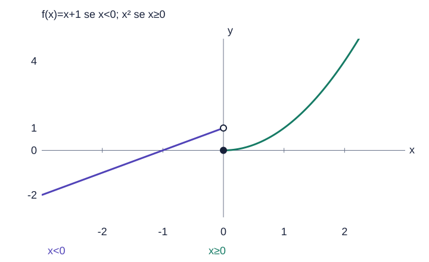

### Tela 5 · Pratique

Na mesma função, quanto vale f(0)?

A) 1

B) Não definido

C) 0

Resposta comentada — consulte depois de tentar

**C.** O símbolo ≥ inclui zero no segundo ramo.

### Tela 6 · Exemplo guiado

**1. Organizar as informações**

Avalie a função do conceito em x=−2,0,2. Para −2, use o ramo x<0: f(−2)=−2+1=−1.

**2. Desenvolver o raciocínio**

Para 0, use x≥0: f(0)=0²=0. Para 2, o mesmo ramo dá f(2)=4.

**3. Concluir e conferir**

No esboço, trace y=x+1 só à esquerda de zero, com (0,1) aberto; trace a metade de y=x² com x≥0, incluindo (0,0).

### Tela 7 · Pratique

Quanto vale f(2)?

A) −1

B) 4

C) 3

Resposta comentada — consulte depois de tentar

**B.** A entrada 2 usa a expressão x².

### Tela 8 · Pratique

Qual ponto fica aberto no ramo x+1 do exemplo?

A) (0,1)

B) (0,0)

C) (−1,0)

Resposta comentada — consulte depois de tentar

**A.** A fórmula x+1 vale apenas para x<0; seu extremo em x=0 não entra.

### Tela 9 · O erro que vale investigar

Não escolha o ramo pelo sinal do resultado. Escolha pelo valor da entrada. E um círculo aberto no gráfico de um ramo não significa necessariamente que a entrada está fora do domínio: outro ramo pode defini-la em outra altura.

Antes de seguir: explique o erro em suas palavras e construa um exemplo que o torne visível.

### Tela 10 · Pratique

Qual ponto fica fechado em x=0?

A) (0,1)

B) Nenhum

C) (0,0)

Resposta comentada — consulte depois de tentar

**C.** O segundo ramo inclui zero e produz a saída zero.

### Tela 11 · Pratique

O que determina a escolha do ramo?

A) O ramo com menor expressão

B) O intervalo da entrada

C) O sinal da saída desejada

Resposta comentada — consulte depois de tentar

**B.** Primeiro localizamos x nas condições do domínio.

### Tela 12 · Levar a ideia para outra situação

Funções por partes podem modelar faixas de acesso, tabelas de uso de equipamentos e regras administrativas fictícias. Escreva o domínio como união dos intervalos e confira se há sobreposição ou lacuna antes de calcular valores.

### Tela 13 · Pratique

Regras f(x)=0 para x≤1 e f(x)=2 para x≥1 definem uma função em ℝ?

A) Não

B) Sim

C) Só se os ramos forem desenhados separados

Resposta comentada — consulte depois de tentar

**A.** Em x=1 as regras dão duas saídas diferentes.

### Tela 14 · Pratique

Regras só para x<0 e x>0 cobrem qual domínio?

A) ℝ

B) Apenas {0}

C) ℝ sem 0

Resposta comentada — consulte depois de tentar

**C.** Nenhum ramo inclui zero.

### Tela 15 · Mapa de bolso

Uma função por partes associa expressões diferentes a regiões do domínio. Os intervalos indicam qual expressão usar. Cada entrada deve ter uma única saída; sobreposição de regras com resultados diferentes viola a definição. No gráfico, ponto fechado indica extremo incluído e ponto aberto, excluído. Lacunas de domínio devem ser explicitadas.

Verificação: No esboço, trace y=x+1 só à esquerda de zero, com (0,1) aberto; trace a metade de y=x² com x≥0, incluindo (0,0).

Recuperação ativa: explique como avaliar e esboçar funções definidas por intervalos. Depois reconstrua o exemplo sem consultar a solução.

Referência curricular: IMD1001_acervo_unificado_P1_P2_P3.md, fornecido pelo estudante; recorte P1/P2/P3 de 2025.2. Texto, exemplos e questões desta versão são autorais. Os PDFs de P2/P3 não foram conferidos diretamente nesta produção. As exclusões de 2025.2 não devem ser presumidas para outras ofertas.

### Tela 16 · Pratique

Se dois ramos se sobrepõem mas dão sempre o mesmo valor na sobreposição, há conflito de unicidade?

A) Apenas se houver infinitos pontos

B) Não

C) Sim

Resposta comentada — consulte depois de tentar

**B.** A mesma entrada continua com uma única saída, embora a escrita seja redundante.

### Tela 17 · Pratique

Um círculo aberto em (1,3) impede f(1)=2 por outro ramo?

A) Não

B) Sim

C) Impede qualquer saída em x=1

Resposta comentada — consulte depois de tentar

**A.** O círculo exclui aquele ponto específico, não toda a vertical.

---

## Passo 43 · Periodicidade: repetir exige uma regra

### Tela 1 · Periodicidade: repetir exige uma regra

Uma rotina de laboratório se repete em ciclos. Ver dois resultados iguais não prova que o ciclo inteiro voltou: pode ter sido coincidência. A periodicidade exige que toda a função aceite o mesmo deslocamento, não apenas um par de pontos.

Ao concluir: Reconhecer períodos, período fundamental e limites da observação.

Para começar: Funções e leitura de padrões.

### Tela 2 · Dar nome às ideias

T>0 é um período de f se o domínio é preservado por deslocamentos ±T e f(x+T)=f(x) para todo x do domínio. Quando existe o menor período positivo, ele é o período fundamental. Se T é período, múltiplos inteiros positivos de T também são. Funções constantes admitem qualquer T>0 e não têm menor período positivo.

**f(x+T)=f(x), T>0**

Leitura: Um período positivo preserva todas as saídas após o mesmo deslocamento.

### Tela 3 · Pratique

Se T é período, qual igualdade vale para todas as entradas?

A) f(T)=0

B) f(x+T)=T·f(x)

C) f(x+T)=f(x)

Resposta comentada — consulte depois de tentar

**C.** A função repete a saída após o deslocamento T.

### Tela 4 · Por que isso funciona?

A igualdade pode ser aplicada sucessivamente: f(x+2T)=f((x+T)+T)=f(x+T)=f(x). Isso demonstra os múltiplos positivos. Em uma função constante, qualquer deslocamento mantém a saída; sempre podemos escolher T/2, impedindo um menor período positivo. Uma amostra finita não estabelece a regra em toda a reta.

- **Objetivo:** Reconhecer períodos, período fundamental e limites da observação. Uma função em ℝ repete o bloco: valor 0 em [2k,2k+1) e valor 1 em [2k+1,2k+2), para todo inteiro k.
- **Conferência:** Volte às condições da expressão original. O período fundamental é 2: um deslocamento entre 0 e 1 muda a saída perto de 1; entre 1 e 2, muda a saída em x=0. Todo T em (0,2) falha.

### Tela 5 · Pratique

Se 3 é período, qual também é período?

A) 3/2

B) 6

C) 1

Resposta comentada — consulte depois de tentar

**B.** Aplicar duas vezes o deslocamento de 3 preserva a saída.

### Tela 6 · Exemplo guiado

**1. Organizar as informações**

Uma função em ℝ repete o bloco: valor 0 em [2k,2k+1) e valor 1 em [2k+1,2k+2), para todo inteiro k.

**2. Desenvolver o raciocínio**

Somar 2 mantém a posição dentro de blocos do mesmo tipo, portanto f(x+2)=f(x). Somar 1 troca os valores 0 e 1, então 1 não é período.

**3. Concluir e conferir**

O período fundamental é 2: um deslocamento entre 0 e 1 muda a saída perto de 1; entre 1 e 2, muda a saída em x=0. Todo T em (0,2) falha.

### Tela 7 · Pratique

Uma função constante em ℝ tem menor período positivo?

A) Não

B) Sim, 1

C) Sim, 0

Resposta comentada — consulte depois de tentar

**A.** Todo T>0 é período e T/2 também; zero não é período positivo.

### Tela 8 · Pratique

f(0)=f(2) prova que 2 é período?

A) Sim

B) Apenas se f for contínua

C) Não

Resposta comentada — consulte depois de tentar

**C.** É necessário verificar a igualdade para todo x, não só num ponto.

### Tela 9 · O erro que vale investigar

O fato de f(0)=f(2) não torna 2 um período. Em f(x)=x²−2x, f(0)=f(2)=0, mas f(1)=−1 e f(3)=3. Para uma afirmação universal, um padrão observado precisa de justificativa que cubra todas as entradas.

Antes de seguir: explique o erro em suas palavras e construa um exemplo que o torne visível.

### Tela 10 · Pratique

No bloco alternado 0 e 1 do exemplo, qual é o período fundamental?

A) 4

B) 2

C) 1

Resposta comentada — consulte depois de tentar

**B.** Deslocar 2 repete o bloco; deslocamentos positivos menores falham.

### Tela 11 · Pratique

Nesse exemplo, somar 1 faz o quê?

A) Troca 0 por 1 e 1 por 0

B) Preserva sempre a saída

C) Deixa o domínio vazio

Resposta comentada — consulte depois de tentar

**A.** O deslocamento passa de uma metade do bloco à outra.

### Tela 12 · Levar a ideia para outra situação

Periodicidade será a ponte para seno, cosseno e tangente. Antes de olhar fórmulas, descreva o que se repete, em qual domínio e após qual deslocamento. Em dados reais, ciclos podem ser aproximações; aqui estudamos igualdade matemática exata.

### Tela 13 · Pratique

Qual função não é periódica em ℝ?

A) f(x)=5

B) O bloco alternado do exemplo

C) f(x)=x

Resposta comentada — consulte depois de tentar

**C.** Se T>0, f(x+T)=x+T difere de x.

### Tela 14 · Pratique

O período fundamental, quando existe, precisa ser qual?

A) O maior período

B) O menor período positivo

C) Qualquer ponto de máximo

Resposta comentada — consulte depois de tentar

**B.** Múltiplos de um período não têm maior valor, mas pode haver um menor positivo.

### Tela 15 · Mapa de bolso

T>0 é um período de f se o domínio é preservado por deslocamentos ±T e f(x+T)=f(x) para todo x do domínio. Quando existe o menor período positivo, ele é o período fundamental. Se T é período, múltiplos inteiros positivos de T também são. Funções constantes admitem qualquer T>0 e não têm menor período positivo.

Verificação: O período fundamental é 2: um deslocamento entre 0 e 1 muda a saída perto de 1; entre 1 e 2, muda a saída em x=0. Todo T em (0,2) falha.

Recuperação ativa: explique como reconhecer períodos, período fundamental e limites da observação. Depois reconstrua o exemplo sem consultar a solução.

Referência curricular: IMD1001_acervo_unificado_P1_P2_P3.md, fornecido pelo estudante; recorte P1/P2/P3 de 2025.2. Texto, exemplos e questões desta versão são autorais. Os PDFs de P2/P3 não foram conferidos diretamente nesta produção. As exclusões de 2025.2 não devem ser presumidas para outras ofertas.

### Tela 16 · Pratique

Qual exigência sobre o domínio é relevante?

A) Ele precisa admitir os deslocamentos usados

B) Precisa ser só [0,T]

C) Precisa ser finito

Resposta comentada — consulte depois de tentar

**A.** Comparar x e x+T exige entradas válidas e uma estrutura de repetição.

### Tela 17 · Pratique

Se 2 é o período fundamental, 4 pode ser chamado de período?

A) Não

B) Só se a função for constante

C) Sim

Resposta comentada — consulte depois de tentar

**C.** O período fundamental é o menor, mas seus múltiplos também são períodos.

---

## Passo 44 · Exponenciais: crescer, decair e nunca tocar zero

### Tela 1 · Exponenciais: crescer, decair e nunca tocar zero

Um arquivo dobrado a cada rodada e uma quantidade reduzida à metade têm curvas opostas, mas uma característica em comum: nenhum número finito de rodadas produz exatamente zero. A linha horizontal aparece como aproximação, não como destino alcançado.

Ao concluir: Descrever gráficos, domínio, imagem e assíntota de aˣ.

Para começar: Potências reais e função crescente ou decrescente.

### Tela 2 · Dar nome às ideias

Para a>0 e a≠1, f(x)=aˣ tem domínio ℝ, imagem (0,∞), intercepto (0,1) e assíntota horizontal y=0. Se a>1 é estritamente crescente; se 0<a<1 é estritamente decrescente. Na primeira, aˣ tende a 0 quando x vai para −∞; na segunda, quando x vai para +∞.

**f(x)=aˣ>0, a>0, a≠1**

Leitura: Uma exponencial básica de base positiva diferente de um tem valores sempre positivos.

### Tela 3 · Pratique

Qual é o domínio de 2ˣ?

A) [0,∞)

B) ℝ

C) (0,∞)

Resposta comentada — consulte depois de tentar

**B.** A base positiva admite todo expoente real.

### Tela 4 · Por que isso funciona?

aˣ é sempre positivo e cada y>0 tem o expoente x=logₐy, o que justifica a imagem. Se x₂>x₁, aˣ²/aˣ¹=a^(x₂−x₁). Essa razão é maior que 1 para a>1 e menor que 1 para 0<a<1, demonstrando a monotonia. Bases positivas garantem a definição para todo real x.

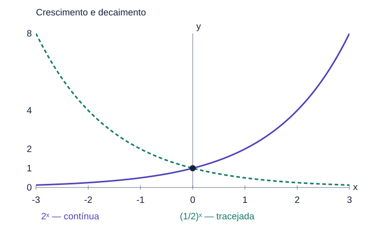

### Tela 5 · Pratique

Qual é a imagem de 2ˣ?

A) (0,∞)

B) [0,∞)

C) ℝ

Resposta comentada — consulte depois de tentar

**A.** Os valores são positivos e todo positivo é atingido.

### Tela 6 · Exemplo guiado

**1. Organizar as informações**

Compare f(x)=2ˣ e g(x)=(1/2)ˣ nos valores −1,0,1: f dá 1/2,1,2; g dá 2,1,1/2.

**2. Desenvolver o raciocínio**

Os gráficos passam por (0,1), são positivos e têm sentidos de monotonia opostos. Além disso, g(x)=f(−x), uma reflexão no eixo vertical.

**3. Concluir e conferir**

Nenhum gráfico passa por (x,0). A assíntota descreve valores cada vez mais próximos de zero em uma direção ilimitada, sem afirmar igualdade em uma entrada finita.

### Tela 7 · Pratique

Qual é o intercepto vertical de aˣ?

A) (0,0)

B) (1,0)

C) (0,1)

Resposta comentada — consulte depois de tentar

**C.** a⁰=1 para a>0.

### Tela 8 · Pratique

Qual é a assíntota horizontal de 2ˣ?

A) y=1

B) y=0

C) x=0

Resposta comentada — consulte depois de tentar

**B.** Quando x vai para −∞, os valores se aproximam de zero.

### Tela 9 · O erro que vale investigar

A imagem não é [0,∞): zero não é atingido. Uma curva exponencial de base positiva também não passa pela origem. O modelo exponencial pode ser matematicamente definido em ℝ e fisicamente válido apenas num intervalo de tempo.

Antes de seguir: explique o erro em suas palavras e construa um exemplo que o torne visível.

### Tela 10 · Pratique

Como é a monotonia de (1/3)ˣ?

A) Estritamente decrescente

B) Estritamente crescente

C) Constante

Resposta comentada — consulte depois de tentar

**A.** A base está entre 0 e 1.

### Tela 11 · Pratique

Quanto vale 2⁻¹?

A) −2

B) 0

C) 1/2

Resposta comentada — consulte depois de tentar

**C.** Expoente negativo produz o recíproco.

### Tela 12 · Levar a ideia para outra situação

Compare uma sequência linear 1,2,3,4 com uma exponencial 1,2,4,8 nos mesmos instantes. Explique a diferença entre acrescentar uma quantidade fixa e multiplicar por um fator fixo. Isso ajuda a interpretar modelos sem vender previsões ilimitadas.

### Tela 13 · Pratique

Existe x real tal que 2ˣ=0?

A) Sim, x=−1

B) Não

C) Sim, x=0

Resposta comentada — consulte depois de tentar

**B.** Potências reais de base positiva são estritamente positivas.

### Tela 14 · Pratique

Qual relação vale entre (1/2)ˣ e 2ˣ?

A) (1/2)ˣ=2⁻ˣ

B) (1/2)ˣ=−2ˣ

C) (1/2)ˣ=2ˣ/2

Resposta comentada — consulte depois de tentar

**A.** A base recíproca equivale a trocar o sinal do expoente.

### Tela 15 · Mapa de bolso

Para a>0 e a≠1, f(x)=aˣ tem domínio ℝ, imagem (0,∞), intercepto (0,1) e assíntota horizontal y=0. Se a>1 é estritamente crescente; se 0<a<1 é estritamente decrescente. Na primeira, aˣ tende a 0 quando x vai para −∞; na segunda, quando x vai para +∞.

Verificação: Nenhum gráfico passa por (x,0). A assíntota descreve valores cada vez mais próximos de zero em uma direção ilimitada, sem afirmar igualdade em uma entrada finita.

Recuperação ativa: explique como descrever gráficos, domínio, imagem e assíntota de aˣ. Depois reconstrua o exemplo sem consultar a solução.

Referência curricular: IMD1001_acervo_unificado_P1_P2_P3.md, fornecido pelo estudante; recorte P1/P2/P3 de 2025.2. Texto, exemplos e questões desta versão são autorais. Os PDFs de P2/P3 não foram conferidos diretamente nesta produção. As exclusões de 2025.2 não devem ser presumidas para outras ofertas.

### Tela 16 · Pratique

Se x₂>x₁ e a>1, como comparar aˣ² e aˣ¹?

A) aˣ²<aˣ¹

B) São iguais

C) aˣ²>aˣ¹

Resposta comentada — consulte depois de tentar

**C.** A função é estritamente crescente para base maior que 1.

### Tela 17 · Pratique

O modelo dobrado a cada rodada tem qual mudança entre saídas consecutivas?

A) Soma constante 2

B) Razão constante 2

C) Diferença constante 2

Resposta comentada — consulte depois de tentar

**B.** Crescimento exponencial mantém um fator multiplicativo, não um acréscimo fixo.

---

## Passo 45 · Logarítmica: o gráfico de volta

### Tela 1 · Logarítmica: o gráfico de volta

A curva exponencial já sabe ir da rodada ao tamanho. A logarítmica responde o caminho de volta: do tamanho à rodada. Trocar as coordenadas transforma a tabela e também gira nossa interpretação de entradas e saídas.

Ao concluir: Relacionar exponencial e logarítmica, incluindo eˣ e ln x.

Para começar: Logaritmos, exponenciais e função inversa.

### Tela 2 · Dar nome às ideias

f(x)=logₐx, a>0 e a≠1, tem domínio (0,∞), imagem ℝ, intercepto horizontal (1,0) e assíntota vertical x=0. É crescente para a>1 e decrescente para 0<a<1. É a inversa de aˣ. Em particular ln(eˣ)=x para x∈ℝ e e^(ln x)=x para x>0.

**ln(eˣ)=x; e^(ln x)=x para x>0**

Leitura: A exponencial natural e o logaritmo natural são inversos, respeitando o argumento positivo do logaritmo.

### Tela 3 · Pratique

Qual é o domínio de ln x?

A) (0,∞)

B) ℝ

C) [0,∞)

Resposta comentada — consulte depois de tentar

**A.** O argumento do logaritmo real deve ser positivo.

### Tela 4 · Por que isso funciona?

O par (u,aᵘ) da exponencial corresponde a (aᵘ,u) da logarítmica, refletido em y=x. Domínio e imagem trocam de papel. Como aᵘ pode ser qualquer positivo e u pode ser qualquer real, obtemos os conjuntos declarados. Para base maior que 1, logₐx tende a −∞ quando x se aproxima de 0 pela direita.

### Tela 5 · Pratique

Qual é a imagem de ln x?

A) (0,∞)

B) [0,∞)

C) ℝ

Resposta comentada — consulte depois de tentar

**C.** Cada real u aparece como ln(eᵘ).

### Tela 6 · Exemplo guiado

**1. Organizar as informações**

Na exponencial 2ˣ, os pontos (−1,1/2),(0,1),(1,2) tornam-se (1/2,−1),(1,0),(2,1) em log₂x.

**2. Desenvolver o raciocínio**

Assim log₂(1/2)=−1 e log₂2=1. A curva cruza o eixo x em x=1 e não cruza o eixo y, pois x=0 é proibido.

**3. Concluir e conferir**

Para ln, o mesmo raciocínio fornece ln1=0 e ln e=1. A expressão e^(ln7) retorna 7 e ln(e⁻²) retorna −2.

### Tela 7 · Pratique

Qual é o intercepto horizontal de logₐx?

A) (0,0)

B) (1,0)

C) (0,1)

Resposta comentada — consulte depois de tentar

**B.** logₐ1=0.

### Tela 8 · Pratique

Qual é a assíntota vertical da função logarítmica básica?

A) x=0

B) y=0

C) x=1

Resposta comentada — consulte depois de tentar

**A.** O gráfico se aproxima do eixo y pelo lado positivo do domínio.

### Tela 9 · O erro que vale investigar

ln0 não é zero nem um número real muito negativo: não está definido. A assíntota indica um comportamento de aproximação. Esta etapa mantém domínio geral da função básica; cálculos elaborados de domínio de expressões logarítmicas ficam fora da prioridade da P3 2025.2 conforme o acervo.

Antes de seguir: explique o erro em suas palavras e construa um exemplo que o torne visível.

### Tela 10 · Pratique

Quanto vale ln(e⁻²)?

A) 2

B) e⁻²

C) −2

Resposta comentada — consulte depois de tentar

**C.** ln desfaz a exponencial natural em todo expoente real.

### Tela 11 · Pratique

Quanto vale e^(ln7)?

A) e·7

B) 7

C) ln7

Resposta comentada — consulte depois de tentar

**B.** O argumento 7 é positivo, permitindo a composição inversa.

### Tela 12 · Levar a ideia para outra situação

Desenhe a reta y=x e reflita três pontos da exponencial para construir a logarítmica. Escreva as coordenadas em texto junto ao desenho. É uma forma de visualizar inversas sem depender de um aplicativo ou de percepção de cor.

### Tela 13 · Pratique

Quanto vale ln0 em ℝ?

A) Não está definido

B) 0

C) −1

Resposta comentada — consulte depois de tentar

**A.** Não há expoente real que faça eˣ=0.

### Tela 14 · Pratique

Se (2,4) está em y=2ˣ, qual ponto correspondente está na inversa?

A) (−2,4)

B) (2,−4)

C) (4,2)

Resposta comentada — consulte depois de tentar

**C.** A inversão troca as coordenadas.

### Tela 15 · Mapa de bolso

f(x)=logₐx, a>0 e a≠1, tem domínio (0,∞), imagem ℝ, intercepto horizontal (1,0) e assíntota vertical x=0. É crescente para a>1 e decrescente para 0<a<1. É a inversa de aˣ. Em particular ln(eˣ)=x para x∈ℝ e e^(ln x)=x para x>0.

Verificação: Para ln, o mesmo raciocínio fornece ln1=0 e ln e=1. A expressão e^(ln7) retorna 7 e ln(e⁻²) retorna −2.

Recuperação ativa: explique como relacionar exponencial e logarítmica, incluindo eˣ e ln x. Depois reconstrua o exemplo sem consultar a solução.

Referência curricular: IMD1001_acervo_unificado_P1_P2_P3.md, fornecido pelo estudante; recorte P1/P2/P3 de 2025.2. Texto, exemplos e questões desta versão são autorais. Os PDFs de P2/P3 não foram conferidos diretamente nesta produção. As exclusões de 2025.2 não devem ser presumidas para outras ofertas.

### Tela 16 · Pratique

Como é a monotonia de log_(1/2)x?

A) Constante

B) Estritamente decrescente

C) Estritamente crescente

Resposta comentada — consulte depois de tentar

**B.** A função inversa mantém o sentido de monotonia da exponencial de base 1/2.

### Tela 17 · Pratique

Qual é o ponto comum de todas as logarítmicas básicas admissíveis?

A) (1,0)

B) (0,1)

C) (e,1)

Resposta comentada — consulte depois de tentar

**A.** Toda base admissível elevada a zero produz 1, logo logₐ1=0.

---

## Passo 46 · Modelos multiplicativos e tempo de espera

### Tela 1 · Modelos multiplicativos e tempo de espera

Um projeto de catalogação dobra o número de registros organizados a cada etapa de um modelo ideal. Outro perde metade dos arquivos pendentes por etapa. O desafio não é só calcular o tamanho: é descobrir quando uma meta será atingida e se o resultado cabe numa etapa inteira.

Ao concluir: Resolver equações exponenciais simples e interpretar logaritmos em modelos.

Para começar: Inversão entre exponencial e logaritmo.

### Tela 2 · Dar nome às ideias

Um modelo multiplicativo pode ser N(t)=N₀aᵗ, com N₀>0 e a>0, a≠1. Para atingir M>0, resolva aᵗ=M/N₀, obtendo t=ln(M/N₀)/ln a. Se t representa etapas inteiras e se pede ‘ao menos’, compare inteiros e use o sentido de crescimento ou decaimento. O modelo não autoriza extrapolações ilimitadas.

**N(t)=N₀aᵗ**

Leitura: Um modelo multiplicativo aplica o mesmo fator a cada unidade de tempo.

### Tela 3 · Pratique

Em N(t)=50·2ᵗ, qual é o valor inicial?

A) 2

B) 100

C) 50

Resposta comentada — consulte depois de tentar

**C.** N(0)=50·1=50.

### Tela 4 · Por que isso funciona?

Dividir por N₀ isola a potência. Aplicar ln transforma ln(aᵗ)=t ln a; como a≠1, ln a≠0 e a divisão é válida. Esse argumento deriva a fórmula a partir das propriedades já demonstradas. Para a<1, o denominador é negativo, coerente com a redução multiplicativa.

### Tela 5 · Pratique

Quanto vale N(3) nesse modelo?

A) 150

B) 400

C) 300

Resposta comentada — consulte depois de tentar

**B.** 50·2³=50·8=400.

### Tela 6 · Exemplo guiado

**1. Organizar as informações**

Uma coleção fictícia começa com 50 registros e dobra por etapa: N(t)=50·2ᵗ. Para chegar a 400, resolva 2ᵗ=8.

**2. Desenvolver o raciocínio**

Como 8=2³, a meta exata ocorre em t=3. Pelo logaritmo: ln8/ln2=3.

**3. Concluir e conferir**

Se a meta for pelo menos 300 em etapas inteiras, N(2)=200 e N(3)=400. A primeira etapa admissível é 3, embora o instante real de igualdade esteja entre 2 e 3.

### Tela 7 · Pratique

Em qual etapa exata N(t)=400?

A) 3

B) 8

C) 4

Resposta comentada — consulte depois de tentar

**A.** A equação se reduz a 2ᵗ=8.

### Tela 8 · Pratique

Qual é a primeira etapa inteira com N(t)≥300?

A) 2

B) 6

C) 3

Resposta comentada — consulte depois de tentar

**C.** Na etapa 2 há 200; na 3 há 400, e o modelo é crescente.

### Tela 9 · O erro que vale investigar

Uma redução de 20% por etapa corresponde a fator 0,8, não −0,2. E duplicar a cada etapa não significa acrescentar sempre o mesmo número. Antes de calcular logaritmos, confira se as grandezas comparadas têm unidades compatíveis.

Antes de seguir: explique o erro em suas palavras e construa um exemplo que o torne visível.

### Tela 10 · Pratique

Uma redução de 20% por etapa usa qual fator?

A) 1,2

B) 0,8

C) −0,2

Resposta comentada — consulte depois de tentar

**B.** Permanece 80% do valor anterior, isto é, 0,8 vezes esse valor.

### Tela 11 · Pratique

Uma redução pela metade usa qual modelo com início 80?

A) N(t)=80·(1/2)ᵗ

B) N(t)=80−t/2

C) N(t)=80·2ᵗ

Resposta comentada — consulte depois de tentar

**A.** O fator multiplicativo é 1/2 a cada etapa.

### Tela 12 · Levar a ideia para outra situação

Use exemplos em acervos, ambientes, redes ou culturas fictícias como modelos matemáticos, sem tomar os números como previsões reais. Declare o que o tempo mede, se ele é contínuo ou discreto e em que faixa a regra foi assumida.

### Tela 13 · Pratique

Após três etapas de redução pela metade a partir de 80, qual é o valor?

A) 40

B) 20

C) 10

Resposta comentada — consulte depois de tentar

**C.** 80·(1/2)³=80/8=10.

### Tela 14 · Pratique

Qual fórmula resolve N₀aᵗ=M nas condições dadas?

A) t=M/(N₀a)

B) t=ln(M/N₀)/ln a

C) t=ln(M−N₀)

Resposta comentada — consulte depois de tentar

**B.** Dividir pelo inicial e aplicar ln isola o expoente.

### Tela 15 · Mapa de bolso

Um modelo multiplicativo pode ser N(t)=N₀aᵗ, com N₀>0 e a>0, a≠1. Para atingir M>0, resolva aᵗ=M/N₀, obtendo t=ln(M/N₀)/ln a. Se t representa etapas inteiras e se pede ‘ao menos’, compare inteiros e use o sentido de crescimento ou decaimento. O modelo não autoriza extrapolações ilimitadas.

Verificação: Se a meta for pelo menos 300 em etapas inteiras, N(2)=200 e N(3)=400. A primeira etapa admissível é 3, embora o instante real de igualdade esteja entre 2 e 3.

Recuperação ativa: explique como resolver equações exponenciais simples e interpretar logaritmos em modelos. Depois reconstrua o exemplo sem consultar a solução.

Referência curricular: IMD1001_acervo_unificado_P1_P2_P3.md, fornecido pelo estudante; recorte P1/P2/P3 de 2025.2. Texto, exemplos e questões desta versão são autorais. Os PDFs de P2/P3 não foram conferidos diretamente nesta produção. As exclusões de 2025.2 não devem ser presumidas para outras ofertas.

### Tela 16 · Pratique

Por que ln a pode ser usado como divisor?

A) Porque a≠1 implica ln a≠0

B) Porque todo logaritmo é positivo

C) Porque a pode ser negativo

Resposta comentada — consulte depois de tentar

**A.** O único argumento positivo com ln igual a zero é 1.

### Tela 17 · Pratique

O modelo matemático garante previsões válidas para sempre num fenômeno real?

A) Sim

B) Só se usar base e

C) Não

Resposta comentada — consulte depois de tentar

**C.** Validade empírica depende das hipóteses e da faixa de aplicação, não apenas da forma algébrica.

---

## Passo 47 · Triângulos: uma razão que não depende do tamanho

### Tela 1 · Triângulos: uma razão que não depende do tamanho

Um grupo de extensão mede a altura de uma estrutura sem subir nela. Um desenho em escala diferente mantém os ângulos e muda todos os lados na mesma proporção. As razões sobrevivem à mudança de tamanho: essa é a porta de entrada da trigonometria.

Ao concluir: Usar seno, cosseno e tangente de ângulos agudos em triângulos retângulos.

Para começar: Razões, raízes e teorema de Pitágoras.

### Tela 2 · Dar nome às ideias

Num triângulo retângulo, a hipotenusa é o lado oposto ao ângulo reto. Para um ângulo agudo θ, senθ=cateto oposto/hipotenusa, cosθ=cateto adjacente/hipotenusa e tanθ=cateto oposto/cateto adjacente. O cateto oposto depende do ângulo escolhido. Pitágoras fornece oposto²+adjacente²=hipotenusa².

**senθ=oposto/hipotenusa**

Leitura: O seno de um ângulo agudo é a razão entre cateto oposto e hipotenusa.

### Tela 3 · Pratique

Qual lado fica oposto ao ângulo reto?

A) Cateto oposto ao ângulo agudo

B) Hipotenusa

C) Cateto adjacente

Resposta comentada — consulte depois de tentar

**B.** A hipotenusa é definida pelo ângulo reto e é o maior lado.

### Tela 4 · Por que isso funciona?

Triângulos retângulos com o mesmo ângulo agudo são semelhantes pelo critério ângulo–ângulo. Seus lados correspondentes mudam pelo mesmo fator; por isso as razões dependem de θ e não do tamanho. Dividir Pitágoras pelo quadrado da hipotenusa dá sen²θ+cos²θ=1.

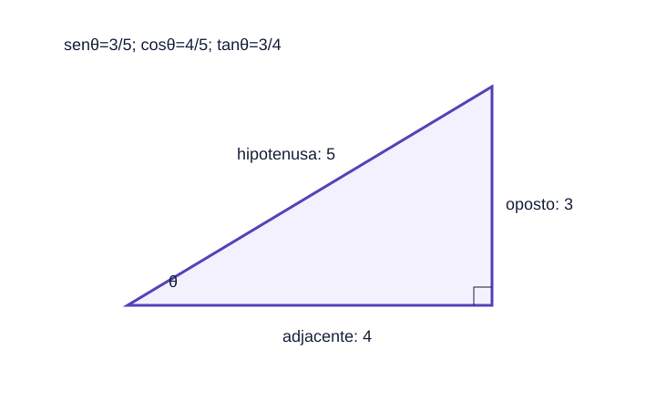

### Tela 5 · Pratique

No triângulo do exemplo, quanto vale senθ?

A) 3/5

B) 4/5

C) 3/4

Resposta comentada — consulte depois de tentar

**A.** O seno divide o cateto oposto 3 pela hipotenusa 5.

### Tela 6 · Exemplo guiado

**1. Organizar as informações**

Num triângulo 3–4–5, escolha o ângulo cujo cateto oposto mede 3 e o adjacente 4. A hipotenusa mede 5.

**2. Desenvolver o raciocínio**

Assim senθ=3/5, cosθ=4/5 e tanθ=3/4. Confira: (3/5)²+(4/5)²=9/25+16/25=1.

**3. Concluir e conferir**

Se o triângulo for ampliado por fator 2, os lados viram 6,8,10. As razões continuam 6/10=3/5, 8/10=4/5 e 6/8=3/4.

### Tela 7 · Pratique

Quanto vale cosθ no exemplo?

A) 3/5

B) 4/3

C) 4/5

Resposta comentada — consulte depois de tentar

**C.** O cosseno usa cateto adjacente 4 e hipotenusa 5.

### Tela 8 · Pratique

Quanto vale tanθ no exemplo?

A) 3/5

B) 3/4

C) 4/3

Resposta comentada — consulte depois de tentar

**B.** A tangente divide oposto por adjacente.

### Tela 9 · O erro que vale investigar

‘Adjacente’ aqui não é qualquer lado que toca o ângulo: excluímos a hipotenusa. E a altura de uma estrutura pode exigir somar a altura do ponto de observação ao cateto calculado; um desenho com unidades evita essa perda de contexto.

Antes de seguir: explique o erro em suas palavras e construa um exemplo que o torne visível.

### Tela 10 · Pratique

Se os catetos medem 5 e 12, quanto mede a hipotenusa?

A) 13

B) 17

C) 7

Resposta comentada — consulte depois de tentar

**A.** Pitágoras dá √(25+144)=√169=13.

### Tela 11 · Pratique

Ampliar todos os lados por fator 3 muda as razões do mesmo ângulo?

A) Sim, triplica todas

B) Sim, divide todas por 3

C) Não

Resposta comentada — consulte depois de tentar

**C.** O fator comum cancela no quociente dos lados.

### Tela 12 · Levar a ideia para outra situação

Use problemas geométricos de medidas hipotéticas, sem presumir equipamentos específicos. Esboce um triângulo, marque o ângulo de referência e só então nomeie oposto, adjacente e hipotenusa. Se trocar o ângulo agudo, os dois catetos trocam de papel.

### Tela 13 · Pratique

Ao trocar um ângulo agudo pelo outro, o que acontece com os catetos oposto e adjacente?

A) Mantêm sempre o mesmo nome

B) Trocam de papel

C) Viram hipotenusas

Resposta comentada — consulte depois de tentar

**B.** Esses nomes dependem do ângulo de referência.

### Tela 14 · Pratique

Qual identidade deriva de Pitágoras?

A) sen²θ+cos²θ=1

B) senθ+cosθ=1

C) tanθ=senθ·cosθ

Resposta comentada — consulte depois de tentar

**A.** Dividir os quadrados dos lados pela hipotenusa ao quadrado produz a identidade.

### Tela 15 · Mapa de bolso

Num triângulo retângulo, a hipotenusa é o lado oposto ao ângulo reto. Para um ângulo agudo θ, senθ=cateto oposto/hipotenusa, cosθ=cateto adjacente/hipotenusa e tanθ=cateto oposto/cateto adjacente. O cateto oposto depende do ângulo escolhido. Pitágoras fornece oposto²+adjacente²=hipotenusa².

Verificação: Se o triângulo for ampliado por fator 2, os lados viram 6,8,10. As razões continuam 6/10=3/5, 8/10=4/5 e 6/8=3/4.

Recuperação ativa: explique como usar seno, cosseno e tangente de ângulos agudos em triângulos retângulos. Depois reconstrua o exemplo sem consultar a solução.

Referência curricular: IMD1001_acervo_unificado_P1_P2_P3.md, fornecido pelo estudante; recorte P1/P2/P3 de 2025.2. Texto, exemplos e questões desta versão são autorais. Os PDFs de P2/P3 não foram conferidos diretamente nesta produção. As exclusões de 2025.2 não devem ser presumidas para outras ofertas.

### Tela 16 · Pratique

Se um ângulo agudo tem senθ=1/2 e hipotenusa 10, quanto mede o cateto oposto?

A) 20

B) 10

C) 5

Resposta comentada — consulte depois de tentar

**C.** Oposto/10=1/2 implica oposto=5.

### Tela 17 · Pratique

Qual justificativa explica por que as razões dependem só do ângulo?

A) Todo ângulo agudo é de 45°

B) Semelhança de triângulos

C) Todos os triângulos têm lados iguais

Resposta comentada — consulte depois de tentar

**B.** Triângulos com os mesmos ângulos têm lados correspondentes proporcionais.

---

## Passo 48 · Radianos: medir ângulo pelo arco

### Tela 1 · Radianos: medir ângulo pelo arco

Graus dividem a volta em 360 partes. Radianos fazem uma pergunta geométrica: quantos raios cabem no comprimento do arco? A nova unidade parece menos familiar, mas conversa diretamente com a circunferência.

Ao concluir: Converter graus e radianos e localizar voltas e sentidos.

Para começar: Circunferência e proporções.

### Tela 2 · Dar nome às ideias

Em uma circunferência de raio r>0, o ângulo central em radianos é θ=s/r, com s sendo o comprimento de arco orientado. Uma volta mede 2π rad=360°; meia volta, π rad=180°. Converta graus para radianos multiplicando por π/180; faça o caminho inverso multiplicando por 180/π. O sentido anti-horário é positivo.

**θ=s/r; π rad=180°**

Leitura: O ângulo em radianos é arco dividido pelo raio; pi radianos equivalem a cento e oitenta graus.

### Tela 3 · Pratique

Quantos radianos há em uma volta completa?

A) 2π

B) π

C) 360π

Resposta comentada — consulte depois de tentar

**A.** O arco completo tem comprimento 2πr; dividido por r resulta 2π.

### Tela 4 · Por que isso funciona?

A circunferência inteira tem comprimento 2πr, então θ=(2πr)/r=2π. O raio cancela: a medida angular independe do tamanho da circunferência. Ângulos que diferem por 2kπ, k inteiro, chegam ao mesmo ponto no ciclo, embora suas medidas orientadas possam ser diferentes.

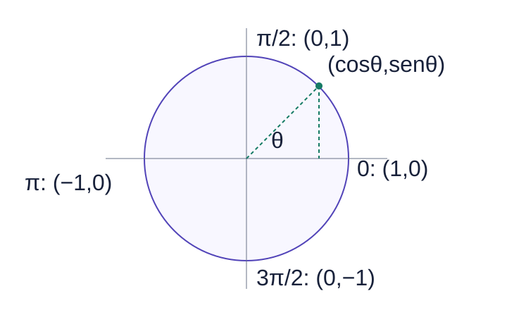

### Tela 5 · Pratique

Quanto vale 180° em radianos?

A) 2π

B) π/2

C) π

Resposta comentada — consulte depois de tentar

**C.** Meia volta equivale a π radianos.

### Tela 6 · Exemplo guiado

**1. Organizar as informações**

Converta 150°: 150·π/180=5π/6 rad. É menor que π e maior que π/2, logo termina no segundo quadrante.

**2. Desenvolver o raciocínio**

Converta −π/3 rad: −π/3·180/π=−60°. A rotação é horária.

**3. Concluir e conferir**

Somando uma volta a −π/3, obtemos 5π/3, que termina no mesmo ponto. Os ângulos são coterminais, não a mesma medida orientada.

### Tela 7 · Pratique

Quanto vale 60° em radianos?

A) 3π

B) π/3

C) π/6

Resposta comentada — consulte depois de tentar

**B.** Multiplicar 60 por π/180 dá π/3.

### Tela 8 · Pratique

Quanto vale 150° em radianos?

A) 5π/6

B) 3π/5

C) 5π/3

Resposta comentada — consulte depois de tentar

**A.** Simplificamos 150π/180 para 5π/6.

### Tela 9 · O erro que vale investigar

π rad equivale a 180°, e não a 3,14°. A constante π é um número; ‘rad’ indica a unidade angular. Também não esqueça o sinal ao converter uma rotação horária.

Antes de seguir: explique o erro em suas palavras e construa um exemplo que o torne visível.

### Tela 10 · Pratique

Quanto vale 3π/2 rad em graus?

A) 90°

B) 180°

C) 270°

Resposta comentada — consulte depois de tentar

**C.** Multiplicar por 180/π dá 270°.

### Tela 11 · Pratique

Qual é o sentido de um ângulo negativo pela convenção adotada?

A) Sempre vertical

B) Horário

C) Anti-horário

Resposta comentada — consulte depois de tentar

**B.** O sentido anti-horário foi escolhido como positivo.

### Tela 12 · Levar a ideia para outra situação

Use uma volta desenhada com os marcos 0,π/2,π,3π/2 e 2π. Depois localize ângulos intermediários por comparação. Uma conversão exata com π é preferível a arredondar cedo e perder informação.

### Tela 13 · Pratique

Qual ângulo é coterminal com −π/3?

A) 5π/3

B) π/3

C) 2π/3

Resposta comentada — consulte depois de tentar

**A.** Somamos 2π e obtemos 5π/3.

### Tela 14 · Pratique

Em qual quadrante termina 5π/6?

A) Primeiro

B) Terceiro

C) Segundo

Resposta comentada — consulte depois de tentar

**C.** Está entre π/2 e π.

### Tela 15 · Mapa de bolso

Em uma circunferência de raio r>0, o ângulo central em radianos é θ=s/r, com s sendo o comprimento de arco orientado. Uma volta mede 2π rad=360°; meia volta, π rad=180°. Converta graus para radianos multiplicando por π/180; faça o caminho inverso multiplicando por 180/π. O sentido anti-horário é positivo.

Verificação: Somando uma volta a −π/3, obtemos 5π/3, que termina no mesmo ponto. Os ângulos são coterminais, não a mesma medida orientada.

Recuperação ativa: explique como converter graus e radianos e localizar voltas e sentidos. Depois reconstrua o exemplo sem consultar a solução.

Referência curricular: IMD1001_acervo_unificado_P1_P2_P3.md, fornecido pelo estudante; recorte P1/P2/P3 de 2025.2. Texto, exemplos e questões desta versão são autorais. Os PDFs de P2/P3 não foram conferidos diretamente nesta produção. As exclusões de 2025.2 não devem ser presumidas para outras ofertas.

### Tela 16 · Pratique

Se um arco mede 6 e o raio 3, qual é o ângulo em radianos?

A) 1/2

B) 2

C) 18

Resposta comentada — consulte depois de tentar

**B.** θ=s/r=6/3=2.

### Tela 17 · Pratique

π rad é igual a aproximadamente 3,14°?

A) Não

B) Sim

C) Só em raio 1

Resposta comentada — consulte depois de tentar

**A.** π rad=180°; trocar unidade sem conversão altera a medida.

---

## Passo 49 · Ciclo unitário e ângulos notáveis

### Tela 1 · Ciclo unitário e ângulos notáveis

O triângulo retângulo ajudou com ângulos agudos. Agora vamos fazê-lo passear por uma volta completa. No círculo de raio 1, o ponto final da rotação guarda dois números: cosseno na horizontal e seno na vertical.

Ao concluir: Ler seno e cosseno como coordenadas e obter valores exatos.

Para começar: Radianos e razões no triângulo retângulo.

### Tela 2 · Dar nome às ideias

No ciclo unitário, o ponto do ângulo θ é (cosθ,senθ). Quadrantes I, II, III e IV têm sinais de (cos,sen) iguais a (+,+),(−,+),(−,−),(+,−). Os marcos são 0→(1,0), π/2→(0,1), π→(−1,0), 3π/2→(0,−1). Para π/6,π/4,π/3, os senos são 1/2,√2/2,√3/2 e os cossenos, √3/2,√2/2,1/2.

**P(θ)=(cosθ,senθ)**

Leitura: O ponto do ciclo unitário tem cosseno na coordenada horizontal e seno na vertical.

### Tela 3 · Pratique

Qual é o ponto do ciclo correspondente a θ?

A) (senθ,cosθ)

B) (tanθ,senθ)

C) (cosθ,senθ)

Resposta comentada — consulte depois de tentar

**C.** O cosseno mede a coordenada horizontal e o seno a vertical.

### Tela 4 · Por que isso funciona?

Um triângulo retângulo isósceles de catetos 1 tem hipotenusa √2: dividir por ela dá sen(π/4)=cos(π/4)=√2/2. Dividir um triângulo equilátero de lado 2 ao meio produz lados 1,√3,2 e os valores de 30° e 60°. Reflexões no círculo fornecem os sinais e os valores dos demais quadrantes.

### Tela 5 · Pratique

Quanto vale sen(π/6)?

A) √2/2

B) 1/2

C) √3/2

Resposta comentada — consulte depois de tentar

**B.** O triângulo 30°–60°–90° fornece oposto 1 e hipotenusa 2.

### Tela 6 · Exemplo guiado

**1. Organizar as informações**

Calcule sen(5π/6) e cos(5π/6). O ângulo está no segundo quadrante e seu ângulo de referência é π−5π/6=π/6.

**2. Desenvolver o raciocínio**

O seno é positivo e mantém o valor 1/2. O cosseno é negativo e fica −√3/2.

**3. Concluir e conferir**

O ponto é (−√3/2,1/2). Confira que os quadrados somam 3/4+1/4=1, como exige o círculo unitário.

### Tela 7 · Pratique

Quanto vale cos(π/3)?

A) 1/2

B) √3/2

C) 0

Resposta comentada — consulte depois de tentar

**A.** O cosseno de 60° é 1/2.

### Tela 8 · Pratique

Quanto vale sen(π/4)?

A) 1/2

B) 1

C) √2/2

Resposta comentada — consulte depois de tentar

**C.** No triângulo isósceles retângulo, a razão é 1/√2=√2/2.

### Tela 9 · O erro que vale investigar

A ordem do par é (cos,sen), mesmo quando você está mais interessado no seno. Nos eixos, não se atribui um quadrante ao ponto. E valores notáveis exatos não precisam virar decimais para ser respostas completas.

Antes de seguir: explique o erro em suas palavras e construa um exemplo que o torne visível.

### Tela 10 · Pratique

Quanto vale cosπ?

A) 0

B) −1

C) 1

Resposta comentada — consulte depois de tentar

**B.** O ponto de meia volta é (−1,0).

### Tela 11 · Pratique

Quanto vale sen(3π/2)?

A) −1

B) 1

C) 0

Resposta comentada — consulte depois de tentar

**A.** O ponto é (0,−1), cuja coordenada vertical é −1.

### Tela 12 · Levar a ideia para outra situação

Esboce o círculo com os eixos e escreva os sinais por extenso, além de quaisquer cores. Localize um ângulo pela volta e depois use a referência aguda. Essa sequência é mais segura do que tentar memorizar uma tabela enorme sem geometria.

### Tela 13 · Pratique

No segundo quadrante, quais são os sinais de cos e sen?

A) Positivo e negativo

B) Ambos negativos

C) Negativo e positivo

Resposta comentada — consulte depois de tentar

**C.** O ponto fica à esquerda e acima da origem.

### Tela 14 · Pratique

Quanto vale sen(5π/6)?

A) √3/2

B) 1/2

C) −1/2

Resposta comentada — consulte depois de tentar

**B.** A referência é π/6 e o seno é positivo no segundo quadrante.

### Tela 15 · Mapa de bolso

No ciclo unitário, o ponto do ângulo θ é (cosθ,senθ). Quadrantes I, II, III e IV têm sinais de (cos,sen) iguais a (+,+),(−,+),(−,−),(+,−). Os marcos são 0→(1,0), π/2→(0,1), π→(−1,0), 3π/2→(0,−1). Para π/6,π/4,π/3, os senos são 1/2,√2/2,√3/2 e os cossenos, √3/2,√2/2,1/2.

Verificação: O ponto é (−√3/2,1/2). Confira que os quadrados somam 3/4+1/4=1, como exige o círculo unitário.

Recuperação ativa: explique como ler seno e cosseno como coordenadas e obter valores exatos. Depois reconstrua o exemplo sem consultar a solução.

Referência curricular: IMD1001_acervo_unificado_P1_P2_P3.md, fornecido pelo estudante; recorte P1/P2/P3 de 2025.2. Texto, exemplos e questões desta versão são autorais. Os PDFs de P2/P3 não foram conferidos diretamente nesta produção. As exclusões de 2025.2 não devem ser presumidas para outras ofertas.

### Tela 16 · Pratique

Quanto vale cos(5π/6)?

A) −√3/2

B) √3/2

C) −1/2

Resposta comentada — consulte depois de tentar

**A.** A referência é π/6 e o cosseno é negativo no segundo quadrante.

### Tela 17 · Pratique

Um ponto exatamente no eixo vertical superior pertence a qual quadrante?

A) Ao primeiro

B) Ao segundo

C) A nenhum quadrante

Resposta comentada — consulte depois de tentar

**C.** Os eixos são fronteiras dos quadrantes, não parte de um deles.

---

## Passo 50 · Seis razões e seus pontos proibidos

### Tela 1 · Seis razões e seus pontos proibidos

Seno e cosseno já guardam as coordenadas. As outras razões combinam ou invertem esses valores. Parece um elenco com seis protagonistas, mas as duas coordenadas sustentam quase toda a trama — desde que ninguém divida por zero.

Ao concluir: Relacionar tan, sec, csc e cot a seno e cosseno com domínio.

Para começar: Ciclo trigonométrico, frações e ângulos notáveis.

### Tela 2 · Dar nome às ideias

tanθ=senθ/cosθ e secθ=1/cosθ exigem cosθ≠0. cscθ=1/senθ e cotθ=cosθ/senθ exigem senθ≠0. Assim tan e sec excluem θ=π/2+kπ; csc e cot excluem θ=kπ, k∈ℤ. Seno e cosseno estão definidos para todo real. sec é secante; csc, cossecante; cot, cotangente.

**tanθ=senθ/cosθ**

Leitura: A tangente é seno dividido por cosseno, onde o cosseno não é zero.

### Tela 3 · Pratique

Qual é a definição de secθ?

A) senθ/cosθ

B) 1/cosθ

C) 1/senθ

Resposta comentada — consulte depois de tentar

**B.** Secante é o recíproco do cosseno.

### Tela 4 · Por que isso funciona?

As definições prolongam as razões do triângulo usando coordenadas orientadas. Os pontos proibidos surgem exatamente dos zeros dos denominadores no ciclo unitário. A tangente é positiva nos quadrantes I e III, pois seno e cosseno têm mesmo sinal; é negativa em II e IV, onde têm sinais opostos.

### Tela 5 · Pratique

Qual é a definição de cscθ?

A) 1/senθ

B) 1/cosθ

C) cosθ/senθ

Resposta comentada — consulte depois de tentar

**A.** Cossecante é o recíproco do seno.

### Tela 6 · Exemplo guiado

**1. Organizar as informações**

Para θ=π/3, senθ=√3/2 e cosθ=1/2. Então tanθ=√3.

**2. Desenvolver o raciocínio**

Os recíprocos dão secθ=2 e cscθ=2/√3=2√3/3. A cotangente é 1/√3=√3/3.

**3. Concluir e conferir**

Em θ=π/2, o seno vale 1 e o cosseno zero. Logo csc e cot estão definidas, com valores 1 e 0; tan e sec não estão definidas.

### Tela 7 · Pratique

Qual é a definição de tanθ?

A) cosθ/senθ

B) 1/senθ

C) senθ/cosθ

Resposta comentada — consulte depois de tentar

**C.** A tangente divide a coordenada vertical pela horizontal.

### Tela 8 · Pratique

Em quais ângulos a tangente não está definida?

A) Apenas em 0

B) π/2+kπ, k∈ℤ

C) kπ, k∈ℤ

Resposta comentada — consulte depois de tentar

**B.** O denominador cosθ zera nos pontos superiores e inferiores do ciclo.

### Tela 9 · O erro que vale investigar

sec não é 1/sen: secante é recíproco do cosseno; cossecante é recíproco do seno. E cotθ=1/tanθ só pode ser usado onde ambos os lados estão definidos: em π/2, cot vale 0, mas tan nem existe.

Antes de seguir: explique o erro em suas palavras e construa um exemplo que o torne visível.

### Tela 10 · Pratique

Em quais ângulos csc não está definida?

A) kπ, k∈ℤ

B) π/2+kπ, k∈ℤ

C) Nenhum real

Resposta comentada — consulte depois de tentar

**A.** O denominador senθ zera nos pontos horizontais do ciclo.

### Tela 11 · Pratique

Quanto vale tan(π/3)?

A) 1/√3

B) 2

C) √3

Resposta comentada — consulte depois de tentar

**C.** (√3/2)/(1/2)=√3.

### Tela 12 · Levar a ideia para outra situação

Para calcular qualquer uma das seis razões, comece com o par (cos,sen), confira denominadores e só então divida. Faça uma tabela de pontos proibidos com uma frase explicando a causa de cada exclusão.

### Tela 13 · Pratique

Quanto vale sec(π/3)?

A) √3

B) 2

C) 1/2

Resposta comentada — consulte depois de tentar

**B.** O cosseno é 1/2 e seu recíproco é 2.

### Tela 14 · Pratique

Quanto vale cot(π/2)?

A) 0

B) Não definido

C) 1

Resposta comentada — consulte depois de tentar

**A.** cos(π/2)/sen(π/2)=0/1=0.

### Tela 15 · Mapa de bolso

tanθ=senθ/cosθ e secθ=1/cosθ exigem cosθ≠0. cscθ=1/senθ e cotθ=cosθ/senθ exigem senθ≠0. Assim tan e sec excluem θ=π/2+kπ; csc e cot excluem θ=kπ, k∈ℤ. Seno e cosseno estão definidos para todo real. sec é secante; csc, cossecante; cot, cotangente.

Verificação: Em θ=π/2, o seno vale 1 e o cosseno zero. Logo csc e cot estão definidas, com valores 1 e 0; tan e sec não estão definidas.

Recuperação ativa: explique como relacionar tan, sec, csc e cot a seno e cosseno com domínio. Depois reconstrua o exemplo sem consultar a solução.

Referência curricular: IMD1001_acervo_unificado_P1_P2_P3.md, fornecido pelo estudante; recorte P1/P2/P3 de 2025.2. Texto, exemplos e questões desta versão são autorais. Os PDFs de P2/P3 não foram conferidos diretamente nesta produção. As exclusões de 2025.2 não devem ser presumidas para outras ofertas.

### Tela 16 · Pratique

Qual é o sinal da tangente no terceiro quadrante?

A) Negativo

B) Zero em todo o quadrante

C) Positivo

Resposta comentada — consulte depois de tentar

**C.** Seno e cosseno são ambos negativos, e o quociente é positivo.

### Tela 17 · Pratique

Podemos substituir cot(π/2) por 1/tan(π/2)?

A) Apenas se arredondar π

B) Não

C) Sim

Resposta comentada — consulte depois de tentar

**B.** A tangente não está definida nesse ângulo, embora a cotangente esteja.

---

## Passo 51 · Identidades: provar sem apagar o domínio

### Tela 1 · Identidades: provar sem apagar o domínio

Uma identidade parece uma igualdade já pronta, mas sua prova tem trabalho para fazer. O desafio é transformar um lado no outro sem dividir por algo que pode ser zero. Até as fórmulas clássicas precisam apresentar o ingresso do domínio.

Ao concluir: Demonstrar identidades fundamentais e simplificar expressões válidas.

Para começar: Seis razões e pontos proibidos.

### Tela 2 · Dar nome às ideias

No círculo unitário, sen²θ+cos²θ=1 para todo real θ. Dividindo por cos²θ, onde cosθ≠0, obtemos 1+tan²θ=sec²θ. Dividindo por sen²θ, onde senθ≠0, obtemos 1+cot²θ=csc²θ. Identidade significa igualdade para todas as entradas do domínio comum indicado.

**sen²θ+cos²θ=1**

Leitura: A soma dos quadrados do seno e do cosseno é um.

### Tela 3 · Pratique

Qual identidade vale para todo θ real?

A) sen²θ+cos²θ=1

B) senθ+cosθ=1

C) tan²θ+1=cos²θ

Resposta comentada — consulte depois de tentar

**A.** É a equação do círculo unitário em suas coordenadas.

### Tela 4 · Por que isso funciona?

As coordenadas do círculo satisfazem x²+y²=1; trocar x por cosθ e y por senθ fornece a relação fundamental. As outras duas identidades vêm de dividir termo a termo, preservando as restrições. Isso permite reconstruir as fórmulas e explica por que seus domínios não são idênticos.

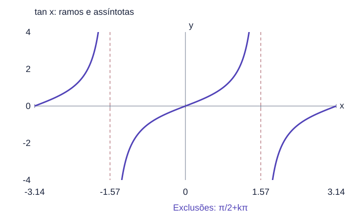

### Tela 5 · Pratique

Quanto vale sec²θ−tan²θ no domínio original?

A) 0

B) −1

C) 1

Resposta comentada — consulte depois de tentar

**C.** Reorganizar 1+tan²θ=sec²θ dá a diferença igual a 1.

### Tela 6 · Exemplo guiado

**1. Organizar as informações**

Simplifique sec²θ−tan²θ onde cosθ≠0. Pela identidade 1+tan²θ=sec²θ, a diferença vale 1.

**2. Desenvolver o raciocínio**

Outra prova escreve (1−sen²θ)/cos²θ=cos²θ/cos²θ=1.

**3. Concluir e conferir**

O resultado reduzido 1 não amplia o domínio original: θ=π/2 continua proibido, pois a expressão de partida não existe ali.

### Tela 7 · Pratique

Qual condição permite dividir a relação fundamental por cos²θ?

A) θ>0

B) cosθ≠0

C) senθ≠0

Resposta comentada — consulte depois de tentar

**B.** O divisor precisa ser não nulo.

### Tela 8 · Pratique

Qual é a outra identidade pitagórica com cot e csc?

A) 1+cot²θ=csc²θ

B) 1+cot²θ=sec²θ

C) cot²θ+csc²θ=1

Resposta comentada — consulte depois de tentar

**A.** Dividimos a relação fundamental por sen²θ.

### Tela 9 · O erro que vale investigar

Verificar em θ=0 ou θ=π/4 não demonstra uma identidade universal. Também não tire raiz de cos²θ como se fosse sempre cosθ: a raiz principal é |cosθ|. Para escolher o sinal, use o quadrante.

Antes de seguir: explique o erro em suas palavras e construa um exemplo que o torne visível.

### Tela 10 · Pratique

Se senθ=3/5 e θ está no segundo quadrante, quanto vale cosθ?

A) 4/5

B) −3/5

C) −4/5

Resposta comentada — consulte depois de tentar

**C.** cos²θ=1−9/25=16/25 e o cosseno é negativo no segundo quadrante.

### Tela 11 · Pratique

Quanto vale √(cos²θ) em geral?

A) −cosθ sempre

B) |cosθ|

C) cosθ sempre

Resposta comentada — consulte depois de tentar

**B.** A raiz principal é não negativa e corresponde ao valor absoluto.

### Tela 12 · Levar a ideia para outra situação

Uma prova eficiente começa pelo lado mais composto, troca razões por seno e cosseno e usa a relação fundamental. Anote as condições antes dos cancelamentos. Compare uma identidade com uma equação trigonométrica: a segunda pode valer só para algumas entradas.

### Tela 13 · Pratique

Testar uma igualdade em três ângulos prova uma identidade em ℝ?

A) Não

B) Sim

C) Só se forem ângulos notáveis

Resposta comentada — consulte depois de tentar

**A.** Um domínio infinito exige argumento geral; testes podem apenas refutar uma igualdade universal.

### Tela 14 · Pratique

Ao reduzir sec²θ−tan²θ a 1, podemos incluir θ=π/2 no domínio original?

A) Sim

B) Só se escrever 1 primeiro

C) Não

Resposta comentada — consulte depois de tentar

**C.** As razões originais não estão definidas nesse ponto.

### Tela 15 · Mapa de bolso

No círculo unitário, sen²θ+cos²θ=1 para todo real θ. Dividindo por cos²θ, onde cosθ≠0, obtemos 1+tan²θ=sec²θ. Dividindo por sen²θ, onde senθ≠0, obtemos 1+cot²θ=csc²θ. Identidade significa igualdade para todas as entradas do domínio comum indicado.

Verificação: O resultado reduzido 1 não amplia o domínio original: θ=π/2 continua proibido, pois a expressão de partida não existe ali.

Recuperação ativa: explique como demonstrar identidades fundamentais e simplificar expressões válidas. Depois reconstrua o exemplo sem consultar a solução.

Referência curricular: IMD1001_acervo_unificado_P1_P2_P3.md, fornecido pelo estudante; recorte P1/P2/P3 de 2025.2. Texto, exemplos e questões desta versão são autorais. Os PDFs de P2/P3 não foram conferidos diretamente nesta produção. As exclusões de 2025.2 não devem ser presumidas para outras ofertas.

### Tela 16 · Pratique

Se tanθ=2, quanto vale sec²θ?

A) 4

B) 5

C) 3

Resposta comentada — consulte depois de tentar

**B.** Pela identidade, sec²θ=1+2²=5.

### Tela 17 · Pratique

Se cotθ=3, quanto vale csc²θ?

A) 10

B) 8

C) 9

Resposta comentada — consulte depois de tentar

**A.** A identidade fornece 1+3²=10.

---

## Passo 52 · Somar ângulos sem somar senos

### Tela 1 · Somar ângulos sem somar senos

15° não aparece na primeira tabela de ângulos notáveis, mas é 45°−30°. Esse parentesco permite um valor exato. Só não vale somar os senos como se a curva tivesse assinado contrato de linearidade.

Ao concluir: Aplicar e justificar fórmulas de soma e diferença.

Para começar: Ângulos notáveis, simetria e identidade fundamental.

### Tela 2 · Dar nome às ideias

sen(α±β)=senα cosβ±cosα senβ. cos(α+β)=cosα cosβ−senα senβ e cos(α−β)=cosα cosβ+senα senβ. Quando as tangentes envolvidas e o quociente estão definidos, tan(α±β)=(tanα±tanβ)/(1∓tanα tanβ). Seno é ímpar e cosseno é par.

**sen(α+β)=senα cosβ+cosα senβ**

Leitura: O seno de uma soma é a soma dos produtos cruzados de seno e cosseno.

### Tela 3 · Pratique

Qual é a fórmula de sen(α+β)?

A) senα+senβ

B) senα senβ+cosα cosβ

C) senα cosβ+cosα senβ

Resposta comentada — consulte depois de tentar

**C.** A fórmula combina produtos cruzados, sem substituir seno por uma operação linear.

### Tela 4 · Por que isso funciona?

Para dois pontos unitários de ângulos α e β, a distância ao quadrado é 2−2[cosα cosβ+senα senβ] por expansão das coordenadas. Pela lei dos cossenos no triângulo com dois lados unitários, também é 2−2cos(α−β). Igualar dá a fórmula do cosseno da diferença. Usar −β e a relação sen t=cos(π/2−t) produz as demais. A fórmula da tangente vem de dividir seno por cosseno da soma ou diferença.

- **Objetivo:** Aplicar e justificar fórmulas de soma e diferença. Calcule sen15°=sen(45°−30°). A fórmula fornece sen45° cos30°−cos45° sen30°.
- **Conferência:** Volte às condições da expressão original. Portanto sen15°=(√6−√2)/4. Uma conferência de tamanho: é positivo e menor que sen30°=1/2, como esperado para um ângulo agudo menor.

### Tela 5 · Pratique

Qual é a fórmula de cos(α−β)?

A) cosα−cosβ

B) cosα cosβ+senα senβ

C) cosα cosβ−senα senβ

Resposta comentada — consulte depois de tentar

**B.** Na diferença de ângulos o termo entre os produtos é positivo.

### Tela 6 · Exemplo guiado

**1. Organizar as informações**

Calcule sen15°=sen(45°−30°). A fórmula fornece sen45° cos30°−cos45° sen30°.

**2. Desenvolver o raciocínio**

Substitua os valores: (√2/2)(√3/2)−(√2/2)(1/2).

**3. Concluir e conferir**

Portanto sen15°=(√6−√2)/4. Uma conferência de tamanho: é positivo e menor que sen30°=1/2, como esperado para um ângulo agudo menor.

### Tela 7 · Pratique

Quanto vale sen15°?

A) (√6−√2)/4

B) (√6+√2)/4

C) 1/4

Resposta comentada — consulte depois de tentar

**A.** Use 45°−30° e substitua os valores notáveis.

### Tela 8 · Pratique

Quanto vale cos60° pela fórmula de 30°+30°?

A) 1

B) 0

C) 1/2

Resposta comentada — consulte depois de tentar

**C.** (√3/2)²−(1/2)²=3/4−1/4=1/2.

### Tela 9 · O erro que vale investigar

sen(α+β) não é senα+senβ. Com α=β=π/2, o primeiro vale 0 e a soma vale 2. No cosseno, a soma leva menos entre os produtos, enquanto a diferença leva mais. Reconstrua pelo caso α=β para conferir sinais.

Antes de seguir: explique o erro em suas palavras e construa um exemplo que o torne visível.

### Tela 10 · Pratique

Quanto vale sen(−π/6)?

A) √3/2

B) −1/2

C) 1/2

Resposta comentada — consulte depois de tentar

**B.** O seno é ímpar.

### Tela 11 · Pratique

Quanto vale cos(−π/3)?

A) 1/2

B) −1/2

C) −√3/2

Resposta comentada — consulte depois de tentar

**A.** O cosseno é par.

### Tela 12 · Levar a ideia para outra situação

Use decomposições por ângulos conhecidos para obter resultados exatos. Como apoio à demonstração, a lei dos cossenos afirma d²=u²+v²−2uv cosγ para lados u,v com ângulo γ; sua origem é a decomposição de um lado em projeções e Pitágoras. Assim cada fórmula mantém uma ligação geométrica.

### Tela 13 · Pratique

Qual exemplo refuta sen(α+β)=senα+senβ?

A) α=β=0

B) α=0,β=π/3

C) α=β=π/2

Resposta comentada — consulte depois de tentar

**C.** No primeiro caso os dois lados valem 0 e 2, respectivamente.

### Tela 14 · Pratique

Qual é a fórmula de tan(α+β), no domínio adequado?

A) (tanα−tanβ)/(1+tanα tanβ)

B) (tanα+tanβ)/(1−tanα tanβ)

C) tanα+tanβ

Resposta comentada — consulte depois de tentar

**B.** A divisão das fórmulas de seno e cosseno gera esse quociente.

### Tela 15 · Mapa de bolso

sen(α±β)=senα cosβ±cosα senβ. cos(α+β)=cosα cosβ−senα senβ e cos(α−β)=cosα cosβ+senα senβ. Quando as tangentes envolvidas e o quociente estão definidos, tan(α±β)=(tanα±tanβ)/(1∓tanα tanβ). Seno é ímpar e cosseno é par.

Verificação: Portanto sen15°=(√6−√2)/4. Uma conferência de tamanho: é positivo e menor que sen30°=1/2, como esperado para um ângulo agudo menor.

Recuperação ativa: explique como aplicar e justificar fórmulas de soma e diferença. Depois reconstrua o exemplo sem consultar a solução.

Referência curricular: IMD1001_acervo_unificado_P1_P2_P3.md, fornecido pelo estudante; recorte P1/P2/P3 de 2025.2. Texto, exemplos e questões desta versão são autorais. Os PDFs de P2/P3 não foram conferidos diretamente nesta produção. As exclusões de 2025.2 não devem ser presumidas para outras ofertas.

### Tela 16 · Pratique

Quanto vale tan75°?

A) 2+√3

B) 2−√3

C) √3−1

Resposta comentada — consulte depois de tentar

**A.** Use 45°+30°: (1+1/√3)/(1−1/√3), que simplifica a 2+√3.

### Tela 17 · Pratique

O que fazer se 1−tanα tanβ=0 na fórmula da soma?

A) Definir a tangente como zero

B) Cancelar o denominador

C) Verificar a definição original; o quociente escrito não pode ser usado

Resposta comentada — consulte depois de tentar

**C.** Divisão por zero é proibida; quando as tangentes individuais existem, esse caso corresponde a cos(α+β)=0.

---

## Passo 53 · Seno, cosseno e tangente como funções

### Tela 1 · Seno, cosseno e tangente como funções

Imagine acompanhar só a altura de um ponto dando voltas no círculo. A altura sobe, desce, fica negativa e retorna. Você acabou de construir o gráfico do seno. A posição horizontal constrói o cosseno; a razão das duas coordenadas constrói uma função com interrupções.

Ao concluir: Descrever domínio, imagem, simetria e períodos das funções básicas.

Para começar: Ciclo, periodicidade e seis razões.

### Tela 2 · Dar nome às ideias

sen e cos têm domínio ℝ, imagem [−1,1] e período fundamental 2π. Seno é ímpar; cosseno é par. Tan tem domínio ℝ∖{π/2+kπ:k∈ℤ}, imagem ℝ, período fundamental π e é ímpar. Suas assíntotas verticais são x=π/2+kπ. Em (−π/2,π/2), tan é estritamente crescente. Estudamos aqui as funções básicas, sem transformações de período e imagem.

**T_sen=T_cos=2π; T_tan=π**

Leitura: Os períodos fundamentais do seno e cosseno são duas vezes pi; o da tangente é pi.

### Tela 3 · Pratique

Qual é a imagem de sen x?

A) ℝ

B) [−1,1]

C) (−1,1)

Resposta comentada — consulte depois de tentar

**B.** O seno atinge os extremos 1 e −1 nos pontos superiores e inferiores do ciclo.

### Tela 4 · Por que isso funciona?

As coordenadas do círculo variam de −1 a 1 e repetem a cada volta completa. Meia volta troca simultaneamente os sinais do seno e do cosseno, preservando seu quociente: tan(x+π)=tan x. No intervalo central, a tangente cresce de valores sem limite inferior até valores sem limite superior. Para a,b nesse intervalo e a<b, tan b−tan a=sen(b−a)/(cos a cos b)>0, justificando a monotonia sem cálculo diferencial.

![Seno e cosseno entre 0 e 2π: seno começa em 0, chega a 1 em π/2 e −1 em 3π/2; cosseno começa em 1 e chega a −1 em π. Ambos têm imagem [−1,1] e repetem o ciclo em 2π.](../../public/materiais/elementar/ondas.svg)

### Tela 5 · Pratique

Qual é o período fundamental de cos x?

A) 2π

B) π

C) π/2

Resposta comentada — consulte depois de tentar

**A.** O padrão completo da coordenada horizontal se repete em uma volta.

### Tela 6 · Exemplo guiado

**1. Organizar as informações**

Para esboçar sen x em [0,2π], marque (0,0),(π/2,1),(π,0),(3π/2,−1),(2π,0). Ligue com curva suave conforme o movimento do círculo.

**2. Desenvolver o raciocínio**

Para cos x, marque (0,1),(π/2,0),(π,−1),(3π/2,0),(2π,1). Não troque os valores iniciais.

**3. Concluir e conferir**

Para tan x, marque (0,0) no ramo central e desenhe assíntotas em ±π/2. Não conecte ramos atravessando as assíntotas; repita-os a cada π.

### Tela 7 · Pratique

Qual função é par?

A) sen x

B) tan x

C) cos x

Resposta comentada — consulte depois de tentar

**C.** cos(−x)=cos x.

### Tela 8 · Pratique

Qual é o valor inicial sen0?

A) −1

B) 0

C) 1

Resposta comentada — consulte depois de tentar

**B.** O ponto inicial do ciclo é (1,0), com coordenada vertical zero.

### Tela 9 · O erro que vale investigar

A tangente não tem imagem [−1,1]; essa limitação pertence às coordenadas seno e cosseno. Um salto de desenho através de uma assíntota não faz parte do gráfico. Nos extremos ±1 das imagens de sen e cos, use colchetes: ambos os valores são atingidos.

Antes de seguir: explique o erro em suas palavras e construa um exemplo que o torne visível.

### Tela 10 · Pratique

Qual é o valor inicial cos0?

A) 1

B) 0

C) −1

Resposta comentada — consulte depois de tentar

**A.** A coordenada horizontal do ponto inicial é 1.

### Tela 11 · Pratique

Qual é o período fundamental de tan x?

A) 2π

B) π/2

C) π

Resposta comentada — consulte depois de tentar

**C.** Uma meia volta troca os sinais de seno e cosseno e mantém o quociente.

### Tela 12 · Levar a ideia para outra situação

Dê uma descrição verbal de cada gráfico com pontos notáveis, domínio e período. As funções básicas fornecem um vocabulário de ciclos; aplicações com amplitudes, deslocamentos e frequências diferentes são aprofundamento fora do recorte prioritário da P3 2025.2 indicado no acervo.

### Tela 13 · Pratique

Qual é a imagem da tangente?

A) (0,∞)

B) ℝ

C) [−1,1]

Resposta comentada — consulte depois de tentar

**B.** O ramo central percorre todos os valores reais.

### Tela 14 · Pratique

Qual é uma assíntota vertical da tangente?

A) x=π/2

B) y=π/2

C) x=0

Resposta comentada — consulte depois de tentar

**A.** O cosseno zera em π/2 e a função se torna indefinida com crescimento sem limite no entorno.

### Tela 15 · Mapa de bolso

sen e cos têm domínio ℝ, imagem [−1,1] e período fundamental 2π. Seno é ímpar; cosseno é par. Tan tem domínio ℝ∖{π/2+kπ:k∈ℤ}, imagem ℝ, período fundamental π e é ímpar. Suas assíntotas verticais são x=π/2+kπ. Em (−π/2,π/2), tan é estritamente crescente. Estudamos aqui as funções básicas, sem transformações de período e imagem.

Verificação: Para tan x, marque (0,0) no ramo central e desenhe assíntotas em ±π/2. Não conecte ramos atravessando as assíntotas; repita-os a cada π.

Recuperação ativa: explique como descrever domínio, imagem, simetria e períodos das funções básicas. Depois reconstrua o exemplo sem consultar a solução.

Referência curricular: IMD1001_acervo_unificado_P1_P2_P3.md, fornecido pelo estudante; recorte P1/P2/P3 de 2025.2. Texto, exemplos e questões desta versão são autorais. Os PDFs de P2/P3 não foram conferidos diretamente nesta produção. As exclusões de 2025.2 não devem ser presumidas para outras ofertas.

### Tela 16 · Pratique

Qual é a monotonia da tangente em (−π/2,π/2)?

A) Estritamente decrescente

B) Constante

C) Estritamente crescente

Resposta comentada — consulte depois de tentar

**C.** A diferença tan b−tan a é positiva para a<b nesse intervalo.

### Tela 17 · Pratique

Devemos conectar o gráfico de tan x através de x=π/2?

A) Só com uma linha vertical contínua

B) Não

C) Sim

Resposta comentada — consulte depois de tentar

**B.** A entrada é proibida e separa ramos diferentes; a assíntota não pertence ao gráfico.

---

## Passo 54 · Oficina do ciclo: justificar em vez de adivinhar

### Tela 1 · Oficina do ciclo: justificar em vez de adivinhar

O desafio reúne um ângulo negativo, uma identidade e uma tangente que talvez nem exista. A missão não é correr até a tabela, mas decidir o que pode ser calculado e por qual caminho. Aqui o quadrante serve de verificação independente para os sinais.

Ao concluir: Integrar conversão, quadrante, identidades e funções trigonométricas.

Para começar: Passos 47 a 53.

### Tela 2 · Dar nome às ideias

Um roteiro confiável é converter a unidade, reduzir por voltas completas, localizar o quadrante ou eixo, obter os valores de referência e aplicar as definições com domínio. Esta oficina autoral treina habilidades relacionadas à trigonometria da P3 2025.2, com respostas justificadas.

**tan(−θ)=−tanθ no domínio**

Leitura: A tangente é ímpar nas entradas em que está definida.

### Tela 3 · Pratique

Quanto vale −225° em radianos?

A) −5π/4

B) −4π/5

C) −3π/4

Resposta comentada — consulte depois de tentar

**A.** Multiplicar por π/180 e simplificar dá −5π/4.

### Tela 4 · Por que isso funciona?

Reduzir um ângulo por 2kπ preserva seno e cosseno e, onde definida, a tangente. O oposto preserva cosseno e troca o sinal do seno e da tangente. Essas propriedades reduzem muitos problemas a ângulos agudos conhecidos, enquanto o domínio impede resultados sem sentido.

![Seno e cosseno entre 0 e 2π: seno começa em 0, chega a 1 em π/2 e −1 em 3π/2; cosseno começa em 1 e chega a −1 em π. Ambos têm imagem [−1,1] e repetem o ciclo em 2π.](../../public/materiais/elementar/ondas.svg)

### Tela 5 · Pratique

Qual ângulo em [0,2π) é coterminal com −5π/4?

A) 5π/4

B) π/4

C) 3π/4

Resposta comentada — consulte depois de tentar

**C.** Somamos 2π=8π/4 e obtemos 3π/4.

### Tela 6 · Exemplo guiado

**1. Organizar as informações**

Calcule tan(−225°). Converta: −225π/180=−5π/4. Some 2π e obtenha 3π/4, no segundo quadrante.

**2. Desenvolver o raciocínio**

As coordenadas são cos=−√2/2 e sen=√2/2. Seu quociente é −1.

**3. Concluir e conferir**

Portanto tan(−225°)=−1. O denominador não zera, e o sinal negativo combina com o segundo quadrante. Pela periodicidade π, também poderíamos reduzir a −π/4.

### Tela 7 · Pratique

Quanto vale tan(−225°)?

A) Não definido

B) −1

C) 1

Resposta comentada — consulte depois de tentar

**B.** A redução para 3π/4 dá seno positivo e cosseno negativo de mesmo módulo.

### Tela 8 · Pratique

Quanto vale sen(7π/6)?

A) −1/2

B) 1/2

C) −√3/2

Resposta comentada — consulte depois de tentar

**A.** O ângulo está no terceiro quadrante e tem referência π/6.

### Tela 9 · O erro que vale investigar

Usar uma calculadora em graus com uma entrada em radianos pode produzir uma resposta plausível e errada. A unidade deve estar declarada antes da conta. Nos cálculos exatos desta oficina, π permanece simbólico até a conclusão.

Antes de seguir: explique o erro em suas palavras e construa um exemplo que o torne visível.

### Tela 10 · Pratique

Quanto vale cos(5π/3)?

A) −1/2

B) √3/2

C) 1/2

Resposta comentada — consulte depois de tentar

**C.** No quarto quadrante, a referência é π/3 e o cosseno é positivo.

### Tela 11 · Pratique

Quanto vale secπ?

A) Não definido

B) −1

C) 1

Resposta comentada — consulte depois de tentar

**B.** cosπ=−1; seu recíproco é −1.

### Tela 12 · Levar a ideia para outra situação

Escolha uma questão para escrever como solução discursiva completa, incluindo unidade, quadrante, valores e conclusão. Em outra, explique por que a expressão não está definida. Saber interromper uma operação inválida também é competência matemática.

### Tela 13 · Pratique

Quanto vale csc0?

A) Não definido

B) 0

C) 1

Resposta comentada — consulte depois de tentar

**A.** O denominador sen0 é zero.

### Tela 14 · Pratique

Quanto vale 1+tan²(π/4)?

A) 1

B) 0

C) 2

Resposta comentada — consulte depois de tentar

**C.** tan(π/4)=1, então 1+1²=2.

### Tela 15 · Mapa de bolso

Um roteiro confiável é converter a unidade, reduzir por voltas completas, localizar o quadrante ou eixo, obter os valores de referência e aplicar as definições com domínio. Esta oficina autoral treina habilidades relacionadas à trigonometria da P3 2025.2, com respostas justificadas.

Verificação: Portanto tan(−225°)=−1. O denominador não zera, e o sinal negativo combina com o segundo quadrante. Pela periodicidade π, também poderíamos reduzir a −π/4.

Recuperação ativa: explique como integrar conversão, quadrante, identidades e funções trigonométricas. Depois reconstrua o exemplo sem consultar a solução.

Referência curricular: IMD1001_acervo_unificado_P1_P2_P3.md, fornecido pelo estudante; recorte P1/P2/P3 de 2025.2. Texto, exemplos e questões desta versão são autorais. Os PDFs de P2/P3 não foram conferidos diretamente nesta produção. As exclusões de 2025.2 não devem ser presumidas para outras ofertas.

### Tela 16 · Pratique

Se senθ=4/5 no primeiro quadrante, quanto vale tanθ?

A) 4/5

B) 4/3

C) 3/4

Resposta comentada — consulte depois de tentar

**B.** cosθ=3/5 positivo; o quociente é 4/3.

### Tela 17 · Pratique

Qual afirmação descreve o domínio da tangente?

A) Exclui π/2+kπ para k inteiro

B) Exclui apenas zero

C) Contém todos os reais

Resposta comentada — consulte depois de tentar

**A.** Os zeros do cosseno tornam a divisão sen/cos inválida.

---

## Passo 55 · Matrizes: linhas e colunas com significado

### Tela 1 · Matrizes: linhas e colunas com significado

Uma pesquisa registra participação por atividade e por turno. A tabela tem linhas com um significado e colunas com outro. Transformá-la em matriz não apaga esses significados: organiza os números para que possamos operar com eles sem perder quem é quem.

Ao concluir: Ler dimensões, índices, igualdade e matrizes especiais.

Para começar: Tabelas e operações reais.

### Tela 2 · Dar nome às ideias

Uma matriz A de dimensão m×n tem m linhas e n colunas. O elemento aᵢⱼ ocupa a linha i e a coluna j, contando a partir de 1. Matrizes são iguais quando têm a mesma dimensão e entradas correspondentes iguais. Matriz quadrada tem m=n. A matriz nula tem todas as entradas zero; a identidade Iₙ tem 1 na diagonal principal e 0 fora dela.

**A=(aᵢⱼ) de dimensão m×n**

Leitura: Uma matriz m por n tem m linhas e n colunas; os índices informam linha primeiro e coluna depois.

### Tela 3 · Pratique

Quantas linhas e colunas tem uma matriz 2×3?

A) 3 linhas e 2 colunas

B) 6 linhas e 1 coluna

C) 2 linhas e 3 colunas

Resposta comentada — consulte depois de tentar

**C.** A convenção escreve primeiro o número de linhas.

### Tela 4 · Por que isso funciona?

A dimensão define quais posições existem e quais operações fazem sentido. Em uma matriz 2×3, a₂₃ existe, mas a₃₂ não. A diagonal principal de uma matriz quadrada reúne a₁₁,a₂₂,…,aₙₙ. A identidade será importante porque preserva vetores e matrizes em multiplicações compatíveis.

- **Objetivo:** Ler dimensões, índices, igualdade e matrizes especiais. Escreva A=[[2,5,1],[4,0,3]], notação em que cada par de colchetes internos é uma linha. Há duas linhas e três colunas: dimensão 2×3.
- **Conferência:** Volte às condições da expressão original. Se B=[[2,x,1],[4,0,3]] e A=B, então x=5. A igualdade compara todas as posições, e não apenas a soma dos números.

### Tela 5 · Pratique

Em A=[[2,5,1],[4,0,3]], qual é a₁₂?

A) 1

B) 5

C) 4

Resposta comentada — consulte depois de tentar

**B.** Linha 1, coluna 2 contém 5.

### Tela 6 · Exemplo guiado

**1. Organizar as informações**

Escreva A=[[2,5,1],[4,0,3]], notação em que cada par de colchetes internos é uma linha. Há duas linhas e três colunas: dimensão 2×3.

**2. Desenvolver o raciocínio**

O elemento a₁₂ é 5, enquanto a₂₁ é 4. O índice da linha vem primeiro.

**3. Concluir e conferir**

Se B=[[2,x,1],[4,0,3]] e A=B, então x=5. A igualdade compara todas as posições, e não apenas a soma dos números.

### Tela 7 · Pratique

Na mesma matriz, qual é a₂₁?

A) 4

B) 5

C) 0

Resposta comentada — consulte depois de tentar

**A.** Linha 2, coluna 1 contém 4.

### Tela 8 · Pratique

Qual posição não existe numa matriz 2×3?

A) a₂₃

B) a₁₁

C) a₃₂

Resposta comentada — consulte depois de tentar

**C.** Não há terceira linha.

### Tela 9 · O erro que vale investigar

2×3 não significa seis linhas; indica duas linhas e três colunas. Na matriz identidade, ‘diagonal’ não quer dizer qualquer linha inclinada: é a diagonal dos índices iguais. Não atribua à matriz uma ordem de grandeza pelo total de elementos quando a pergunta pede dimensão.

Antes de seguir: explique o erro em suas palavras e construa um exemplo que o torne visível.

### Tela 10 · Pratique

Qual matriz é quadrada?

A) Uma de dimensão 1×4

B) Uma de dimensão 3×3

C) Uma de dimensão 2×3

Resposta comentada — consulte depois de tentar

**B.** Matriz quadrada tem números iguais de linhas e colunas.

### Tela 11 · Pratique

Qual é I₂?

A) [[1,0],[0,1]]

B) [[1,1],[1,1]]

C) [[0,1],[1,0]]

Resposta comentada — consulte depois de tentar

**A.** A identidade tem uns na diagonal principal e zeros fora dela.

### Tela 12 · Levar a ideia para outra situação

Tabelas de acervos, treinos esportivos, pesquisas sociais ou medições podem virar matrizes. Declare rótulos e unidades fora da notação compacta. Os números podem ser iguais enquanto os significados das tabelas diferem; o modelo precisa guardar essa informação.

### Tela 13 · Pratique

Qual propriedade define a matriz nula?

A) Só a diagonal é zero

B) Só a primeira linha é zero

C) Todas as entradas são zero

Resposta comentada — consulte depois de tentar

**C.** Nenhuma posição pode ter valor não nulo.

### Tela 14 · Pratique

Para matrizes serem iguais, o que é necessário?

A) Apenas a mesma quantidade de elementos

B) Mesma dimensão e todas as entradas correspondentes iguais

C) Apenas a mesma soma de entradas

Resposta comentada — consulte depois de tentar

**B.** Igualdade é posição por posição com dimensões coincidentes.

### Tela 15 · Mapa de bolso

Uma matriz A de dimensão m×n tem m linhas e n colunas. O elemento aᵢⱼ ocupa a linha i e a coluna j, contando a partir de 1. Matrizes são iguais quando têm a mesma dimensão e entradas correspondentes iguais. Matriz quadrada tem m=n. A matriz nula tem todas as entradas zero; a identidade Iₙ tem 1 na diagonal principal e 0 fora dela.

Verificação: Se B=[[2,x,1],[4,0,3]] e A=B, então x=5. A igualdade compara todas as posições, e não apenas a soma dos números.

Recuperação ativa: explique como ler dimensões, índices, igualdade e matrizes especiais. Depois reconstrua o exemplo sem consultar a solução.

Referência curricular: IMD1001_acervo_unificado_P1_P2_P3.md, fornecido pelo estudante; recorte P1/P2/P3 de 2025.2. Texto, exemplos e questões desta versão são autorais. Os PDFs de P2/P3 não foram conferidos diretamente nesta produção. As exclusões de 2025.2 não devem ser presumidas para outras ofertas.

### Tela 16 · Pratique

Se [[1,x],[0,2]]=[[1,3],[0,2]], qual é x?

A) 3

B) 1

C) 2

Resposta comentada — consulte depois de tentar

**A.** Compare a entrada da primeira linha e segunda coluna.

### Tela 17 · Pratique

Quais índices descrevem a diagonal principal?

A) i+j=1

B) i>j sempre

C) i=j

Resposta comentada — consulte depois de tentar

**C.** Na diagonal principal, o número da linha coincide com o da coluna.

---

## Passo 56 · Somar, escalar e transpor

### Tela 1 · Somar, escalar e transpor

Duas equipes registraram as mesmas atividades nas mesmas linhas e turnos nas mesmas colunas. Agora é possível somar as tabelas. Se uma equipe trocou os eixos, a primeira tarefa será alinhar a organização, não sair somando posições às cegas.

Ao concluir: Operar entrada a entrada e reconhecer transpostas e simétricas.

Para começar: Dimensões e índices de matrizes.

### Tela 2 · Dar nome às ideias

A+B e A−B exigem a mesma dimensão e operam entrada a entrada. Em λA, cada entrada é multiplicada pelo real λ. A transposta Aᵀ troca linhas por colunas: (Aᵀ)ᵢⱼ=aⱼᵢ. Se A tem dimensão m×n, Aᵀ tem n×m. Uma matriz simétrica é quadrada e satisfaz Aᵀ=A.

**(Aᵀ)ᵢⱼ=aⱼᵢ**

Leitura: A transposta troca os índices de linha e coluna.

### Tela 3 · Pratique

Quando A+B está definida pela soma usual?

A) Quando só têm o mesmo total de entradas

B) Quando A e B têm a mesma dimensão

C) Quando só têm o mesmo número de linhas

Resposta comentada — consulte depois de tentar

**B.** Precisamos de posições correspondentes em todas as linhas e colunas.

### Tela 4 · Por que isso funciona?

A transposição leva cada posição (i,j) para (j,i), portanto aplicá-la duas vezes devolve a posição original: (Aᵀ)ᵀ=A. A condição de simetria é aᵢⱼ=aⱼᵢ em todas as posições. Soma de matrizes representa soma de valores comparáveis quando os rótulos e as unidades das tabelas foram alinhados.

- **Objetivo:** Operar entrada a entrada e reconhecer transpostas e simétricas. Tome A=[[1,2],[3,4]] e B=[[2,0],[−1,5]]. Some posição a posição: A+B=[[3,2],[2,9]].
- **Conferência:** Volte às condições da expressão original. A não é simétrica, pois a₁₂=2 e a₂₁=3. Já [[1,2],[2,4]] é simétrica, porque as posições espelhadas coincidem.

### Tela 5 · Pratique

Se A=[[1,2],[3,4]], qual é 2A?

A) [[2,4],[6,8]]

B) [[1,4],[9,16]]

C) [[3,4],[5,6]]

Resposta comentada — consulte depois de tentar

**A.** O escalar 2 multiplica cada entrada.

### Tela 6 · Exemplo guiado

**1. Organizar as informações**

Tome A=[[1,2],[3,4]] e B=[[2,0],[−1,5]]. Some posição a posição: A+B=[[3,2],[2,9]].

**2. Desenvolver o raciocínio**

Multiplique A por 2: 2A=[[2,4],[6,8]]. A transposta é Aᵀ=[[1,3],[2,4]].

**3. Concluir e conferir**

A não é simétrica, pois a₁₂=2 e a₂₁=3. Já [[1,2],[2,4]] é simétrica, porque as posições espelhadas coincidem.

### Tela 7 · Pratique

Qual é Aᵀ para A=[[1,2],[3,4]]?

A) [[4,3],[2,1]]

B) [[2,1],[4,3]]

C) [[1,3],[2,4]]

Resposta comentada — consulte depois de tentar

**C.** As linhas de A tornam-se colunas na transposta.

### Tela 8 · Pratique

Qual é a dimensão da transposta de uma matriz 2×3?

A) 6×1

B) 3×2

C) 2×3

Resposta comentada — consulte depois de tentar

**B.** A transposição troca as contagens de linhas e colunas.

### Tela 9 · O erro que vale investigar

A transposta não inverte a ordem dos números numa linha; ela transforma uma linha inteira em coluna. E multiplicar por escalar não é elevar cada entrada a uma potência. Matrizes com a mesma quantidade total de entradas, mas dimensões diferentes, não podem ser somadas pela regra usual.

Antes de seguir: explique o erro em suas palavras e construa um exemplo que o torne visível.

### Tela 10 · Pratique

Qual é A+B no exemplo?

A) [[3,2],[2,9]]

B) [[2,0],[−3,20]]

C) [[−1,2],[4,−1]]

Resposta comentada — consulte depois de tentar

**A.** Somamos valores de posições iguais.

### Tela 11 · Pratique

Qual é A−B no exemplo?

A) [[3,2],[2,9]]

B) [[1,2],[3,4]]

C) [[−1,2],[4,−1]]

Resposta comentada — consulte depois de tentar

**C.** Subtraímos cada entrada de B da correspondente em A.

### Tela 12 · Levar a ideia para outra situação

Antes de somar dados matriciais, confira significado, unidade e posição dos rótulos. Uma transposição pode facilitar a leitura sem mudar os valores registrados. Explique em palavras para onde vai o elemento a₂₃ ao transpor: linha 3, coluna 2.

### Tela 13 · Pratique

Qual matriz é simétrica?

A) [[1,0,2]]

B) [[1,2],[2,4]]

C) [[1,2],[3,4]]

Resposta comentada — consulte depois de tentar

**B.** Ela é quadrada e a₁₂=a₂₁.

### Tela 14 · Pratique

Quanto vale (Aᵀ)ᵀ?

A) A

B) −A

C) A²

Resposta comentada — consulte depois de tentar

**A.** Trocar os índices duas vezes devolve cada posição original.

### Tela 15 · Mapa de bolso

A+B e A−B exigem a mesma dimensão e operam entrada a entrada. Em λA, cada entrada é multiplicada pelo real λ. A transposta Aᵀ troca linhas por colunas: (Aᵀ)ᵢⱼ=aⱼᵢ. Se A tem dimensão m×n, Aᵀ tem n×m. Uma matriz simétrica é quadrada e satisfaz Aᵀ=A.

Verificação: A não é simétrica, pois a₁₂=2 e a₂₁=3. Já [[1,2],[2,4]] é simétrica, porque as posições espelhadas coincidem.

Recuperação ativa: explique como operar entrada a entrada e reconhecer transpostas e simétricas. Depois reconstrua o exemplo sem consultar a solução.

Referência curricular: IMD1001_acervo_unificado_P1_P2_P3.md, fornecido pelo estudante; recorte P1/P2/P3 de 2025.2. Texto, exemplos e questões desta versão são autorais. Os PDFs de P2/P3 não foram conferidos diretamente nesta produção. As exclusões de 2025.2 não devem ser presumidas para outras ofertas.

### Tela 16 · Pratique

Em que posição fica a₂₃ após transpor?

A) Linha 2, coluna 3

B) Linha 3, coluna 3

C) Linha 3, coluna 2

Resposta comentada — consulte depois de tentar

**C.** A transposta troca a ordem dos dois índices.

### Tela 17 · Pratique

Podemos somar usualmente matrizes 2×3 e 3×2?

A) Só se todas as entradas forem positivas

B) Não

C) Sim

Resposta comentada — consulte depois de tentar

**B.** A quantidade total de entradas é igual, mas as dimensões não coincidem.

---

## Passo 57 · Produto matricial: linha encontra coluna

### Tela 1 · Produto matricial: linha encontra coluna

Uma tabela diz quantas unidades de cada recurso um projeto utiliza; outra diz o custo unitário em cada cenário fictício. Para obter o total por projeto e cenário, é preciso somar produtos de quantidades e custos. Esse encontro é linha com coluna.

Ao concluir: Calcular produtos compatíveis e refutar comutatividade geral.

Para começar: Matrizes, somas e multiplicações reais.

### Tela 2 · Dar nome às ideias

Se A é m×n e B é n×p, AB existe e tem dimensão m×p. A entrada (AB)ᵢⱼ é a soma aᵢ₁b₁ⱼ+…+aᵢₙbₙⱼ. O número de colunas de A deve coincidir com o de linhas de B. Em geral AB≠BA; às vezes BA nem está definido. A identidade satisfaz AI=A e IA=A com ordens compatíveis.

**(AB)ᵢⱼ=Σₖ aᵢₖbₖⱼ**

Leitura: Uma entrada do produto é a soma dos produtos da linha correspondente pela coluna correspondente.

### Tela 3 · Pratique

Se A é 2×3 e B é 3×4, qual é a dimensão de AB?

A) 2×4

B) 3×3

C) 4×2

Resposta comentada — consulte depois de tentar

**A.** As dimensões internas coincidem e as externas formam a dimensão do resultado.

### Tela 4 · Por que isso funciona?

Cada linha de A fornece pesos para os termos de cada coluna de B. A soma de produtos combina todas as contribuições intermediárias. A associatividade (AB)C=A(BC) em dimensões compatíveis vem da distributividade das somas finitas. Comutatividade não é garantida porque trocar a ordem muda os papéis das linhas e colunas.

- **Objetivo:** Calcular produtos compatíveis e refutar comutatividade geral. Multiplique A=[[1,2],[0,1]] por B=[[2,0],[3,1]]. Primeira linha × primeira coluna: 1·2+2·3=8. Primeira linha × segunda coluna: 1·0+2·1=2.
- **Conferência:** Volte às condições da expressão original. Invertendo a ordem, BA=[[2,4],[3,7]]. As matrizes diferem, embora ambos os produtos existam. Esse é um contraexemplo explícito à comutatividade geral.

### Tela 5 · Pratique

Se A é 2×3 e B é 2×2, AB existe?

A) Sim

B) Só se A tiver zeros

C) Não

Resposta comentada — consulte depois de tentar

**C.** As três colunas de A não coincidem com as duas linhas de B.

### Tela 6 · Exemplo guiado

**1. Organizar as informações**

Multiplique A=[[1,2],[0,1]] por B=[[2,0],[3,1]]. Primeira linha × primeira coluna: 1·2+2·3=8. Primeira linha × segunda coluna: 1·0+2·1=2.

**2. Desenvolver o raciocínio**

Segunda linha × primeira coluna: 0·2+1·3=3. Segunda linha × segunda coluna: 0·0+1·1=1. Logo AB=[[8,2],[3,1]].

**3. Concluir e conferir**

Invertendo a ordem, BA=[[2,4],[3,7]]. As matrizes diferem, embora ambos os produtos existam. Esse é um contraexemplo explícito à comutatividade geral.

### Tela 7 · Pratique

Qual é a regra de uma entrada de AB?

A) Soma de uma coluna de A com uma linha de B

B) Soma dos produtos de uma linha de A por uma coluna de B

C) Produto das entradas de mesma posição

Resposta comentada — consulte depois de tentar

**B.** A definição combina todos os índices intermediários.

### Tela 8 · Pratique

No exemplo, qual é (AB)₁₁?

A) 8

B) 2

C) 3

Resposta comentada — consulte depois de tentar

**A.** 1·2+2·3=8.

### Tela 9 · O erro que vale investigar

Produto usual de matrizes não é multiplicação de entradas correspondentes. E ‘as duas são quadradas’ não garante que comutem. Antes de calcular, anote as dimensões intermediárias para detectar produtos impossíveis.

Antes de seguir: explique o erro em suas palavras e construa um exemplo que o torne visível.

### Tela 10 · Pratique

No exemplo, qual é (AB)₁₂?

A) 0

B) 4

C) 2

Resposta comentada — consulte depois de tentar

**C.** 1·0+2·1=2.

### Tela 11 · Pratique

Qual é AB no exemplo?

A) [[2,4],[3,7]]

B) [[8,2],[3,1]]

C) [[2,0],[0,1]]

Resposta comentada — consulte depois de tentar

**B.** Cada entrada vem da respectiva combinação linha–coluna.

### Tela 12 · Levar a ideia para outra situação

Uma aplicação precisa explicar o que é somado em cada entrada. Nos custos fictícios, unidades de recurso vezes custo por unidade produzem custo total; conferir unidades ajuda a avaliar a ordem das matrizes. Faça a conta de uma entrada por extenso antes de usar o esquema compacto.

### Tela 13 · Pratique

Qual é BA no exemplo?

A) [[2,4],[3,7]]

B) [[8,2],[3,1]]

C) [[2,2],[3,1]]

Resposta comentada — consulte depois de tentar

**A.** Inverter a ordem muda as combinações e os valores.

### Tela 14 · Pratique

Em geral AB=BA?

A) Sim

B) Só porque ambas são matrizes

C) Não

Resposta comentada — consulte depois de tentar

**C.** O exemplo fornece dois produtos diferentes, refutando a regra universal.

### Tela 15 · Mapa de bolso

Se A é m×n e B é n×p, AB existe e tem dimensão m×p. A entrada (AB)ᵢⱼ é a soma aᵢ₁b₁ⱼ+…+aᵢₙbₙⱼ. O número de colunas de A deve coincidir com o de linhas de B. Em geral AB≠BA; às vezes BA nem está definido. A identidade satisfaz AI=A e IA=A com ordens compatíveis.

Verificação: Invertendo a ordem, BA=[[2,4],[3,7]]. As matrizes diferem, embora ambos os produtos existam. Esse é um contraexemplo explícito à comutatividade geral.

Recuperação ativa: explique como calcular produtos compatíveis e refutar comutatividade geral. Depois reconstrua o exemplo sem consultar a solução.

Referência curricular: IMD1001_acervo_unificado_P1_P2_P3.md, fornecido pelo estudante; recorte P1/P2/P3 de 2025.2. Texto, exemplos e questões desta versão são autorais. Os PDFs de P2/P3 não foram conferidos diretamente nesta produção. As exclusões de 2025.2 não devem ser presumidas para outras ofertas.

### Tela 16 · Pratique

Quanto vale AIₙ para A com n colunas?

A) Aᵀ

B) A

C) Iₙ

Resposta comentada — consulte depois de tentar

**B.** A identidade seleciona as próprias entradas de cada linha.

### Tela 17 · Pratique

Uma matriz 1×3 vezes uma 3×1 produz qual tipo de resultado?

A) Matriz 1×1

B) Matriz 3×3

C) Matriz 3×1

Resposta comentada — consulte depois de tentar

**A.** As dimensões externas são 1 e 1; o único elemento é uma soma de três produtos.

---

## Passo 58 · Determinantes 2×2 e 3×3

### Tela 1 · Determinantes 2×2 e 3×3

Uma matriz inteira pode receber um único número que ajuda a dizer se ela admite inversa. Mas esse número não é a soma das entradas. No caso 2×2, dois produtos disputam o resultado; no 3×3, uma organização de seis produtos evita perder sinais.

Ao concluir: Calcular determinantes por fórmulas diretas e regra de Sarrus.

Para começar: Matrizes quadradas e operações com sinais.

### Tela 2 · Dar nome às ideias

Para A=[[a,b],[c,d]], detA=ad−bc. Para A=[[a,b,c],[d,e,f],[g,h,i]], detA=aei+bfg+cdh−ceg−bdi−afh. A regra de Sarrus organiza esses seis produtos repetindo as duas primeiras colunas à direita. Ela é específica para 3×3; não a estenda a 4×4. Determinantes são definidos aqui para matrizes quadradas.

**det[[a,b],[c,d]]=ad−bc**

Leitura: O determinante dois por dois é a vezes d menos b vezes c.

### Tela 3 · Pratique

Qual é det[[2,1],[3,4]]?

A) 11

B) −5

C) 5

Resposta comentada — consulte depois de tentar

**C.** O cálculo é 2·4−1·3=8−3=5.

### Tela 4 · Por que isso funciona?

Em 2×2, ad−bc mede a área orientada do paralelogramo das colunas: zero indica direções dependentes. A fórmula pode ser demonstrada decompondo a área ou usando base×altura com coordenadas. Em 3×3, os seis termos da expressão definem a regra usada; Sarrus apenas os organiza, sem criar novos produtos. Propriedades gerais e cofatores não são prioridade da P3 2025.2 conforme o acervo.

- **Objetivo:** Calcular determinantes por fórmulas diretas e regra de Sarrus. Calcule detA para A=[[1,2,0],[0,3,1],[2,0,1]]. Os produtos somados são 1·3·1=3, 2·1·2=4 e 0·0·0=0.
- **Conferência:** Volte às condições da expressão original. Portanto detA=3+4+0−0−0−0=7. Para B=[[2,1],[3,4]], detB=2·4−1·3=5.

### Tela 5 · Pratique

Qual é det[[1,2],[2,4]]?

A) −4

B) 0

C) 8

Resposta comentada — consulte depois de tentar

**B.** 1·4−2·2=0.

### Tela 6 · Exemplo guiado

**1. Organizar as informações**

Calcule detA para A=[[1,2,0],[0,3,1],[2,0,1]]. Os produtos somados são 1·3·1=3, 2·1·2=4 e 0·0·0=0.

**2. Desenvolver o raciocínio**

Os produtos subtraídos são 0·3·2=0, 2·0·1=0 e 1·1·0=0.

**3. Concluir e conferir**

Portanto detA=3+4+0−0−0−0=7. Para B=[[2,1],[3,4]], detB=2·4−1·3=5.

### Tela 7 · Pratique

Qual é det[[1,−2],[3,4]]?

A) 10

B) −2

C) 2

Resposta comentada — consulte depois de tentar

**A.** 1·4−(−2)·3=4+6=10.

### Tela 8 · Pratique

Qual é det[[1,2,0],[0,3,1],[2,0,1]]?

A) 3

B) −1

C) 7

Resposta comentada — consulte depois de tentar

**C.** Os produtos positivos somam 7 e os subtraídos somam zero.

### Tela 9 · O erro que vale investigar

Em ad−bc, a subtração é parte da definição e não uma soma de diagonais. Na regra de Sarrus, calcule cada produto com seus sinais antes de subtrair o grupo. Uma entrada negativa pode transformar uma subtração de produto negativo em adição.

Antes de seguir: explique o erro em suas palavras e construa um exemplo que o torne visível.

### Tela 10 · Pratique

Qual é o produto aei na matriz do exemplo?

A) 0

B) 3

C) 4

Resposta comentada — consulte depois de tentar

**B.** a=1,e=3,i=1, portanto aei=3.

### Tela 11 · Pratique

Qual é o produto bfg no exemplo?

A) 4

B) 3

C) 0

Resposta comentada — consulte depois de tentar

**A.** b=2,f=1,g=2, portanto bfg=4.

### Tela 12 · Levar a ideia para outra situação

Use a fórmula com letras como legenda permanente ao lado do cálculo. Depois confira cada entrada pela sua linha e coluna. O determinante será o teste inicial para a existência de inversa, mas não é ele próprio a matriz inversa.

### Tela 13 · Pratique

A regra de Sarrus ensinada vale diretamente para qual ordem?

A) Qualquer ordem

B) Apenas 2×2

C) 3×3

Resposta comentada — consulte depois de tentar

**C.** Repetir colunas como em Sarrus não fornece o determinante de uma matriz 4×4.

### Tela 14 · Pratique

Qual é detI₂?

A) 2

B) 1

C) 0

Resposta comentada — consulte depois de tentar

**B.** 1·1−0·0=1.

### Tela 15 · Mapa de bolso

Para A=[[a,b],[c,d]], detA=ad−bc. Para A=[[a,b,c],[d,e,f],[g,h,i]], detA=aei+bfg+cdh−ceg−bdi−afh. A regra de Sarrus organiza esses seis produtos repetindo as duas primeiras colunas à direita. Ela é específica para 3×3; não a estenda a 4×4. Determinantes são definidos aqui para matrizes quadradas.

Verificação: Portanto detA=3+4+0−0−0−0=7. Para B=[[2,1],[3,4]], detB=2·4−1·3=5.

Recuperação ativa: explique como calcular determinantes por fórmulas diretas e regra de Sarrus. Depois reconstrua o exemplo sem consultar a solução.

Referência curricular: IMD1001_acervo_unificado_P1_P2_P3.md, fornecido pelo estudante; recorte P1/P2/P3 de 2025.2. Texto, exemplos e questões desta versão são autorais. Os PDFs de P2/P3 não foram conferidos diretamente nesta produção. As exclusões de 2025.2 não devem ser presumidas para outras ofertas.

### Tela 16 · Pratique

Qual é det[[k,1],[2,1]]?

A) k−2

B) k+2

C) 2k−1

Resposta comentada — consulte depois de tentar

**A.** Use ad−bc: k·1−1·2.

### Tela 17 · Pratique

Para qual k a matriz anterior tem determinante zero?

A) −2

B) 0

C) 2

Resposta comentada — consulte depois de tentar

**C.** A equação k−2=0 dá k=2.

---

## Passo 59 · Inversas 2×2 e 3×3: conferir é parte da solução

### Tela 1 · Inversas 2×2 e 3×3: conferir é parte da solução

Desfazer uma transformação matricial exige uma matriz de volta. Dividir cada entrada por ela mesma não resolve; a inversa deve produzir identidade pelo produto linha–coluna. A verificação é o teste que não aceita desculpas de sinal.

Ao concluir: Determinar invertibilidade e construir inversas sem cofatores.

Para começar: Produto matricial, determinantes e sistemas lineares.

### Tela 2 · Dar nome às ideias

Uma matriz quadrada real A é invertível se, e somente se, detA≠0. Sua inversa satisfaz AA⁻¹=A⁻¹A=I. Para 2×2, A⁻¹=(1/(ad−bc))[[d,−b],[−c,a]]. Para 3×3, resolva A v₁=e₁, A v₂=e₂ e A v₃=e₃, usando as colunas da identidade como lados direitos; reúna as soluções em colunas. Isso equivale a reduzir [A | I] até [I | A⁻¹] por operações reversíveis de linhas.

**AA⁻¹=A⁻¹A=I**

Leitura: Multiplicar uma matriz invertível por sua inversa nos dois sentidos produz a identidade.

### Tela 3 · Pratique

Qual condição caracteriza invertibilidade de uma matriz quadrada real?

A) detA=0

B) detA≠0

C) Todas as entradas não nulas

Resposta comentada — consulte depois de tentar

**B.** O determinante não nulo é o critério; entradas individuais podem ser zero.

### Tela 4 · Por que isso funciona?

No caso 2×2, multiplicar A por [[d,−b],[−c,a]] produz (ad−bc)I, provando a fórmula quando o determinante não zera. Para o método por colunas, AX=I significa exatamente A vⱼ=eⱼ para cada coluna de X. Como operações elementares de linha são reversíveis, aplicar as mesmas operações a A e I constrói uma matriz que desfaz A. O critério geral do determinante é usado aqui como teorema; sua demonstração completa pertence ao estudo de Álgebra Linear, além do recorte de propriedades de determinantes desta unidade.

- **Objetivo:** Determinar invertibilidade e construir inversas sem cofatores. Em A=[[2,1],[1,1]], detA=1. A fórmula fornece A⁻¹=[[1,−1],[−1,2]]. Multiplicar nos dois sentidos dá I₂.
- **Conferência:** Volte às condições da expressão original. Para lados direitos e₁,e₂,e₃, as colunas resultantes são (1,0,0),(−1,1,0),(1,−1,1). Logo B⁻¹=[[1,−1,1],[0,1,−1],[0,0,1]]. Conferindo BB⁻¹ e B⁻¹B, cada linha×coluna fornece os uns diagonais e os zeros externos.

### Tela 5 · Pratique

Qual é a inversa de [[2,1],[1,1]]?

A) [[1,−1],[−1,2]]

B) [[1/2,1],[1,1]]

C) [[2,−1],[−1,1]]

Resposta comentada — consulte depois de tentar

**A.** O determinante é 1; trocamos os elementos diagonais e negamos os outros.

### Tela 6 · Exemplo guiado

**1. Organizar as informações**

Em A=[[2,1],[1,1]], detA=1. A fórmula fornece A⁻¹=[[1,−1],[−1,2]]. Multiplicar nos dois sentidos dá I₂.

**2. Desenvolver o raciocínio**

Para B=[[1,1,0],[0,1,1],[0,0,1]], resolva B(x,y,z)ᵀ=(u,v,w)ᵀ: z=w; y=v−w; x=u−v+w.

**3. Concluir e conferir**

Para lados direitos e₁,e₂,e₃, as colunas resultantes são (1,0,0),(−1,1,0),(1,−1,1). Logo B⁻¹=[[1,−1,1],[0,1,−1],[0,0,1]]. Conferindo BB⁻¹ e B⁻¹B, cada linha×coluna fornece os uns diagonais e os zeros externos.

### Tela 7 · Pratique

Qual é o produto de A por A⁻¹?

A) Matriz nula

B) A²

C) I

Resposta comentada — consulte depois de tentar

**C.** Pela definição, a inversa desfaz A e produz a identidade.

### Tela 8 · Pratique

[[1,2],[2,4]] tem inversa?

A) Só porque não tem zeros

B) Não

C) Sim

Resposta comentada — consulte depois de tentar

**B.** Seu determinante é 4−4=0.

### Tela 9 · O erro que vale investigar

A⁻¹ não é a matriz dos recíprocos das entradas. Entradas zero são permitidas em uma matriz invertível; o que não pode ser zero é seu determinante. Se o sistema para alguma coluna da identidade não tiver solução, não há inversa completa.

Antes de seguir: explique o erro em suas palavras e construa um exemplo que o torne visível.

### Tela 10 · Pratique

Para B do exemplo, qual é a solução de B(x,y,z)ᵀ=(u,v,w)ᵀ para z?

A) z=w

B) z=u

C) z=v−w

Resposta comentada — consulte depois de tentar

**A.** A última linha da equação é z=w.

### Tela 11 · Pratique

No mesmo sistema, quanto vale y?

A) v+w

B) u−v

C) v−w

Resposta comentada — consulte depois de tentar

**C.** A segunda linha diz y+z=v e z=w.

### Tela 12 · Levar a ideia para outra situação

Para qualquer inversa candidata, faça pelo menos o produto inteiro com A e confirme identidade; os dois sentidos ficam explícitos nos exemplos. Em uma solução discursiva, mostre determinante, método, matriz candidata e verificação. O procedimento 3×3 não depende de cofatores.

### Tela 13 · Pratique

No mesmo sistema, quanto vale x?

A) u−v−w

B) u−v+w

C) u+v+w

Resposta comentada — consulte depois de tentar

**B.** A primeira linha é x+y=u; substituindo y=v−w dá x=u−v+w.

### Tela 14 · Pratique

Qual é a segunda coluna de B⁻¹ no exemplo?

A) (−1,1,0)ᵀ

B) (1,−1,1)ᵀ

C) (0,1,1)ᵀ

Resposta comentada — consulte depois de tentar

**A.** Use (u,v,w)=(0,1,0) nas fórmulas de x,y,z.

### Tela 15 · Mapa de bolso

Uma matriz quadrada real A é invertível se, e somente se, detA≠0. Sua inversa satisfaz AA⁻¹=A⁻¹A=I. Para 2×2, A⁻¹=(1/(ad−bc))[[d,−b],[−c,a]]. Para 3×3, resolva A v₁=e₁, A v₂=e₂ e A v₃=e₃, usando as colunas da identidade como lados direitos; reúna as soluções em colunas. Isso equivale a reduzir [A | I] até [I | A⁻¹] por operações reversíveis de linhas.

Verificação: Para lados direitos e₁,e₂,e₃, as colunas resultantes são (1,0,0),(−1,1,0),(1,−1,1). Logo B⁻¹=[[1,−1,1],[0,1,−1],[0,0,1]]. Conferindo BB⁻¹ e B⁻¹B, cada linha×coluna fornece os uns diagonais e os zeros externos.

Recuperação ativa: explique como determinar invertibilidade e construir inversas sem cofatores. Depois reconstrua o exemplo sem consultar a solução.

Referência curricular: IMD1001_acervo_unificado_P1_P2_P3.md, fornecido pelo estudante; recorte P1/P2/P3 de 2025.2. Texto, exemplos e questões desta versão são autorais. Os PDFs de P2/P3 não foram conferidos diretamente nesta produção. As exclusões de 2025.2 não devem ser presumidas para outras ofertas.

### Tela 16 · Pratique

Qual é a terceira coluna de B⁻¹?

A) (0,0,1)ᵀ

B) (−1,1,0)ᵀ

C) (1,−1,1)ᵀ

Resposta comentada — consulte depois de tentar

**C.** Use (u,v,w)=(0,0,1), obtendo x=1,y=−1,z=1.

### Tela 17 · Pratique

O que acompanha A na matriz aumentada usada para inverter?

A) A transposta obrigatoriamente

B) A identidade da mesma ordem

C) A matriz nula

Resposta comentada — consulte depois de tentar

**B.** Aplicar operações reversíveis à matriz aumentada de A e I até obter I à esquerda produz a inversa à direita.

---

## Passo 60 · Missão final: ligar as três unidades

### Tela 1 · Missão final: ligar as três unidades

A última estação mistura conjuntos, uma parábola, um ângulo e uma matriz. Parece uma reunião de departamentos, mas todos compartilham o mesmo método: entender os objetos, declarar condições, calcular e justificar. A habilidade que atravessa a trilha é saber fazer essas perguntas.

Ao concluir: Integrar fundamentos, funções, trigonometria e matrizes em argumentos completos.

Para começar: Unidades 1, 2 e 3; retome os passos indicados pelos temas.

### Tela 2 · Dar nome às ideias

Esta revisão autoral reúne habilidades das três unidades e não se apresenta como prova oficial. Em cada solução, explicite o universo, as restrições e a conclusão. Resultados iguais podem ter significados diferentes: uma raiz é entrada que zera uma função; um determinante é um número associado a uma matriz; um intervalo é um conjunto de entradas ou saídas conforme a pergunta.

**detA(t)≠0 define os parâmetros invertíveis**

Leitura: Os valores de parâmetro que dão determinante não nulo são os que tornam a matriz invertível.

### Tela 3 · Pratique

Qual é o domínio real de 1/(x−1)?

A) ℝ sem 1

B) ℝ

C) [1,∞)

Resposta comentada — consulte depois de tentar

**A.** A divisão exige x−1≠0; a restrição usa a linguagem de conjuntos.

### Tela 4 · Por que isso funciona?

As conexões tornam o estudo verificável. O domínio de uma função racional usa conjuntos e equações; a imagem quadrática usa desigualdades; a relação trigonométrica fundamental usa a geometria do círculo; a inversa matricial usa sistemas. A técnica muda, mas a obrigação de justificar condições permanece.

- **Objetivo:** Integrar fundamentos, funções, trigonometria e matrizes em argumentos completos. Considere A(t)=[[1,t],[2,1]]. Temos detA(t)=1−2t. A inversa existe exatamente quando t≠1/2.
- **Conferência:** Volte às condições da expressão original. O produto nos dois sentidos é I₂. O argumento conectou parâmetro, equação linear, complemento de um ponto, determinante e produto matricial, sem precisar de uma regra nova.

### Tela 5 · Pratique

Quanto vale log₂16+ln e?

A) 4

B) 6

C) 5

Resposta comentada — consulte depois de tentar

**C.** log₂16=4 e ln e=1.

### Tela 6 · Exemplo guiado

**1. Organizar as informações**

Considere A(t)=[[1,t],[2,1]]. Temos detA(t)=1−2t. A inversa existe exatamente quando t≠1/2.

**2. Desenvolver o raciocínio**

A condição define o conjunto (−∞,1/2)∪(1/2,∞). Para t=0, A=[[1,0],[2,1]] e A⁻¹=[[1,0],[−2,1]].

**3. Concluir e conferir**

O produto nos dois sentidos é I₂. O argumento conectou parâmetro, equação linear, complemento de um ponto, determinante e produto matricial, sem precisar de uma regra nova.

### Tela 7 · Pratique

Qual é a solução real de x⁴−5x²+4=0?

A) {−4,−1,1,4}

B) {−2,−1,1,2}

C) {1,4}

Resposta comentada — consulte depois de tentar

**B.** Com t=x², as raízes t=1,4 retornam a x=±1,±2.

### Tela 8 · Pratique

Qual é a imagem de (x−2)²−1 em ℝ?

A) [−1,∞)

B) [2,∞)

C) ℝ

Resposta comentada — consulte depois de tentar

**A.** O vértice (2,−1) fornece o mínimo −1.

### Tela 9 · O erro que vale investigar

Terminar a trilha não elimina a necessidade de revisão espaçada. Se você lembra a fórmula, mas não sabe dizer suas condições, o conhecimento ainda está frágil. Escolha erros que revelam uma decisão a corrigir, e não apenas questões que permitem repetir contas já confortáveis.

Antes de seguir: explique o erro em suas palavras e construa um exemplo que o torne visível.

### Tela 10 · Pratique

Para f(x)=x² e g(x)=x+1, quanto vale f(g(2))?

A) 5

B) 8

C) 9

Resposta comentada — consulte depois de tentar

**C.** Primeiro g(2)=3; depois f(3)=9.

### Tela 11 · Pratique

Quanto vale sen(5π/6)?

A) √3/2

B) 1/2

C) −1/2

Resposta comentada — consulte depois de tentar

**B.** O ângulo tem referência π/6 e está no segundo quadrante, com seno positivo.

### Tela 12 · Levar a ideia para outra situação

Roteiro de revisão: explique um conceito sem consulta, resolva um exercício de outra unidade e depois volte ao primeiro tema. Produza uma pequena solução discursiva por unidade e confira domínio, cálculo e conclusão. A jornada termina aqui no mapa, mas a exploração matemática não precisa de créditos finais.

### Tela 13 · Pratique

Em qual entrada a tangente está indefinida?

A) π/2

B) 0

C) π/4

Resposta comentada — consulte depois de tentar

**A.** O cosseno de π/2 é zero, proibindo o quociente.

### Tela 14 · Pratique

Qual é det[[1,t],[2,1]]?

A) 1+2t

B) 2−t

C) 1−2t

Resposta comentada — consulte depois de tentar

**C.** Aplicar ad−bc dá 1·1−t·2.

### Tela 15 · Mapa de bolso

Esta revisão autoral reúne habilidades das três unidades e não se apresenta como prova oficial. Em cada solução, explicite o universo, as restrições e a conclusão. Resultados iguais podem ter significados diferentes: uma raiz é entrada que zera uma função; um determinante é um número associado a uma matriz; um intervalo é um conjunto de entradas ou saídas conforme a pergunta.

Verificação: O produto nos dois sentidos é I₂. O argumento conectou parâmetro, equação linear, complemento de um ponto, determinante e produto matricial, sem precisar de uma regra nova.

Recuperação ativa: explique como integrar fundamentos, funções, trigonometria e matrizes em argumentos completos. Depois reconstrua o exemplo sem consultar a solução.

Referência curricular: IMD1001_acervo_unificado_P1_P2_P3.md, fornecido pelo estudante; recorte P1/P2/P3 de 2025.2. Texto, exemplos e questões desta versão são autorais. Os PDFs de P2/P3 não foram conferidos diretamente nesta produção. As exclusões de 2025.2 não devem ser presumidas para outras ofertas.

### Tela 16 · Pratique

Para quais t a matriz anterior admite inversa?

A) Todos os reais

B) t≠1/2

C) t=1/2

Resposta comentada — consulte depois de tentar

**B.** O determinante precisa ser não nulo: 1−2t≠0.

### Tela 17 · Pratique

Qual é a inversa de [[1,0],[2,1]]?

A) [[1,0],[−2,1]]

B) [[1,0],[2,1]]

C) [[1,2],[0,1]]

Resposta comentada — consulte depois de tentar

**A.** O determinante vale 1 e a fórmula dá a matriz indicada; os produtos de ida e volta são I₂.

